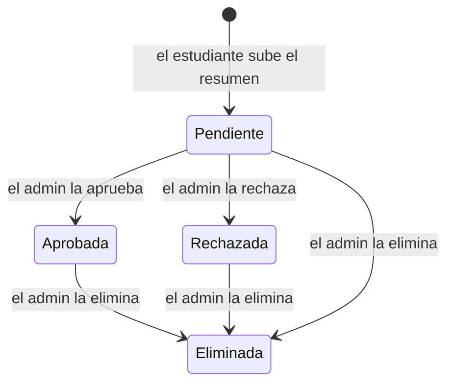

# Estudiario

Plataforma de estudio para estudiantes universitarios, construida como un sistema basado en microservicios para el Práctico Integrador de **Arquitectura de Software 2026** (Facultad de Ingeniería – UCC).

Combina dos partes:

- **Organización personal del estudio.** Cada estudiante carga sus materias, fechas de examen y horas disponibles, y un **agente de IA** le arma el plan de estudio.
- **Foro de resúmenes.** Los estudiantes comparten resúmenes, un administrador los modera antes de publicarlos y el resto de los usuarios los califica.

## Integrantes

| Legajo | Integrante |
|---|---|
| 2405404 | Acuña, Isabela |
| 2417714 | Ainete, Tobías |
| 2418092 | Chamaza, Florencia |
| 2411741 | Silvestrini, Mia |

## Dominio

### Roles

| Rol | Qué puede hacer |
|---|---|
| **Estudiante** | Gestionar sus materias, calendario, disponibilidad y plan de estudio; subir resúmenes al foro; calificar resúmenes publicados |
| **Administrador** | Moderar el foro: aprobar, rechazar o eliminar publicaciones |

### Organización del estudio

Cada estudiante tiene **sus propias materias**, a las que les asigna una **dificultad** (fácil, media, difícil o muy difícil). En su **calendario** carga las fechas importantes de cada materia: parciales, finales, recuperatorios y entregas, con los temas que entran. También declara sus **horas de estudio disponibles**: en qué franjas de la semana puede estudiar y cuántos minutos por día como máximo.

A partir de todo eso, un **agente de IA arma el plan de estudio**. Propone sesiones con fecha, horario, duración, tema y objetivo, y el estudiante las confirma para que queden reservadas en su calendario.

### Foro de resúmenes

Los estudiantes suben **resúmenes** de una materia al foro. Antes de hacerse visible, cada publicación pasa por la **moderación del administrador**:



- Cuando el administrador **aprueba o rechaza** una publicación, el sistema le **envía un mail al autor** avisándole el resultado (y el motivo, si fue rechazada).
- Sólo las publicaciones **aprobadas** son visibles en el foro.
- Los demás estudiantes pueden **calificar** cada resumen publicado. La calificación promedio ayuda a encontrar los mejores resúmenes.

### Acciones principales

| Dominio | Entidad principal | Acción principal | Característica relevante |
|---|---|---|---|
| Planificación de estudio | Examen / sesión de estudio | Confirmar el plan de estudio que arma el agente de IA (reservar sus sesiones) | Las sesiones no pueden superponerse ni superar las horas disponibles del estudiante; una misma confirmación no puede duplicarse; si el examen cambia de fecha, el plan queda desactualizado y hay que replanificarlo |
| Foro de resúmenes | Publicación (resumen) | Moderar una publicación (aprobar / rechazar / eliminar) | La publicación tiene estados con transiciones válidas; cada decisión debe notificarse por mail al autor exactamente una vez; un estudiante califica cada resumen una sola vez |

Ninguna de las dos es una simple alta de registros. La confirmación del plan tiene que validar varias restricciones a la vez, y puede llegar en paralelo desde dos dispositivos o repetirse por un reintento de red. La moderación cambia el estado de la publicación y dispara una notificación por mail que no se puede perder ni duplicar.

## Objetivo

- Que el estudiante no tenga que decidir a mano cuándo estudiar cada materia. El agente de IA propone un plan a partir de las fechas de examen, la dificultad de cada materia, los temas que entran y las horas disponibles. Al confirmarlo, el sistema garantiza que la agenda quede consistente.
- Que los estudiantes puedan compartir y encontrar resúmenes de calidad, con una moderación que evite publicaciones inadecuadas y calificaciones que destaquen los mejores.

## Funcionalidades

- Registro e inicio de sesión, con rol de estudiante o administrador.
- Materias propias de cada estudiante, con su dificultad.
- Calendario con las fechas de exámenes y entregas.
- Disponibilidad: franjas horarias semanales y máximo de minutos de estudio por día.
- Plan de estudio armado por un agente de IA, con confirmación y seguimiento de sesiones.
- Foro de resúmenes: publicación, moderación, búsqueda y calificación.
- Notificación por mail al autor cuando su resumen es aprobado o rechazado.

## Flujo principal

### 1. Plan de estudio

1. **Ingreso.** El estudiante se registra o inicia sesión.
2. **Materias.** Da de alta sus materias con su dificultad.
3. **Calendario.** Carga las fechas de examen de cada materia: tipo, fecha y temas.
4. **Disponibilidad.** Indica sus horas de estudio disponibles: franjas semanales y máximo de minutos por día.
5. **Propuesta del agente de IA.** Pide un plan para un examen y el agente propone sesiones con fecha, horario, duración, tema y objetivo. Por ejemplo: "Leer teoría de Integrales", "Resolver ejercicios", "Simulacro de parcial".
6. **Confirmación.** El estudiante confirma el plan. Las sesiones quedan reservadas en su calendario sólo si:
   - todas caen dentro de sus horas disponibles y antes del examen;
   - ninguna se superpone con otra sesión ya reservada;
   - ningún día supera el máximo de minutos declarado;
   - la confirmación no fue procesada antes (si se repite, se devuelve el mismo resultado en lugar de duplicar sesiones).
7. **Cambios.** Si el examen cambia de fecha o se cancela, el plan pasa a *desactualizado* y las sesiones pendientes se replanifican o se liberan.
8. **Seguimiento.** A medida que estudia, marca cada sesión como completada o pospuesta.

### 2. Foro de resúmenes

1. **Publicación.** El estudiante sube un resumen de una materia y queda *pendiente* de moderación.
2. **Moderación.** El administrador revisa las publicaciones pendientes y aprueba o rechaza cada una. También puede eliminar cualquier publicación.
3. **Notificación.** Al aprobarse o rechazarse, el sistema le envía un mail al autor con el resultado.
4. **Consulta.** Los estudiantes buscan resúmenes aprobados por materia o por texto.
5. **Calificación.** Cada estudiante puede calificar un resumen publicado una sola vez.

## Desafíos adicionales

Además de lo obligatorio, el grupo encara dos desafíos adicionales. El alcance y los criterios de aceptación están en la sección 10 del [`SPEC.md`](SPEC.md#10-desafíos-adicionales).

| Desafío | Qué agrega |
|---|---|
| **Agente que opera el sistema mediante MCP** | El agente de IA consulta las materias y los exámenes del estudiante y propone planes de estudio a través de herramientas expuestas con el *Model Context Protocol* (MCP), un protocolo estándar para que un agente ejecute operaciones de un sistema. El agente propone, pero nunca confirma: la confirmación sigue siendo del estudiante. |
| **Tests end-to-end del flujo principal** | Pruebas automáticas que recorren el flujo del plan de estudio de punta a punta contra el sistema levantado con `docker compose`: desde el registro hasta la confirmación del plan y su reintento. |

## Cómo levantar el sistema

Todo el sistema se levanta con **un único comando** usando Docker, sin configuraciones manuales.

En la Entrega 2 funciona **planner-service** (pedir y confirmar el plan de estudio) con PostgreSQL. Los demás servicios son esqueletos que sólo responden `GET /health`.

### Requisitos

- [Docker Desktop](https://www.docker.com/products/docker-desktop/) (incluye Docker Compose v2).
- Git.

### Pasos

```bash
git clone https://github.com/MichiSil/ProyectoEstudiario.git
cd ProyectoEstudiario
cp .env.example .env        # variables locales; los secretos reales nunca se suben al repo
docker compose up --build
```

La primera vez tarda unos minutos porque descarga las imágenes y compila los servicios. La base `planner` se crea sola con el usuario y la contraseña del `.env`.

Para detenerlo:

```bash
docker compose down         # agregar -v para borrar también los datos locales
```

### Puertos y URLs

| Componente | URL local | Para qué |
|---|---|---|
| **api-gateway** | http://localhost:8080 | Punto de entrada único del frontend |
| planner-service | http://localhost:8082 | Plan de estudio (publicado también para la capacidad de otros grupos, ADR-008) |
| users-service | http://localhost:8081 | Esqueleto: sólo `GET /health` |
| forum-service | http://localhost:8083 | Esqueleto: sólo `GET /health` |
| notification-service | http://localhost:8084 | Esqueleto: sólo `GET /health` |
| **Jaeger** | http://localhost:16686 | Interfaz web para ver las trazas. Recibe trazas OTLP en los puertos 4317 (gRPC) y 4318 (HTTP) |
| **Mock de la capacidad (Prism)** | http://localhost:4010 | Contrato de [`docs/contracts/`](docs/contracts/) con respuestas de ejemplo |
| PostgreSQL (base `planner`) | `localhost:5432` | Usuario y contraseña: variables `PLANNER_DB_*` del `.env` |

Cada servicio responde `GET /health`. Por ejemplo:

```bash
curl http://localhost:8080/health
```

El puerto de PostgreSQL se expone sólo para inspeccionar la base durante el desarrollo: los servicios se conectan entre sí por la red interna de Docker. Si algún puerto ya está ocupado en tu máquina, cambiá el número de la izquierda en el `docker-compose.yml` (por ejemplo, `"5433:5432"`).

Para levantar sólo el mock de la capacidad publicada:

```bash
docker compose up planner-mock
```

> Las credenciales del proveedor de IA se configuran sólo en el `.env` local y nunca se suben al repositorio. Sin credenciales de IA, el plan se arma con el motor de reglas (RN-09).

### Logs y trazas

El api-gateway y planner-service escriben **un log JSON por pedido** con `time`, `level`, `service`, `correlationId`, `method`, `path`, `status` y `durationMs`. Cada pedido lleva un `X-Correlation-Id`: si el cliente no lo manda, lo genera el gateway, lo reenvía al servicio y lo devuelve en la respuesta. La estrategia completa está en el [ADR-011](docs/adr/ADR-011-observabilidad.md).

**Ver los logs:**

```bash
docker compose logs -f api-gateway planner-service
```

Para seguir un pedido puntual, mandalo con tu propio identificador y filtrá por él:

```bash
curl -H "X-Correlation-Id: prueba-1" -H "X-User-Id: estudiante-1" http://localhost:8080/api/planner/sessions
docker compose logs api-gateway planner-service | grep prueba-1
```

**Ver las trazas:** abrí Jaeger en http://localhost:16686, elegí el servicio `api-gateway` y tocá *Find Traces*. Cada traza muestra el pedido completo: el span del gateway y, adentro, el de planner-service, con la duración de cada uno. Para encontrar un pedido puntual, buscá por el tag `correlation.id=prueba-1`.

### Estructura del repositorio

| Carpeta | Contenido |
|---|---|
| `services/` | Un módulo de Go por servicio (`api-gateway`, `users-service`, `planner-service`, `forum-service`, `notification-service`), con el ejecutable en `cmd/<nombre>/` y su `Dockerfile` |
| `docs/` | Arquitectura, ADR y contrato de la capacidad publicada |

### Entorno desplegado

La capacidad que publicamos para otros grupos va a estar desplegada en la nube con una URL pública. La vamos a publicar acá cuando esté disponible.

> **Estado en la Entrega 2:** por indicación de la cátedra, la implementación de la capacidad compartida (generar un plan de estudio para otro grupo) se pospone para una entrega posterior. Lo que ya está disponible es el [contrato versionado](docs/contracts/) y su **mock** (Prism, puerto `4010`), para que el grupo consumidor pueda integrarse desde ahora. La lógica que va a respaldar la capacidad (el motor de reglas y el agente de IA de planner-service) ya funciona para los estudiantes.

## Documentación

| Documento | Contenido |
|---|---|
| [`SPEC.md`](SPEC.md) | Alcance, funcionalidades, reglas de negocio y criterios de aceptación |
| [`docs/ARCHITECTURE.md`](docs/ARCHITECTURE.md) | Arquitectura general, servicios, datos, comunicaciones y diagramas |
| [`docs/adr/`](docs/adr/) | Registro de decisiones arquitectónicas (ADR) |
| [`docs/contracts/`](docs/contracts/) | Contrato versionado de la capacidad publicada para otros grupos |
| [`docs/POSTMORTEM.md`](docs/POSTMORTEM.md) | Informe de la caída controlada |

## Forma de trabajo

- `main` contiene siempre la última versión estable y evaluable.
- Cada tarea se desarrolla en su propia rama (`feature/...`, `docs/...`, `fix/...`) y se integra a `main` con un *pull request* revisado por otra integrante.
