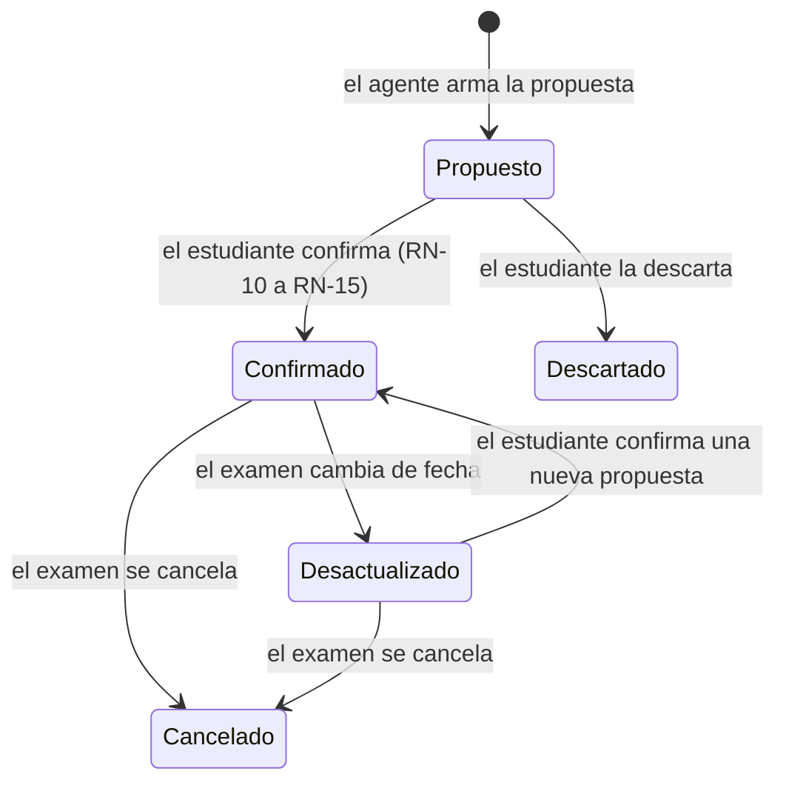
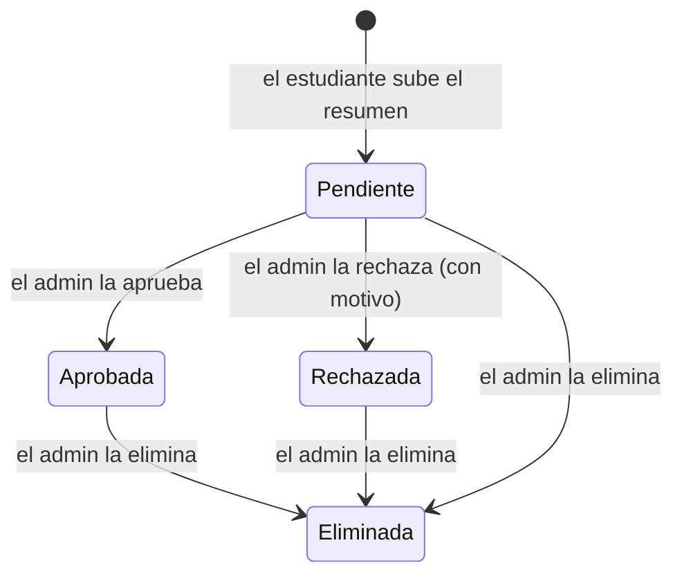

# Especificación de Estudiario

Este documento define **qué** tiene que hacer el sistema: su alcance, las funcionalidades, las reglas de negocio y los criterios de aceptación. **Cómo** se implementa está en [`docs/ARCHITECTURE.md`](docs/ARCHITECTURE.md) y en los [ADR](docs/adr/).

Es un documento vivo: se actualiza en cada entrega a medida que el alcance se precisa.

## 1. Alcance

### 1.1 Incluido

| Área | Qué abarca |
|---|---|
| **Cuentas** | Registro, inicio de sesión y roles (estudiante y administrador). |
| **Organización del estudio** | Materias propias con dificultad, calendario de exámenes y entregas, disponibilidad horaria semanal. |
| **Plan de estudio** | Propuesta de sesiones generada por un agente de IA, confirmación del plan (acción principal), replanificación ante cambios y seguimiento de sesiones. |
| **Foro de resúmenes** | Publicación de resúmenes, moderación por el administrador, búsqueda de resúmenes aprobados y calificación. |
| **Notificaciones** | Mail al autor cuando su resumen es aprobado o rechazado. |
| **Capacidad para otro grupo** | Registro y consulta de documentos del foro, para el Grupo 4 (Agencia de viajes), a través de un contrato publicado en [`docs/contracts/`](docs/contracts/). Ver la sección 11. |
| **Capacidad de otro grupo** | Programa de beneficios del Grupo 1 (Gimnasio), para premiar a los estudiantes que comparten resúmenes. Ver la sección 11. |

### 1.2 Fuera de alcance

- Pagos, suscripciones o cualquier tipo de cobro.
- Aplicaciones móviles nativas (el acceso es por la interfaz web).
- Mensajería entre estudiantes o comentarios en los resúmenes.
- Recuperación de contraseña por mail e inicio de sesión con proveedores externos (Google, etc.).
- Edición de un resumen ya moderado: para corregirlo, el autor sube una nueva publicación.
- Integración con calendarios externos (Google Calendar, Outlook).

## 2. Actores

| Actor | Descripción |
|---|---|
| **Estudiante** | Usuario registrado. Gestiona su organización de estudio, pide y confirma planes, sube resúmenes y califica los de otros. |
| **Administrador** | Usuario con rol de moderación. Aprueba, rechaza o elimina publicaciones del foro. |
| **Agente de IA** | Componente del sistema que propone las sesiones de un plan de estudio. No toma decisiones finales: el estudiante siempre confirma. |
| **Sistema externo consumidor** | Sistema de otro grupo que registra y consulta documentos del foro con la capacidad publicada (el Grupo 4). |
| **Programa de beneficios** | Sistema del Grupo 1 que premia la participación de los usuarios. Estudiario lo usa cuando se aprueba un resumen. |

## 3. Glosario

| Término | Definición |
|---|---|
| **Materia** | Asignatura que cursa un estudiante. Pertenece a un único estudiante y tiene una dificultad. |
| **Dificultad** | Valoración de la materia hecha por el estudiante: 1 fácil, 2 media, 3 difícil, 4 muy difícil. Influye en cuánto antes empieza a estudiarse. |
| **Examen** | Fecha importante de una materia: parcial, final, recuperatorio o entrega. Tiene fecha, hora opcional y temas. |
| **Franja disponible** | Intervalo semanal en el que el estudiante puede estudiar (por ejemplo, lunes de 18:00 a 21:00). |
| **Capacidad diaria** | Máximo de minutos de estudio por día que declara el estudiante. |
| **Sesión de estudio** | Bloque de estudio con fecha, horario, duración, tema y objetivo, asociado a un examen. |
| **Propuesta de plan** | Conjunto de sesiones sugeridas para un examen. Todavía no ocupa lugar en el calendario. |
| **Plan confirmado** | Propuesta aceptada por el estudiante: sus sesiones quedan reservadas en el calendario. |
| **Plan desactualizado** | Plan confirmado cuyo examen cambió de fecha o fue cancelado. |
| **Resumen / publicación** | Material de estudio que un estudiante sube al foro, asociado a una materia. |
| **Moderación** | Decisión del administrador sobre una publicación: aprobarla, rechazarla o eliminarla. |
| **Calificación** | Puntaje de 1 a 5 que un estudiante le da a un resumen aprobado. |

## 4. Convenciones

- **RF-XX**: requisito funcional.
- **RN-XX**: regla de negocio. Es una restricción que el sistema tiene que hacer cumplir siempre, venga de donde venga la operación.
- **CA-XX**: criterio de aceptación, escrito como *Dado / Cuando / Entonces*.

## 5. Cuentas

### 5.1 Requisitos funcionales

| ID | Requisito |
|---|---|
| RF-01 | El estudiante puede registrarse con nombre, mail y contraseña. |
| RF-02 | Un usuario registrado puede iniciar y cerrar sesión. |
| RF-03 | El sistema distingue dos roles: estudiante y administrador. El rol de administrador no se elige al registrarse: se asigna por configuración. |

### 5.2 Reglas de negocio

| ID | Regla |
|---|---|
| RN-01 | No puede haber dos usuarios con el mismo mail. |
| RN-02 | La contraseña tiene como mínimo 8 caracteres y nunca se guarda en texto plano. |
| RN-03 | Cada estudiante sólo puede ver y modificar sus propios datos de estudio (materias, exámenes, disponibilidad, planes y sesiones). |

## 6. Organización del estudio y plan de estudio

### 6.1 Requisitos funcionales

| ID | Requisito |
|---|---|
| RF-04 | El estudiante puede crear, editar, listar y eliminar sus materias, indicando nombre, profesores y dificultad. |
| RF-05 | El estudiante puede cargar exámenes en su calendario: materia, tipo (parcial, final, recuperatorio o entrega), fecha, hora opcional y temas. |
| RF-06 | El estudiante puede editar un examen (fecha, tipo, temas, modalidad o material) o cancelarlo, y puede pedir rehacer su plan de estudio confirmado aunque el examen no haya cambiado. |
| RF-07 | El estudiante puede declarar su disponibilidad: franjas horarias semanales, capacidad diaria en minutos y duración preferida de cada sesión. |
| RF-08 | El estudiante puede pedir una propuesta de plan para un examen. El agente de IA devuelve sesiones con fecha, horario, duración, tema, objetivo y una explicación de por qué se propusieron así. |
| RF-09 | El estudiante puede confirmar una propuesta de plan. Las sesiones confirmadas quedan reservadas en su calendario. **(Acción principal.)** |
| RF-10 | El estudiante puede ver su calendario con exámenes y sesiones reservadas. |
| RF-11 | El estudiante puede marcar una sesión como completada o pospuesta. |
| RF-12 | Si un plan queda desactualizado, el estudiante puede pedir una nueva propuesta que reemplace las sesiones pendientes. |
| RF-13 | *Retirado el 2026-10-29.* Era la capacidad publicada de generar un plan para un sistema externo. La cátedra asignó como capacidad publicada el registro y la consulta de documentos (RF-25 a RF-27). La generación del plan sigue disponible para los estudiantes (RF-08). |

### 6.2 Reglas de negocio

**Propuesta del plan**

| ID | Regla |
|---|---|
| RN-04 | La fecha de un examen no puede estar en el pasado al momento de cargarlo. |
| RN-05 | Cada franja disponible tiene una hora de inicio anterior a la de fin, y las franjas de un mismo día no se superponen. |
| RN-06 | El estudio de un examen empieza con más anticipación cuanto más difícil es la materia. Valores iniciales: fácil 5 días, media 10, difícil 15 y muy difícil 21. Si faltan menos días, se usa el tiempo que queda. |
| RN-07 | La cantidad de sesiones propuestas crece con la dificultad y con la cantidad de temas. Las últimas sesiones antes del examen son de repaso o simulacro. |
| RN-08 | La propuesta del agente de IA nunca se reserva automáticamente: es sólo una sugerencia hasta que el estudiante la confirma. |
| RN-09 | Si el agente de IA no está disponible, el sistema arma la propuesta con un algoritmo de reglas fijas (RN-06 y RN-07), para que el estudiante pueda seguir planificando. |

**Confirmación del plan (acción principal)**

Un plan sólo se confirma si se cumplen **todas** estas reglas. Si alguna falla, no se reserva ninguna sesión (todo o nada).

| ID | Regla |
|---|---|
| RN-10 | Cada sesión cae completa dentro de una franja disponible del estudiante. |
| RN-11 | Cada sesión termina antes del inicio del examen. |
| RN-12 | Ninguna sesión se superpone con otra sesión ya reservada del mismo estudiante, sea de esta materia o de otra. |
| RN-13 | La suma de minutos reservados en un día no supera la capacidad diaria del estudiante. |
| RN-14 | Una misma confirmación no puede procesarse dos veces. Si llega repetida (por un reintento de red o desde dos dispositivos a la vez), el sistema devuelve el resultado de la primera y no duplica sesiones. |
| RN-15 | Un examen tiene como máximo un plan confirmado vigente. |

**Cambios en el examen**

| ID | Regla |
|---|---|
| RN-16 | Si un examen con plan confirmado cambia de fecha, de temas, de modalidad o de material, o si el estudiante pide rehacer el plan, el plan pasa a *desactualizado*. Sus sesiones pendientes siguen visibles, marcadas como desactualizadas, hasta que el estudiante confirme un plan nuevo, que las reemplaza. Cambiar sólo el tipo de examen no afecta al plan. |
| RN-17 | Si un examen se cancela, sus sesiones pendientes se liberan. Las sesiones completadas se conservan como historial. |
| RN-18 | Al replanificar, sólo se reemplazan las sesiones pendientes. Las completadas no se modifican. |

### 6.3 Estados

Una **sesión** confirmada puede estar *pendiente*, *completada* o *pospuesta*. Una sesión pospuesta libera su horario y su tema vuelve a considerarse en la próxima replanificación.

## 7. Foro de resúmenes

### 7.1 Requisitos funcionales

| ID | Requisito |
|---|---|
| RF-14 | El estudiante puede subir un resumen indicando título, materia, descripción y un archivo PDF. |
| RF-15 | El estudiante puede ver el estado de sus propias publicaciones (pendiente, aprobada o rechazada) y, si fue rechazada, el motivo. |
| RF-16 | El administrador puede ver la lista de publicaciones pendientes, ordenadas de la más antigua a la más reciente. |
| RF-17 | El administrador puede aprobar o rechazar una publicación pendiente. Al rechazarla, indica el motivo. |
| RF-18 | El administrador puede eliminar cualquier publicación, esté en el estado que esté. |
| RF-19 | Cualquier estudiante puede buscar resúmenes aprobados por texto (título y descripción), con resultados paginados. |
| RF-20 | La búsqueda permite filtrar por materia y por calificación mínima, y ordenar por relevancia, calificación promedio o fecha de publicación. |
| RF-21 | Cualquier estudiante puede ver el detalle de un resumen aprobado y descargar su archivo. |
| RF-22 | El estudiante puede calificar un resumen aprobado con un puntaje de 1 a 5. |

### 7.2 Reglas de negocio

**Publicación y moderación**

| ID | Regla |
|---|---|
| RN-19 | Toda publicación nueva empieza en estado *pendiente*. |
| RN-20 | El archivo tiene que ser PDF y pesar como máximo 10 MB. |
| RN-21 | Sólo se puede aprobar o rechazar una publicación *pendiente*. Una publicación ya aprobada o rechazada no vuelve a moderarse. |
| RN-22 | Rechazar una publicación exige un motivo. |
| RN-23 | Si dos administradores moderan la misma publicación al mismo tiempo, sólo una decisión es válida. La otra recibe un error indicando que la publicación ya fue moderada. |
| RN-24 | Sólo las publicaciones *aprobadas* aparecen en la búsqueda y en el foro. Una publicación eliminada deja de aparecer, aunque haya estado aprobada. |
| RN-25 | La materia de un resumen es un texto libre (por ejemplo, "Análisis Matemático II"). No depende de las materias personales del autor, para que cualquier estudiante pueda encontrarlo. |

**Búsqueda**

| ID | Regla |
|---|---|
| RN-26 | Un resumen aprobado aparece en la búsqueda en, como máximo, 1 minuto desde su aprobación. Un resumen eliminado deja de aparecer en el mismo plazo. |
| RN-27 | Una página de resultados tiene como máximo 50 resúmenes. |

**Calificación**

| ID | Regla |
|---|---|
| RN-28 | Sólo se califican publicaciones aprobadas. |
| RN-29 | Un estudiante no puede calificar sus propios resúmenes. |
| RN-30 | Cada estudiante califica un resumen una sola vez. Si vuelve a calificarlo, se reemplaza su puntaje anterior: nunca cuenta dos veces. |
| RN-31 | La calificación de un resumen es el promedio de los puntajes recibidos, junto con la cantidad de calificaciones. |

### 7.3 Estados de una publicación

## 8. Notificaciones

### 8.1 Requisitos funcionales

| ID | Requisito |
|---|---|
| RF-23 | Cuando una publicación es aprobada, el sistema le envía un mail al autor avisándole que su resumen fue publicado. |
| RF-24 | Cuando una publicación es rechazada, el sistema le envía un mail al autor con el motivo del rechazo. |

### 8.2 Reglas de negocio

| ID | Regla |
|---|---|
| RN-32 | Cada decisión de moderación genera exactamente un mail: no se puede perder ni enviar duplicado. |
| RN-33 | La moderación no depende del envío del mail. Si el servicio de mail está caído, la publicación queda aprobada o rechazada igual, y el mail se envía cuando el servicio vuelva. |
| RN-34 | Si un mail no puede enviarse después de varios reintentos, queda registrado como fallido para revisarlo, sin bloquear al resto de las notificaciones. |
| RN-35 | La eliminación de una publicación no genera mail. |

## 9. Criterios de aceptación

Cada criterio indica entre paréntesis las reglas o requisitos que verifica. Los criterios marcados como **[crítico]** son los que se usan para demostrar la acción principal y el comportamiento ante fallas.

### 9.1 Cuentas

| ID | Criterio |
|---|---|
| CA-01 | **Dado** un mail ya registrado, **cuando** alguien intenta registrarse con ese mail, **entonces** el sistema rechaza el registro e informa que el mail ya está en uso. *(RN-01)* |
| CA-02 | **Dado** un estudiante con sesión iniciada, **cuando** intenta ver o modificar una materia de otro estudiante, **entonces** el sistema responde que el recurso no existe y no revela sus datos. *(RN-03)* |
| CA-03 | **Dado** un estudiante sin rol de administrador, **cuando** intenta aprobar una publicación, **entonces** el sistema rechaza la operación por falta de permisos. *(RF-03, RF-17)* |

### 9.2 Plan de estudio

| ID | Criterio |
|---|---|
| CA-04 | **Dado** un examen de una materia muy difícil dentro de 30 días, **cuando** el estudiante pide una propuesta, **entonces** las sesiones empiezan como mucho 21 días antes del examen y las últimas son de repaso o simulacro. *(RN-06, RN-07)* |
| CA-05 | **Dado** que el agente de IA no responde, **cuando** el estudiante pide una propuesta, **entonces** recibe igual una propuesta armada por reglas fijas y un aviso de que no la generó la IA. *(RN-09)* **[crítico]** |
| CA-06 | **Dado** una propuesta válida, **cuando** el estudiante la confirma, **entonces** todas sus sesiones quedan reservadas en el calendario y el plan pasa a *confirmado*. *(RF-09)* **[crítico]** |
| CA-07 | **Dado** una propuesta con una sesión fuera de las franjas disponibles, **cuando** el estudiante la confirma, **entonces** el sistema rechaza la confirmación, indica qué sesión incumple la regla y no reserva ninguna sesión. *(RN-10, todo o nada)* **[crítico]** |
| CA-08 | **Dado** una sesión ya reservada el martes de 18:00 a 19:00, **cuando** el estudiante confirma un plan con una sesión el martes de 18:30 a 19:30, **entonces** la confirmación se rechaza por superposición. *(RN-12)* **[crítico]** |
| CA-09 | **Dado** un estudiante con capacidad diaria de 120 minutos y 90 minutos ya reservados el jueves, **cuando** confirma un plan que agrega 60 minutos ese jueves, **entonces** la confirmación se rechaza por superar la capacidad diaria. *(RN-13)* **[crítico]** |
| CA-10 | **Dado** una confirmación ya procesada, **cuando** llega otra vez la misma confirmación (reintento), **entonces** el sistema devuelve el mismo resultado y la cantidad de sesiones reservadas no cambia. *(RN-14)* **[crítico]** |
| CA-11 | **Dado** dos confirmaciones del mismo plan enviadas al mismo tiempo desde dos dispositivos, **cuando** el sistema las procesa, **entonces** se reserva un único conjunto de sesiones. *(RN-14, RN-15)* **[crítico]** |
| CA-12 | **Dado** un examen con plan confirmado, **cuando** el estudiante cambia la fecha o los temas del examen, o pide rehacer el plan, **entonces** el plan pasa a *desactualizado*, sus sesiones pendientes se muestran marcadas como desactualizadas y, al confirmar un plan nuevo, lo reemplazan. *(RN-16)* |
| CA-13 | **Dado** un examen con sesiones completadas y pendientes, **cuando** el estudiante lo cancela, **entonces** las pendientes se liberan y las completadas se conservan. *(RN-17)* |
| CA-14 | *Retirado el 2026-10-29 junto con RF-13.* Los criterios de la capacidad publicada están en la sección 11. |

### 9.3 Foro

| ID | Criterio |
|---|---|
| CA-15 | **Dado** un estudiante, **cuando** sube un resumen en PDF de menos de 10 MB, **entonces** la publicación queda *pendiente* y no aparece en la búsqueda. *(RN-19, RN-24)* |
| CA-16 | **Dado** un estudiante, **cuando** intenta subir un archivo que no es PDF o que pesa más de 10 MB, **entonces** el sistema lo rechaza indicando el motivo. *(RN-20)* |
| CA-17 | **Dado** una publicación pendiente, **cuando** el administrador la rechaza sin indicar motivo, **entonces** el sistema no permite el rechazo. *(RN-22)* |
| CA-18 | **Dado** una publicación pendiente, **cuando** dos administradores la moderan al mismo tiempo, **entonces** sólo una decisión queda registrada y la otra recibe un error de publicación ya moderada. *(RN-23)* **[crítico]** |
| CA-19 | **Dado** un resumen recién aprobado, **cuando** pasa 1 minuto, **entonces** el resumen aparece en los resultados de búsqueda. *(RN-26)* |
| CA-20 | **Dado** un resumen aprobado que aparece en la búsqueda, **cuando** el administrador lo elimina, **entonces** en 1 minuto como máximo deja de aparecer. *(RN-24, RN-26)* |
| CA-21 | **Dado** varios resúmenes aprobados de distintas materias, **cuando** un estudiante busca filtrando por una materia y ordenando por calificación, **entonces** sólo ve resúmenes de esa materia, del mejor al peor calificado, paginados. *(RF-19, RF-20)* |
| CA-22 | **Dado** un resumen aprobado que el estudiante ya calificó con 2, **cuando** lo califica con 5, **entonces** el promedio considera sólo el 5 y la cantidad de calificaciones no cambia. *(RN-30, RN-31)* |
| CA-23 | **Dado** un estudiante, **cuando** intenta calificar su propio resumen, **entonces** el sistema rechaza la calificación. *(RN-29)* |

### 9.4 Notificaciones

| ID | Criterio |
|---|---|
| CA-24 | **Dado** una publicación pendiente, **cuando** el administrador la aprueba, **entonces** el autor recibe un único mail avisando que su resumen fue publicado. *(RF-23, RN-32)* |
| CA-25 | **Dado** una publicación pendiente, **cuando** el administrador la rechaza con un motivo, **entonces** el autor recibe un único mail que incluye ese motivo. *(RF-24, RN-32)* |
| CA-26 | **Dado** que el servicio de mail está caído, **cuando** el administrador aprueba una publicación, **entonces** la aprobación se registra igual y, cuando el servicio de mail vuelve, el autor recibe el mail una sola vez. *(RN-33)* **[crítico]** |
| CA-27 | **Dado** un mail que falla en todos sus reintentos, **cuando** se agotan los intentos, **entonces** queda registrado como fallido y las demás notificaciones se siguen enviando. *(RN-34)* **[crítico]** |

## 10. Desafíos adicionales

Además del alcance obligatorio, el grupo encara estos dos desafíos adicionales.

### 10.1 Agente que ejecuta operaciones del sistema mediante MCP

El agente de IA puede operar Estudiario a través del **Model Context Protocol (MCP)**, un protocolo estándar para que un agente descubra y ejecute operaciones de un sistema. planner-service expone un servidor MCP con herramientas que llaman a los mismos casos de uso que la API REST, así que se aplican las mismas reglas de negocio.

| Herramienta | Qué hace |
|---|---|
| `listar_materias` | Devuelve las materias del estudiante, con su dificultad. |
| `listar_examenes` | Devuelve los próximos exámenes del estudiante, con su fecha y sus temas. |
| `proponer_plan` | Pide una propuesta de plan para un examen (RF-08). |

| ID | Regla |
|---|---|
| RN-36 | El agente actúa siempre en nombre de un estudiante autenticado y sólo accede a sus datos (RN-03). |
| RN-37 | El agente puede proponer planes, pero no confirmarlos: la confirmación sigue siendo una acción del estudiante (RN-08). |

| ID | Criterio |
|---|---|
| CA-28 | **Dado** un estudiante con una materia y un examen cargados, **cuando** el agente usa `listar_examenes` y después `proponer_plan` por MCP, **entonces** obtiene una propuesta en estado *propuesto* y no se reserva ninguna sesión hasta que el estudiante la confirma. *(RN-08, RN-37)* |
| CA-29 | **Dado** el agente conectado por MCP en nombre de un estudiante, **cuando** pide los exámenes de otro estudiante, **entonces** no recibe datos de ese estudiante. *(RN-36)* |

### 10.2 Tests end-to-end del flujo principal

Pruebas automáticas que recorren el flujo del plan de estudio de punta a punta, contra el sistema levantado con `docker compose` y a través del api-gateway, sin simular servicios internos:

1. Registro e inicio de sesión del estudiante.
2. Alta de una materia, carga de un examen y declaración de la disponibilidad.
3. Pedido de una propuesta de plan.
4. Confirmación del plan y verificación de que las sesiones quedaron reservadas en el calendario (CA-06).
5. Reintento de la misma confirmación con la misma `Idempotency-Key`, sin sesiones duplicadas (CA-10).
6. Pedido de una propuesta con la IA no disponible, que llega armada por reglas con el aviso `AI_FALLBACK` (CA-05).

| ID | Criterio |
|---|---|
| CA-30 | **Dado** el sistema levantado desde cero con `docker compose up --build`, **cuando** se ejecutan los tests end-to-end, **entonces** recorren el flujo anterior completo y terminan sin errores. |

## 11. Integración con otros grupos

La cátedra asignó las integraciones: Estudiario **exporta** al Grupo 4 (Agencia de viajes) el registro y la consulta de documentos del foro, y **consume** del Grupo 1 (Gimnasio) su programa de beneficios. Las decisiones están en el [ADR-014](docs/adr/ADR-014-contrato-documentos.md) y el [ADR-009](docs/adr/ADR-009-consumo-del-proveedor.md).

### 11.1 Capacidad publicada: registro y consulta de documentos

El Grupo 4 la usa para **guías de viaje compartidas**. El contrato es genérico: el destino va en la categoría y los datos del viaje en las etiquetas. El contrato está en [`docs/contracts/documents-v1.yaml`](docs/contracts/documents-v1.yaml) y su guía en [`docs/contracts/README.md`](docs/contracts/README.md).

| ID | Requisito |
|---|---|
| RF-25 | Un sistema externo autorizado puede registrar un documento en el foro, con título, categoría, descripción, etiquetas, autor y un archivo PDF. El documento queda pendiente de moderación. |
| RF-26 | Un sistema externo autorizado puede buscar entre los documentos aprobados, con los mismos filtros, órdenes y paginación que RF-19 y RF-20, ver el detalle de cada uno y descargar su PDF. |
| RF-27 | Un sistema externo autorizado puede ver el estado de los documentos que registró (pendiente, aprobado o rechazado) y, si fue rechazado, el motivo. |

| ID | Regla |
|---|---|
| RN-38 | Lo que registra un sistema externo pasa por la misma moderación que un resumen (RN-19, RN-21 a RN-23) y su archivo cumple RN-20. |
| RN-39 | Un documento aprobado lo ve cualquier sistema autorizado y aparece en la búsqueda del foro. Uno pendiente o rechazado sólo lo ve el sistema que lo registró. Uno eliminado no lo ve nadie. |
| RN-40 | Un mismo registro no crea dos documentos: si llega repetido con la misma clave de idempotencia, se devuelve el documento ya registrado. |
| RN-41 | Los documentos registrados por sistemas externos no generan mail ni beneficios, porque su autor no tiene cuenta en Estudiario. |

### 11.2 Capacidad consumida: programa de beneficios del Grupo 1

| ID | Requisito |
|---|---|
| RF-28 | Cuando el administrador aprueba un resumen de un estudiante, el sistema registra esa participación en el programa de beneficios del Grupo 1, para que el estudiante reciba el premio que corresponda. |

| ID | Regla |
|---|---|
| RN-42 | Cada resumen aprobado se registra en el programa de beneficios una sola vez, aunque el aviso de la aprobación se procese más de una vez. |
| RN-43 | La moderación no depende del programa de beneficios. Si el Grupo 1 no responde, la aprobación se registra igual y la participación se registra cuando vuelva, sin intervención manual. |
| RN-44 | Eliminar un resumen ya aprobado no revierte un premio ya otorgado. |

### 11.3 Criterios de aceptación

| ID | Criterio |
|---|---|
| CA-31 | **Dado** un sistema externo con una API key válida, **cuando** registra un PDF de menos de 10 MB con sus datos, **entonces** el documento queda *pendiente* y no aparece en la búsqueda. *(RF-25, RN-38)* |
| CA-32 | **Dado** un documento registrado por un sistema externo, **cuando** el administrador lo aprueba y pasa 1 minuto, **entonces** aparece en la búsqueda de cualquier sistema autorizado y en la del foro. *(RF-26, RN-26, RN-39)* |
| CA-33 | **Dado** un documento pendiente registrado por un sistema, **cuando** otro sistema pide su detalle, **entonces** recibe que no existe. *(RN-39)* |
| CA-34 | **Dado** un registro ya procesado, **cuando** llega otra vez con la misma clave de idempotencia, **entonces** se devuelve el mismo documento y no se crea otro. *(RN-40)* **[crítico]** |
| CA-35 | **Dado** un resumen pendiente de un estudiante, **cuando** el administrador lo aprueba, **entonces** se registra una única participación en el programa de beneficios del Grupo 1. *(RF-28, RN-42)* **[crítico]** |
| CA-36 | **Dado** que el programa de beneficios del Grupo 1 está caído, **cuando** el administrador aprueba un resumen, **entonces** la aprobación se registra igual y, cuando el programa vuelve, la participación se registra una sola vez. *(RN-43)* **[crítico]** |
