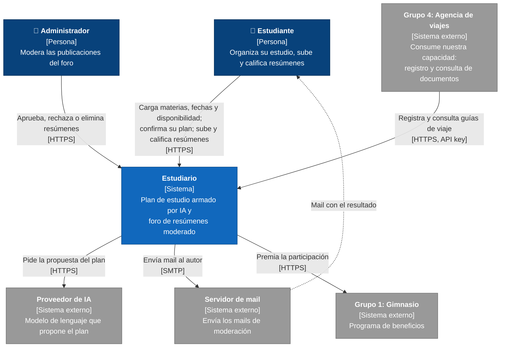
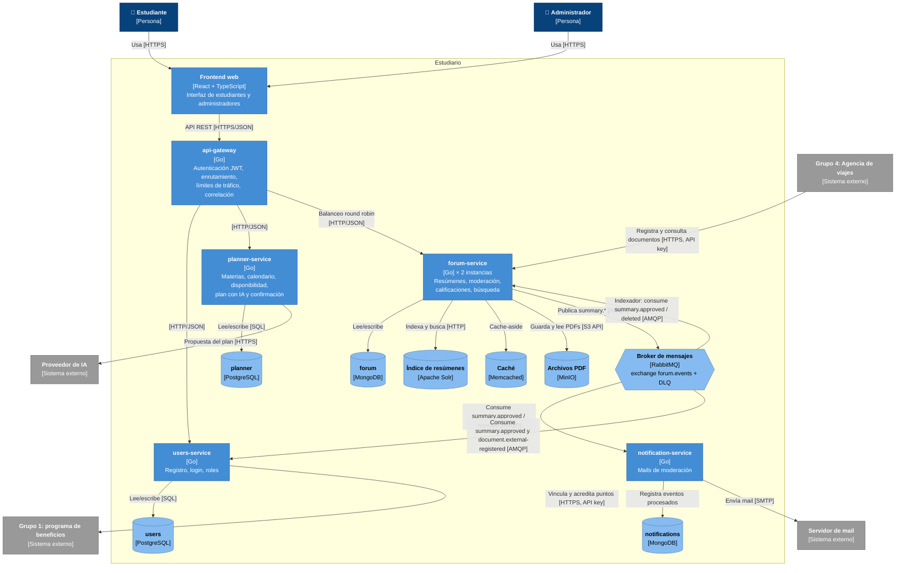
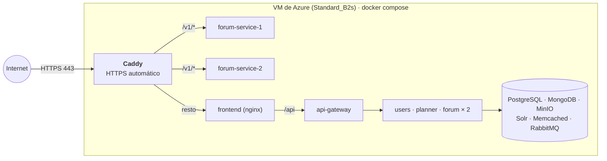

# Arquitectura de Estudiario

> Versión de la presentación final (noviembre de 2026). Se actualizó en cada entrega junto con el código. Las decisiones que lo justifican están en [`docs/adr/`](adr/), y las limitaciones que aceptamos, en la [sección 8](#8-limitaciones-conocidas-y-deuda-técnica).

## 1. Descripción general

Estudiario es una plataforma de estudio para estudiantes universitarios con dos partes:

- **Organización personal del estudio:** cada estudiante carga sus materias (con su dificultad), las fechas de examen, sus horas disponibles, y un agente de IA le arma un plan de estudio que después confirma.
- **Foro de resúmenes:** los estudiantes suben resúmenes, un administrador los aprueba, rechaza o elimina, el autor recibe un mail con el resultado y el resto de los usuarios busca y califica los resúmenes publicados.

El sistema está compuesto por un **frontend web**, un **API gateway** y **cuatro microservicios** escritos en Go. Cada servicio es dueño de sus datos y elige el almacenamiento que mejor se adapta a su forma de uso. Los servicios se comunican de forma **síncrona** (HTTP/REST) cuando el usuario espera una respuesta, y de forma **asíncrona** (eventos por RabbitMQ) para las consecuencias que pueden ocurrir después, como el mail de moderación o los puntos del Club de Beneficios.

Todo el sistema se levanta localmente con `docker compose up --build` (ver el [README](../README.md)).

## 2. Servicios y responsabilidades

| Componente | Responsabilidad | Tecnología |
|---|---|---|
| **frontend** | Interfaz web: centraliza toda la interacción del estudiante y del administrador. Sólo habla con el api-gateway. | React + TypeScript (Vite) |
| **api-gateway** | Punto de entrada único: valida el JWT, enruta cada request al servicio correspondiente, aplica límites de tráfico y propaga el identificador de correlación. No tiene lógica de negocio. | Go |
| **users-service** | Registro, inicio de sesión, emisión del JWT y roles (`estudiante` / `admin`). Vincula la cuenta del estudiante con el **Club de Beneficios del Grupo 1** y le acredita puntos cuando se aprueba un resumen suyo ([ADR-015](adr/ADR-015-club-de-beneficios.md)). Crea las cuentas de los autores de documentos de la agencia de viajes. | Go + PostgreSQL |
| **planner-service** | Materias del estudiante y su dificultad, calendario de exámenes y entregas, disponibilidad horaria, generación del plan de estudio con el agente de IA, **confirmación del plan** (acción principal) y seguimiento de sesiones. | Go + PostgreSQL |
| **forum-service** | Publicación de resúmenes, **moderación** (aprobar / rechazar / eliminar), calificaciones, búsqueda indexada de resúmenes aprobados y caché del listado. Guarda el PDF de cada resumen. Publica los eventos de moderación. Expone la **capacidad publicada para el Grupo 4: registro y consulta de documentos** ([ADR-014](adr/ADR-014-contrato-documentos.md)) Corre en **dos instancias** detrás del balanceo de carga. | Go + MongoDB + MinIO + Apache Solr + Memcached |
| **notification-service** | Consume los eventos de moderación y le envía el mail al autor exactamente una vez. Trata los mensajes que no se pueden procesar. | Go + MongoDB |

La organización interna de cada servicio (planner-service hexagonal; forum-service, users-service y notification-service por capas) está en el [ADR-002](adr/ADR-002-arquitectura-interna.md).

Los criterios para separar los servicios están en el [ADR-001](adr/ADR-001-limites-de-servicios.md).

## 3. Propiedad de los datos

Cada entidad tiene **un único servicio dueño**, que es el único que la escribe. **Ningún servicio accede a la base de otro**: cada uno tiene su propia base y su propio usuario.

| Servicio | Datos que administra | Almacenamiento |
|---|---|---|
| users-service | Usuarios, hash de contraseñas, roles, vinculación con el Club, puntos pendientes de acreditar y eventos ya procesados | PostgreSQL (base `users`) |
| planner-service | Materias, dificultad, exámenes y eventos del calendario, disponibilidad semanal, planes de estudio, sesiones, claves de idempotencia de las confirmaciones | PostgreSQL (base `planner`) |
| forum-service | Resúmenes y documentos externos con su estado de moderación, calificaciones, eventos pendientes de publicar (*outbox*), claves de idempotencia de la capacidad `/v1` | MongoDB (base `forum`) |
| forum-service (archivos) | PDF de cada resumen (privado) y PDF de los documentos de sistemas externos (público, [ADR-014](adr/ADR-014-contrato-documentos.md)) | MinIO (buckets `summaries` y `public-documents`) |
| forum-service (derivados) | Índice de búsqueda de resúmenes aprobados; caché del listado y del detalle | Apache Solr; Memcached |
| notification-service | Registro de notificaciones enviadas (para no enviar dos veces el mismo mail) | MongoDB (base `notifications`) |

Cuando un servicio necesita referirse a una entidad de otro, guarda **sólo su identificador** y los datos mínimos que necesita en ese momento. Por ejemplo, el resumen guarda el `authorId` junto con el nombre y el mail del autor al publicarse, así notification-service no tiene que consultar a users-service. La identidad del usuario viaja en el JWT, por lo que planner-service y forum-service tampoco llaman a users-service en cada request.

El detalle de por qué se eligió cada almacenamiento está en el [ADR-003](adr/ADR-003-persistencia.md).

## 4. Comunicación entre componentes

### Síncrona (HTTP/REST + JSON)

| Origen → destino | Para qué |
|---|---|
| frontend → api-gateway | Toda interacción del usuario |
| api-gateway → users / planner / forum | Enrutamiento de cada request |
| planner-service → proveedor de IA | Generar el plan de estudio |
| users-service → Club de Beneficios del Grupo 1 | Vincular la cuenta y acreditar los puntos del autor cuando se aprueba su resumen ([ADR-015](adr/ADR-015-club-de-beneficios.md)) |
| sistema del Grupo 4 → forum-service | Consumir nuestra capacidad: registrar y consultar documentos ([ADR-014](adr/ADR-014-contrato-documentos.md)) |

- **No hay llamadas síncronas entre servicios propios**, así se evitan cadenas que sumen latencia y propaguen fallas.
- Toda llamada saliente tiene **timeout** y sólo se **reintentan** operaciones idempotentes ante errores transitorios.
- Si la IA no responde, planner-service arma el plan con su **motor de reglas** (degradación controlada).
- La confirmación del plan usa el encabezado `Idempotency-Key` para que un reintento no duplique sesiones.

### Asíncrona (RabbitMQ)

| Evento | Publica | Consume | Efecto |
|---|---|---|---|
| `summary.approved` | forum-service | notification-service, users-service, indexador | Mail al autor; 50 puntos en el Club de Beneficios; el resumen entra al índice |
| `summary.rejected` | forum-service | notification-service | Mail al autor con el motivo |
| `summary.deleted` | forum-service | indexador | El resumen sale del índice |
| `document.external-registered` | forum-service | users-service | Cuenta y contraseña por mail para el autor de una guía de la agencia |

- forum-service guarda el evento junto con el cambio de estado (*outbox*) y lo publica después, así no se pierde aunque RabbitMQ esté caído.
- Los consumidores son **idempotentes**: notification-service registra el `eventId` antes de enviar; users-service guarda los puntos con una clave única por resumen y los eventos ya procesados. Con dos instancias del foro, un mismo evento puede llegar dos veces, y no tiene efecto.
- Los mensajes que fallan se reintentan con espera y, si no se pueden procesar, van a una **dead letter queue** propia de cada cola (`notifications.dlq`, `users.benefits.dlq`, `users.external-authors.dlq`).
- Cada servicio entra a RabbitMQ con su propio usuario, que sólo puede publicar o leer lo suyo.

Los valores concretos de timeouts, reintentos y formato de eventos están en el [ADR-005](adr/ADR-005-comunicacion.md).

### Balanceo de carga

**forum-service corre en dos instancias** (`forum-service-1` y `forum-service-2`). Es el servicio con más tráfico de lectura (listado, búsqueda y detalle de resúmenes), y al no guardar estado en memoria (los datos están en MongoDB, MinIO, Solr y Memcached) cualquier instancia puede atender cualquier pedido.

- El **api-gateway** reparte los pedidos al foro entre las dos instancias (*round robin*).
- Consulta periódicamente el `GET /health` de cada instancia. Si una no responde, deja de enviarle pedidos hasta que vuelva, y el foro sigue funcionando con la otra.
- Cada respuesta indica qué instancia la atendió, y las métricas se separan por instancia, así la distribución y el estado de cada una se pueden comprobar en el tablero de observabilidad.

- Si una instancia no contesta un pedido, sale de la rotación en ese momento. Una lectura (`GET`) se reintenta una vez en la otra instancia; una escritura responde `503`, porque no se sabe si se aplicó.
- Se probó apagando una instancia: el 100 % del tráfico pasó a la otra sin errores, y la instancia volvió a la rotación unos 3 s después de levantarse ([ADR-012](adr/ADR-012-balanceo-de-carga.md)). En la nube, Caddy reparte también el tráfico de la capacidad `/v1` entre las dos instancias.

## 5. Diagramas (modelo C4)

Los diagramas siguen el [modelo C4](https://c4model.com/). Se escriben en Mermaid para que GitHub los muestre directamente y se versionen junto con el código.

### 5.1 Diagrama de contexto

Muestra a Estudiario como una caja negra: quién lo usa y con qué sistemas externos se relaciona.

### 5.2 Diagrama de contenedores

Abre la caja de Estudiario: aplicaciones, servicios, almacenamientos y cómo se comunican.

**Cómo leerlo**

- Las líneas que salen del **api-gateway** son síncronas. La única comunicación entre servicios propios es **asíncrona**, a través de RabbitMQ.
- El **sistema del Grupo 4** entra directo a forum-service (el servicio dueño de los documentos), con su API key, sin pasar por el api-gateway. El frontend propio no participa de esa comunicación.
- **users-service** es el que llama al **Club de Beneficios del Grupo 1**: los puntos son del usuario y la vinculación con el Club es un dato de su cuenta. Se entera de la aprobación por el evento `summary.approved`, así la moderación no espera al Club ([ADR-015](adr/ADR-015-club-de-beneficios.md)).
- **forum-service** aparece una sola vez, pero corre en **dos instancias**: el api-gateway reparte los pedidos entre ellas (ver *Balanceo de carga* en la sección 4).
- La flecha de RabbitMQ hacia forum-service es el **indexador**, un componente interno del foro que consume sus propios eventos para mantener actualizado el índice de Solr. No es una comunicación con otro servicio.
- **Solr** y **Memcached** son almacenes derivados: si se pierden, se reconstruyen desde MongoDB.

## 6. Despliegue

- En la nube corre el **mismo `docker compose`** que en local, en una máquina virtual de Azure, con [Caddy](https://caddyserver.com) como única puerta de entrada y certificado HTTPS automático. Sólo están abiertos los puertos 22, 80 y 443: ninguna base ni servicio interno se publica.
- Caddy manda `/v1/*` (la capacidad para el Grupo 4) directo a las dos instancias de forum-service, y todo lo demás al frontend, que reenvía `/api` al api-gateway.
- Los secretos se generan al preparar la VM y viven sólo en su `.env`. El paso a paso está en [`deploy/azure/README.md`](../deploy/azure/README.md).
- En local, todo se levanta con un solo comando: `docker compose up --build` ([README](../README.md#cómo-levantar-el-sistema)).

## 7. Observabilidad

- **Logs** en JSON con `correlationId`, `traceId`, servicio e instancia en todos los servicios: un pedido se sigue en los logs de todos los servicios con un solo id.
- **Trazas** distribuidas con OpenTelemetry en Jaeger, desde el api-gateway hasta la base, el proveedor de IA y el Club de Beneficios.
- **Métricas, tablero y alertas:** la estrategia, el objetivo de servicio y los criterios de alerta están en el [ADR-011](adr/ADR-011-observabilidad.md).

## 8. Limitaciones conocidas y deuda técnica

Lo que sabemos que el sistema no resuelve, o resuelve a medias, y aceptamos para este alcance. Cada punto tiene su justificación en el ADR indicado.

### Consistencia

| Limitación | Impacto | Por qué se acepta | ADR |
|---|---|---|---|
| **El promedio de calificaciones puede quedar desfasado.** Calificar guarda la calificación y después recalcula el promedio en otro paso; dos calificaciones simultáneas pueden pisarse el recálculo. | El promedio mostrado puede no incluir una calificación hasta la siguiente. Ninguna calificación se pierde (índice único sobre `ratings`). | Es poco probable con el volumen del foro. **Deuda:** pasar a `$inc` atómico sobre suma y cantidad. | [004](adr/ADR-004-concurrencia.md) |
| **Búsqueda y caché eventualmente consistentes.** Solr y Memcached se actualizan después de MongoDB. | Un resumen aprobado tarda hasta 1 minuto en aparecer en la búsqueda; el orden por calificación, hasta 5 minutos. El listado cacheado puede tener hasta 60 s de atraso y el detalle, hasta 10 min. | Son copias derivadas, se reconstruyen desde MongoDB y el atraso está acotado. | [006](adr/ADR-006-busqueda.md), [007](adr/ADR-007-cache.md) |
| **Subir un resumen escribe en MinIO y en MongoDB sin una transacción común.** | Puede quedar un PDF huérfano (nunca un resumen sin PDF). | Un proceso periódico limpia los huérfanos. | [003](adr/ADR-003-persistencia.md) |
| **Entrega de eventos "al menos una vez".** | Con dos instancias del foro, un evento puede publicarse dos veces. En una ventana mínima, un mail puede mandarse dos veces. | Todos los consumidores son idempotentes; se prefiere duplicar un mail antes que perderlo. | [005](adr/ADR-005-comunicacion.md) |
| **Las altas comunes no son idempotentes** (crear una materia, subir un resumen). | Un doble clic puede crear dos. | Sólo la confirmación del plan y el registro de documentos externos llevan `Idempotency-Key`, porque duplicarlos sí tiene consecuencias. | [005](adr/ADR-005-comunicacion.md) |

### Disponibilidad

| Limitación | Impacto | Por qué se acepta | ADR |
|---|---|---|---|
| **PostgreSQL, MongoDB, RabbitMQ y Solr tienen una sola instancia.** | Si se cae PostgreSQL, planner y users responden `503` hasta que vuelva (sin reiniciar nada). Si se cae Solr, sólo la búsqueda. Si se cae RabbitMQ, los eventos esperan en el *outbox*. | Replicarlos excede el alcance y el presupuesto. Cada caída está acotada y probada. | [010](adr/ADR-010-resiliencia.md) |
| **Una sola VM en la nube.** | Si la VM se cae, se cae todo el sistema publicado, incluida la capacidad del Grupo 4. | Es lo que permite el crédito de estudiante. | [013](adr/ADR-013-capacidad-y-costos.md) |
| **Los mails que superan los reintentos quedan en la DLQ.** | Si el servidor de mail está caído más de unos 10 minutos, esos mails no se mandan solos al volver. | Hay que reinyectarlos a mano desde RabbitMQ. Los **puntos del Club**, en cambio, no dependen de la DLQ: un barrido los acredita solo. | [005](adr/ADR-005-comunicacion.md), [015](adr/ADR-015-club-de-beneficios.md) |
| **El estado de los *circuit breakers* vive en memoria de cada instancia.** | Con varias instancias, cada una abre su propio circuito. | Para el volumen esperado no cambia el resultado. | [010](adr/ADR-010-resiliencia.md) |

### Integración con otros grupos

| Limitación | Impacto | Por qué se acepta | ADR |
|---|---|---|---|
| **El Grupo 4 no recibe avisos de moderación.** | Tiene que consultar `GET /v1/submissions` para saber si aprobaron su documento. | Un *webhook* se puede sumar en una versión menor sin romper v1. | [014](adr/ADR-014-contrato-documentos.md) |
| **Los PDF de los documentos externos son públicos desde que se suben** (pedido de la cátedra). | El PDF de un documento todavía pendiente se puede ver si se conoce su id. | El id no es adivinable y es lo que pidió la cátedra. | [014](adr/ADR-014-contrato-documentos.md) |
| **El cupo de la API key se cuenta por instancia.** | Con dos instancias del foro, el límite efectivo se duplica. | Alcanza para el volumen esperado. | [014](adr/ADR-014-contrato-documentos.md) |
| **Dependemos de garantías del Club de Beneficios.** Si dos copias de un evento llegan a la vez, las dos pueden llamar al Club. | No se duplican puntos porque el Club deduplica por `eventId`, garantía que verifica nuestro test de contrato. Con el Club caído, los puntos tardan hasta 1 minuto en acreditarse después de que vuelve. | Es lo que ofrece su contrato. No hay débitos: eliminar un resumen no descuenta puntos. | [015](adr/ADR-015-club-de-beneficios.md) |

### Operación y escalado

| Limitación | Impacto | Por qué se acepta | ADR |
|---|---|---|---|
| **El balanceo está programado en el api-gateway, con una lista fija de instancias.** | Agregar una tercera instancia implica cambiar la configuración y reiniciar el gateway. No hay escalado automático. | Es simple y hace visible el mecanismo que pide el enunciado. En la nube lo complementa Caddy. | [012](adr/ADR-012-balanceo-de-carga.md) |
| **El límite medido es la CPU de PostgreSQL.** | Con 200 usuarios simultáneos la latencia de la confirmación se duplica. | El escalado propuesto (más CPU y réplicas de lectura) no hace falta para el volumen esperado. | [013](adr/ADR-013-capacidad-y-costos.md) |
| **No se busca dentro del PDF, y la materia es texto libre.** | Un resumen sólo se encuentra por título, descripción o materia; "Análisis II" y "Análisis Matemático II" son materias distintas. | La búsqueda por texto lo mitiga en parte. | [006](adr/ADR-006-busqueda.md) |
