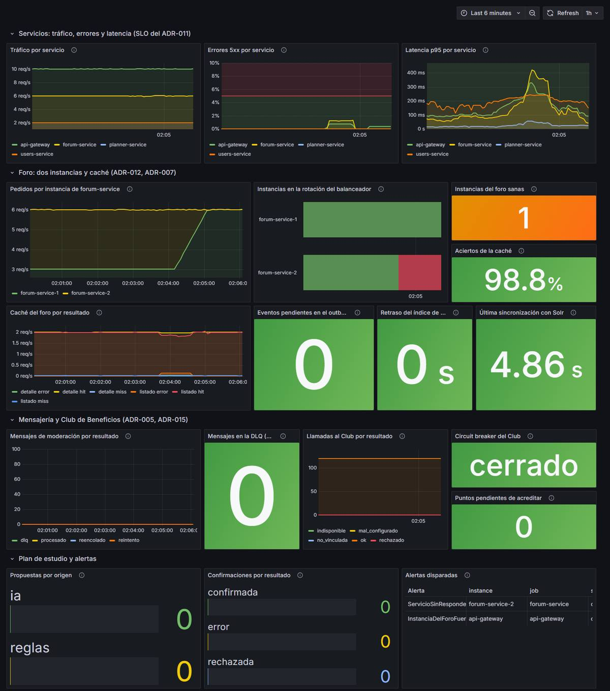
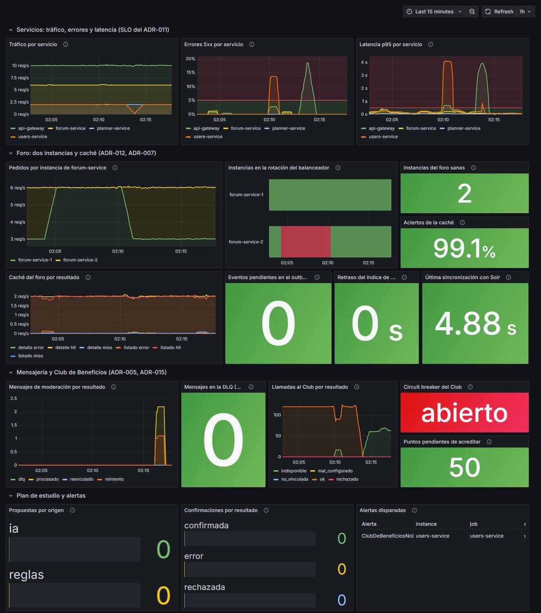
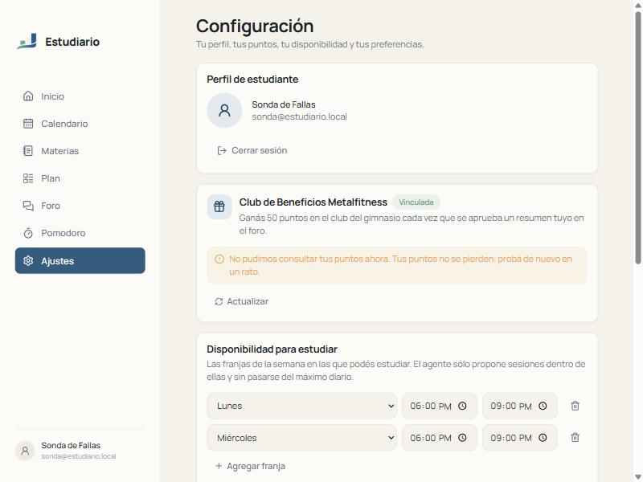
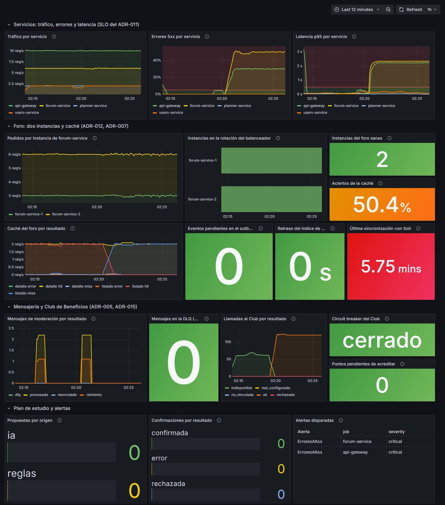
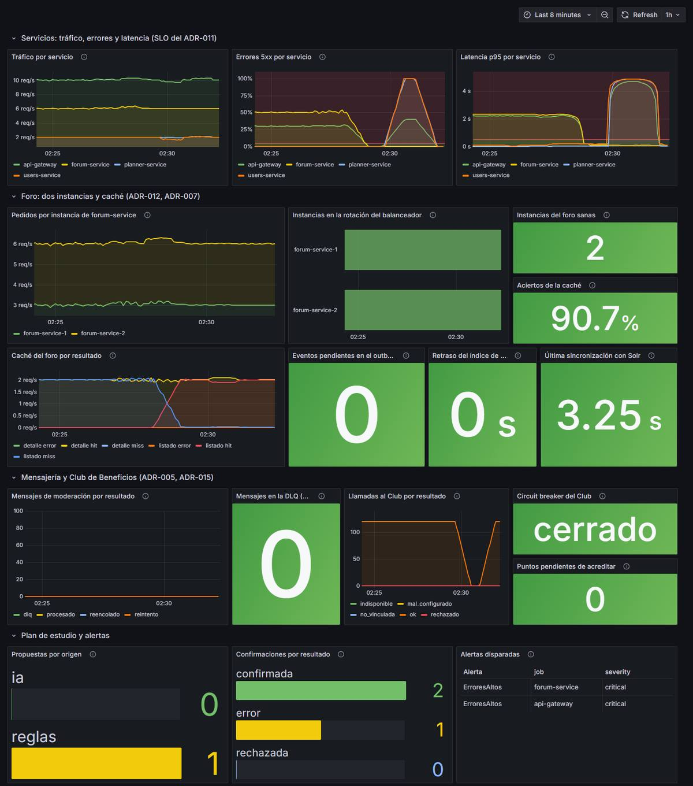
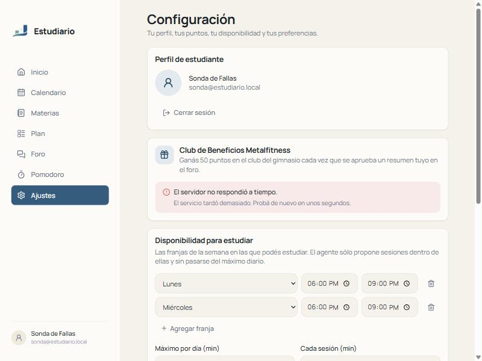

# Postmortem: jornada de fallas controladas

- **Fecha:** 10 de noviembre de 2026, de 01:50 a 02:38 (hora de Córdoba, UTC−3)
- **Tipo:** fallas **provocadas** para verificar la resiliencia del sistema completo ([ADR-010](adr/ADR-010-resiliencia.md))
- **Escenarios:** se cae una instancia de forum-service, el Club de Beneficios del Grupo 1, Apache Solr y PostgreSQL
- **Formato:** sin culpables; el objetivo es aprender del comportamiento del sistema

Al final está la [primera prueba (30/10)](#antecedente-caída-de-postgresql-del-30-de-octubre), que sólo apagó PostgreSQL.

## Resumen

Con tráfico constante por el api-gateway (10 pedidos por segundo durante 43 minutos, 26.109 pedidos), se provocaron cuatro caídas una detrás de otra. En las cuatro **el sistema siguió atendiendo lo que no dependía de la pieza caída y se recuperó solo**, sin reiniciar servicios ni perder datos, y el tablero y las alertas mostraron cada caída:

| Escenario | Lo que se esperaba (ADR-010) | Lo que pasó |
|---|---|---|
| **1. Cae una instancia de forum-service** | El balanceador la saca y el foro sigue | ✅ Salió de la rotación en 10 s; **0 errores** en 2.040 pedidos al foro (listado, detalle y mis resúmenes). Alertas disparadas y resueltas solas. |
| **2. Cae el Club de Beneficios** | La aprobación no espera al Club; el perfil avisa; los puntos se acreditan al volver | ✅ Aprobación `200` en 0,37 s; perfil con *"No pudimos consultar tus puntos"* y 50 puntos pendientes; *circuit breaker* abierto; puntos acreditados **1 s** después de que volvió el Club, una sola vez. ⚠️ Pero si el Club **tarda** en lugar de rechazar, el estudiante ve un error (ver [hallazgos](#hallazgos)). |
| **3. Cae Solr** | La búsqueda responde `503` y el resto del foro sigue | ⚠️ La búsqueda respondió `503`, pero **el listado del foro también**: también sale de Solr. Detalle, publicar y aprobar siguieron. Al volver, el índice se puso al día solo. |
| **4. Cae PostgreSQL** | El plan responde `503` y vuelve solo | ✅ `503` durante la caída, vuelta en 4 s después de que la base estuvo lista. Una confirmación que falló durante la caída se reintentó después con la misma clave **sin duplicar sesiones**. El foro, sin errores. |

La jornada encontró **cinco problemas que las pruebas anteriores no habían mostrado** (sección [Hallazgos](#hallazgos)). Uno ya está corregido; los demás quedan como acciones.

## Cómo se hizo

**Entorno.** Todo el `docker compose` en una notebook (Windows 11, Intel Core i7-1355U), con Docker Desktop limitado a **12 CPU y 2,9 GB de RAM para todos los contenedores**. users-service apuntó al **mock del Club** (`club-mock`, Prism sobre la copia del contrato), porque la API key real del Club no está en este `.env`. La máquina estuvo cargada toda la jornada: RabbitMQ usó entre 2 y 4 CPU y algunos pedidos tardaron más que en un servidor real.

**Tráfico.** [`tests/fallas/sonda.js`](../tests/fallas/sonda.js) (k6, en un contenedor dentro de la red de Docker) hace de estudiante usando la app: 10 pedidos por segundo por el api-gateway, con su JWT, repartidos entre el listado y el detalle del foro, la búsqueda, *mis resúmenes*, las sesiones del plan, el perfil y los puntos del Club. Escribe una línea por pedido (hora, pedido, status, `code`, duración e instancia que atendió), así cada caída se mide pedido por pedido y no sólo mirando el tablero. El gateway se levantó con `RATE_LIMIT_USER_PER_MIN=6000` para que el control de tráfico no frene a la sonda.

**Observación.** El tablero *Estudiario: estado general* de Grafana, las alertas de Prometheus ([`alerts.yml`](../deploy/prometheus/alerts.yml)) y los logs JSON de cada servicio, buscando por `correlationId`.

## Línea de tiempo

Horas de Córdoba (UTC−3). El reloj de los contenedores y el de la notebook difieren en menos de 1 s.

### Escenario 1: cae una instancia de forum-service

| Hora | Qué pasó |
|---|---|
| 02:03:58 | `docker compose stop forum-service-2` |
| 02:04:08 | El api-gateway la saca de la rotación (`instancia fuera de la rotación`); todo el foro pasa a `forum-service-1` |
| 02:04:14 | El contenedor termina de apagarse. `InstanciaDelForoFueraDeRotacion` y `ServicioSinResponder` pasan a *pending* |
| 02:05:14 | Las dos alertas se **disparan** |
| 02:07:08 | `docker compose start forum-service-2` **falla**: *"dependency failed to start: container estudiario-rabbitmq-1 is unhealthy"* |
| 02:09:09 | Se repite el `start` y funciona |
| 02:10:13 | El gateway la vuelve a poner en la rotación; el reparto vuelve a ser 50/50 |
| 02:10:42 | Las alertas se resuelven solas |



### Escenario 2: cae el Club de Beneficios

El estudiante de la sonda tenía la cuenta del Club vinculada.

| Hora | Qué pasó |
|---|---|
| 02:12:37 | `CLUB_BASE_URL=http://club-caido.invalid docker compose up -d users-service`: users-service se recrea apuntando a un Club que no existe |
| 02:12:37 a 02:13:42 | Mientras se recrea, users-service no atiende: **login y perfil responden `503`/`504` durante 65 s** (63 pedidos de la sonda) |
| 02:13:43 | Primera llamada al Club que falla; se reintenta una vez |
| 02:13:44 | **Se abre el *circuit breaker*** (`closed -> open`). Desde acá el perfil responde `200` con `warning: CLUB_UNAVAILABLE` en milisegundos. Cada 30 s el breaker deja pasar una prueba (`half-open`), falla y se vuelve a abrir |
| 02:16:05 | El estudiante publica *"Patrones de resiliencia"* |
| 02:16:07 | El admin lo **aprueba: `200` en 0,37 s**. users-service recibe `summary.approved` dos veces (lo publican las dos instancias del relay), guarda los 50 puntos una sola vez y manda el evento a la cola de reintento (`error transitorio, el evento se reintenta`, `correlationId: e2-aprobar`) |
| 02:16:18 | Perfil: `200`, `"pendingPoints": 50`, `"warning": "CLUB_UNAVAILABLE"` |
| 02:17:29 | Se **dispara** `ClubDeBeneficiosNoDisponible` |
| 02:18:57 | `docker compose up -d users-service`: vuelve el Club (otra vez 15 s sin login ni perfil) |
| 02:19:13 | **Puntos acreditados en el Club** (`resumen-aprobado-…`, 50 puntos), un solo movimiento |
| 02:19:25 | Puntos pendientes: 0; breaker cerrado; la alerta se resuelve |



Lo que ve el estudiante en *Configuración* con el Club caído y el breaker abierto:



### Escenario 3: cae Solr

| Hora | Qué pasó |
|---|---|
| 02:20:07 | `docker compose stop solr` |
| 02:20:18 | Solr apagado. La búsqueda **y el listado** responden `503 SEARCH_UNAVAILABLE` (después de esperar 2 s cada uno) |
| 02:20:25 | El detalle de un resumen responde `200` en 24 ms |
| 02:20:28 | Se publica y se aprueba *"Tolerancia a fallas con Solr caído"*: `200` |
| 02:20:49 | `ErroresAltos` de forum-service pasa a *pending* (50 % de `5xx`); a las 02:21:04, la del api-gateway (30 %) |
| 02:25:49 | `ErroresAltos` de forum-service se **dispara** |
| 02:26:36 | `docker compose start solr` |
| 02:28:11 | Solr termina de arrancar (1 min 35 s). El indexador reconcilia el índice (`added: 1`) y la búsqueda vuelve a responder `200` |
| 02:28:18 | El resumen aprobado durante la caída aparece en la búsqueda (7 s después de que volvió Solr; el SPEC pide 1 minuto) |



### Escenario 4: cae PostgreSQL

Antes de apagarla, el estudiante cargó una materia, su disponibilidad y un examen, y pidió una propuesta (10 sesiones).

| Hora | Qué pasó |
|---|---|
| 02:29:17 | `docker compose stop postgres` |
| 02:29:43 | PostgreSQL apagado |
| 02:29:52 | **Confirmar el plan** (`Idempotency-Key: e4-confirmar-…`): `503 SERVICE_UNAVAILABLE` en 3,0 s. No se guarda nada |
| 02:29:57 | Sesiones del plan: `503 SERVICE_UNAVAILABLE`. Login: `504 UPSTREAM_TIMEOUT`. Foro: `200` |
| 02:30:36 | `docker compose start postgres` |
| 02:31:00 | PostgreSQL listo |
| 02:31:04 | Primer `200` del plan: el pool de conexiones reconecta solo |
| 02:31:07 | **Se reintenta la confirmación con la misma clave: `200`**, 10 sesiones. Un segundo reintento devuelve las mismas 10 |

En la base quedaron **10 sesiones y 1 confirmación** para ese plan: sin duplicados (RN-14).



## Impacto

Pedidos de la sonda (10 por segundo) que no respondieron bien, por escenario:

| Escenario | Pedidos | Foro (listado, detalle, mis resúmenes) | Búsqueda | Plan (sesiones) | Perfil | Puntos del Club |
|---|---|---|---|---|---|---|
| Antes de las caídas (12 min) | 7.493 | 0 | 4 `503` | 0 | 0 | 0 |
| 1. Instancia del foro | 4.080 | **0** | 2 `503` | 0 | 0 | 15 `504` |
| 2. Club | 4.137 | 0 | 0 | 0 | 63 (`503`/`504`, al recrear users-service) | 318 con `CLUB_UNAVAILABLE` (`200`), 65 `5xx` |
| 3. Solr | 4.938 | **945 `503` en el listado** (de 987); detalle y mis resúmenes, 0 | 477 `503` (de 494) | 0 | 0 | 0 |
| 4. PostgreSQL (2 min) | 1.182 | 0 | 0 | 169 `503` (todos) | 84 (70 `504`, 14 `503`) | 84 (74 `504`, 10 `503`) |
| Después de las caídas | 1.826 | 0 | 0 | 0 | 0 | 0 |

- **Datos:** no se perdió ni se duplicó nada. El resumen aprobado con el Club caído sumó sus 50 puntos una sola vez; el aprobado con Solr caído apareció en la búsqueda; la confirmación fallida no dejó sesiones a medias y su reintento no las duplicó.
- **Nunca hizo falta reiniciar un servicio** para recuperarse: la instancia del foro volvió a la rotación, el breaker del Club se cerró, el índice de Solr se puso al día y el pool de PostgreSQL reconectó solos.

## Detección

Cada caída se vio en el tablero en segundos y como alerta al minuto (o a los 5 minutos, para la tasa de errores):

| Escenario | En el tablero | Alerta |
|---|---|---|
| 1 | *Instancias en la rotación* en rojo e *Instancias del foro sanas* = 1, a los 10 s | `InstanciaDelForoFueraDeRotacion` y `ServicioSinResponder`, 1 min después |
| 2 | *Circuit breaker del Club* = abierto, *Puntos pendientes* = 50 | `ClubDeBeneficiosNoDisponible`, 3 min 45 s después de abrirse el breaker (ver [hallazgo 5](#5-detalles-de-operación)) |
| 3 | *Errores 5xx por servicio*: forum-service al 50 % | `ErroresAltos` (forum-service), 5 min después |
| 4 | *Errores 5xx*: planner-service y users-service | `ErroresAltos` en *pending*; la caída duró menos que los 5 min de la alerta |

Los logs dieron la causa de cada error sin entrar a los contenedores: `dependencia no disponible` con el error de conexión (PostgreSQL), `búsqueda no disponible` (Solr), `cambió el estado del circuit breaker` y `falló la llamada al Club` (Club), e `instancia fuera de la rotación` (gateway), todos con el `correlationId` del pedido.

## Hallazgos

### 1. Si el Club tarda, el estudiante ve un error y el breaker no se abre *(corregido el 2026-11-10)*

**Qué pasó.** En tres momentos el Club **tardó** en lugar de rechazar: el mock recién arrancado (01:50), el mock con la máquina al máximo durante el `start` del escenario 1 (02:09:30), y el DNS de `club-caido.invalid` cuando se repitió la caída para ver el frontend (02:34). En los tres, la pantalla de *Configuración* mostró **"El servidor no respondió a tiempo"** en lugar de *"No pudimos consultar tus puntos"*:



**Causa.** Los timeouts no están alineados:

- El api-gateway espera **3 s** a users-service ([ADR-010](adr/ADR-010-resiliencia.md)).
- users-service le da al Club **4 s por intento y 6 s en total** ([ADR-015](adr/ADR-015-club-de-beneficios.md)).

Cuando el Club tarda más de 3 s, el gateway corta y responde `504`; users-service ve el pedido cancelado y lo registra como `500 error interno`. Y como un pedido cancelado **no cuenta como falla del Club** para el *circuit breaker* (está excluido a propósito), **el breaker no se abre nunca**: cada visita al perfil vuelve a esperar 3 s y a fallar. En la prueba con `club-caido.invalid` el breaker quedó en `0` (cerrado) durante minutos. Con un Club que rechaza enseguida (`http://club-mock:9`, un puerto cerrado) el breaker se abrió al tercer pedido y el perfil mostró el aviso correcto.

Lo mismo, en menor medida, con PostgreSQL: users-service espera 3 s a su base, igual que el gateway a users-service, así que con la base caída el login y el perfil respondieron `504 UPSTREAM_TIMEOUT` (70 de 84) en lugar de `503 SERVICE_UNAVAILABLE`.

**Por qué no lo vimos antes.** El escenario 2 de esta jornada, como la validación del ADR-015, usó un Club que fallaba rápido (un host que no resolvía enseguida), y los tests del adaptador prueban su propio timeout, no el del gateway.

### 2. Con Solr caído también cae el listado del foro *(corregido el 2026-11-10)*

**Qué pasó.** El ADR-010 decía que con Solr caído *"la búsqueda responde 503 y el resto del foro sigue"*. Siguieron el detalle, publicar, aprobar y *mis resúmenes*, pero **el listado de aprobados**, que es la página principal del foro, respondió `503` en el 96 % de los pedidos.

**Causa.** El listado (sin texto) también sale de Solr ([ADR-006](adr/ADR-006-busqueda.md)), y la caché no lo cubre: una página cacheada vence a los 60 s, cada aprobación cambia la generación del listado, y si Solr falla no se sirve la copia vencida.

**Corrección.** Ahora, si Solr no responde, el listado sin texto (el del foro y el de `GET /v1/documents` para el Grupo 4) se lee de MongoDB con los mismos filtros, orden y paginación; sólo la búsqueda por texto responde `503`. Con `docker compose stop solr` el listado respondió `200` en 4 a 22 ms ([ADR-006](adr/ADR-006-busqueda.md#actualización-2026-11-10-listado-sin-solr)).

### 3. users-service tiene una sola instancia *(pendiente)*

Para simular la caída del Club hubo que recrear users-service, y cada vez **el login y el perfil no respondieron entre 15 y 65 s**. Lo mismo pasaría en cualquier despliegue o reinicio de users-service. forum-service tiene dos instancias por esto mismo (ADR-012); users-service no.

### 4. El mock del Club rechazaba nuestros pedidos *(corregido)*

Al empezar, el mock respondía `400` a la consulta de saldo: el contrato del Club pide un **UUID** en `X-Correlation-Id` y users-service mandaba nuestro `correlationId`, que no lo es. El Club real lo tolera, pero con el mock (que valida estricto) las acreditaciones habrían quedado como `rechazado` para siempre. El test de contrato no lo detectaba porque no revisa el formato de los encabezados. **Se corrigió** en la rama `fix/club-correlation-id`: sólo se manda si es un UUID (si no, el Club genera uno y queda en el log como `clubCorrelationId`), con un test del adaptador y otro de contrato.

### 5. Detalles de operación

- **Healthcheck de RabbitMQ.** Con la máquina cargada, `rabbitmq-diagnostics` a veces pasa los 5 s de su timeout. RabbitMQ funcionaba, pero quedó *unhealthy* un momento y `docker compose start forum-service-2` se negó a arrancar la instancia (02:07). Hubo que repetirlo.
- **Alerta del Club.** El breaker pasa a `half-open` cada 30 s para probar. Si Prometheus lee justo ese momento, `users_club_breaker_state == 2` deja de cumplirse y el `for: 1m` vuelve a empezar: la alerta tardó 3 min 45 s en dispararse en lugar de 1 min. *(Corregido el 2026-11-10: acción 6.)*
- **Búsquedas sueltas con `503`** aun sin fallas (9 de unas 1.300): Solr superó su timeout de 2 s con la notebook al máximo. Hay que mirarlo en la nube, con una máquina sin la carga de la prueba.
- **`ConfirmarLento` en *pending*** después del escenario 4: con muy pocas confirmaciones, una sola de 3 s (la que falló) lleva el p95 arriba de 500 ms. *(Corregido el 2026-11-10: acción 6.)*

## Qué funcionó

- **Balanceo con chequeo pasivo** (ADR-012): la instancia salió de la rotación con el primer pedido fallido, antes del chequeo periódico, y las lecturas se reintentaron en la otra. 0 errores.
- **La moderación no depende del Club** (RN-43): la aprobación respondió igual de rápido; los puntos se guardaron primero y se acreditaron solos, una vez, aunque el evento llegó dos veces.
- ***Circuit breaker*** (cuando el Club falla rápido): con el breaker abierto el perfil responde en milisegundos.
- **Índice derivado** (ADR-006): lo aprobado con Solr caído apareció al volver, sin reindexar a mano.
- **Confirmación idempotente** (RN-14): la confirmación que falló se reintentó con la misma clave sin duplicar.
- **Errores claros** (ADR-005): `503` con `code`, `correlationId` y, en el plan, `Retry-After`.
- **Observabilidad** (ADR-011): cada caída se vio en el tablero y en las alertas, y los logs dieron la causa con el `correlationId`.

## Acciones

| # | Acción | Responsable | Prioridad |
|---|---|---|---|
| 1 | Alinear los timeouts con el gateway: en los pedidos del usuario, users-service le da al Club menos de 3 s en total (por ejemplo 2,5 s) para responder el aviso a tiempo, y ese corte cuenta como falla para el *circuit breaker*. Lo mismo con el timeout de la base de users-service. Sumar un test con un Club que tarda. | Isabela (users-service) | ✅ Hecha (`fix/club-timeouts`): gateway 10 s para `/me/club`, saldo y movimientos en paralelo con tope de 7 s, base de users a 2 s, test con un Club que tarda |
| 2 | Que el listado de aprobados sin texto no dependa de Solr: leerlo de MongoDB si Solr falla, o servir la copia vencida de la caché. Corregir el ADR-010 mientras tanto. | Flor (forum-service) | ✅ Hecha (`fix/listado-sin-solr`): con Solr caído el listado sin texto (foro y `/v1/documents`) sale de MongoDB, con log `WARN` y la métrica `forum_search_list_fallback_total`; la búsqueda por texto sigue en `503` ([ADR-006](adr/ADR-006-busqueda.md#actualización-2026-11-10-listado-sin-solr)) |
| 3 | No registrar como `500 error interno` un pedido que canceló el gateway | Isabela (users-service) | ✅ Hecha (`fix/club-timeouts`): responde `499` con log `WARN` |
| 4 | Dos instancias de users-service detrás del gateway, como forum-service, o cargar `CLUB_BASE_URL` sin reiniciar | Grupo | Media |
| 5 | Healthcheck de RabbitMQ más liviano (`rabbitmq-diagnostics -q ping`) o con más timeout | Grupo | Baja |
| 6 | Alerta del Club con `max_over_time(users_club_breaker_state[1m]) == 2`, para que el *half-open* no la reinicie; `ConfirmarLento` con un mínimo de confirmaciones | Flor (métricas) | ✅ Hecha (`fix/alerta-club`): la del Club se disparó 66 s después de abrirse el breaker, aunque pasó por *half-open* en el medio; `ConfirmarLento` sólo se evalúa con al menos 10 confirmaciones en 10 min. Las dos tienen tests con `promtool` ([ADR-011](adr/ADR-011-observabilidad.md)) |
| 7 | Repetir la jornada en la nube, con el Club real | Mia (despliegue) | 🟡 En parte (10/11): el escenario del Club caído se repitió en la nube (detalle abajo). Las caídas de una instancia del foro, de Solr y de PostgreSQL no se repitieron en la nube: se probaron con `docker compose`, que es el mismo, y tumbar las bases de la VM el día de la presentación era un riesgo que no valía la pena |
| — | `X-Correlation-Id` del Club sólo si es UUID | Toto | ✅ Hecha (`fix/club-correlation-id`) |
| 8 | `POST /v1/documents` con un texto que no es UTF-8 válido (un cliente de Windows que manda "Guía" en otra codificación) responde `500 INTERNAL_ERROR`: MongoDB rechaza el texto (`text contains invalid UTF-8`). Tiene que ser `422 VALIDATION_ERROR` antes de guardar. Se vio en la prueba de la nube del 10/11 | Flor (forum-service) | Media |
| 9 | `setup.sh` no recrea Caddy: si cambia el `Caddyfile`, el contenedor sigue con el archivo viejo (el montaje apunta al archivo reemplazado por `git pull`). El 9/11 hubo que hacer `up -d --force-recreate caddy` a mano | Mia (despliegue) | Baja |

**Acción 7: el Club caído en la nube (10/11/2026, horas UTC).** Con un estudiante de prueba, desde afuera por la URL pública:

| Hora | Qué pasó |
|---|---|
| 14:13:26 | `CLUB_BASE_URL=http://club-caido.invalid` en el `.env` de la VM y `up -d users-service` |
| 14:13:42 | Vincular la cuenta: `202` en 0,6 s con `{"status":"pendiente","warning":"CLUB_UNAVAILABLE"}`. En el log, `WARN falló la llamada al Club` con el `correlationId` y la causa (`no such host`) |
| 14:13:44 | `cambió el estado del circuit breaker` de `closed` a `open`: desde ahí no se llama más al Club (`durationMs: 0`) |
| 14:13:46 | Perfil (`GET /me/club`): `200` en 0,3 s con el mismo aviso: Configuración muestra "No pudimos consultar tus puntos". El planner, el foro y la app siguieron respondiendo `200` |
| 14:14:21 | `CLUB_BASE_URL` de vuelta a la del Club real y `up -d users-service`. Al arrancar: `Club de Beneficios configurado` |
| 14:14:35 | Perfil: `200`, `sin_vincular` y sin aviso |

Antes de restablecer se borró la vinculación pendiente del estudiante de prueba, para que el barrido no diera de alta en el Club real del Grupo 1 una cuenta con un mail que no existe. Por eso, en la nube no se repitió la acreditación de los puntos pendientes después de la vuelta: quedó probada en local (escenario 2). Con el Club real, una cuenta real se vinculó y quedó `vinculada`, así que la API key de la nube y el flujo de vinculación andan.

**Acciones del antecedente (30/10):**

| Acción | Estado |
|---|---|
| Alerta cuando los `503` de un servicio superan el umbral del SLO | ✅ Hecha: `ErroresAltos` ([ADR-011](adr/ADR-011-observabilidad.md)). Se disparó en el escenario 3 |
| Repetir la prueba con `docker compose` y con una confirmación de plan en el medio | ✅ Hecha en esta jornada (escenario 4). Falta en la nube (acción 7) |
| Documentar en el README cómo provocar la caída | ✅ Hecha: README, sección *Jornada de fallas* |

## Cómo repetirla

Con el sistema levantado, en un `.env` con `CLUB_BASE_URL=http://club-mock:4010` y una `CLUB_API_KEY` cualquiera (el mock no la valida):

```bash
RATE_LIMIT_USER_PER_MIN=6000 docker compose up -d api-gateway        # que el control de tráfico no frene a la sonda
mkdir -p salida && cp tests/fallas/sonda.js salida/
docker run -d --name sonda --network estudiario_default -v "$PWD/salida:/salida" \
  grafana/k6:0.54.0 run --quiet --log-format raw --log-output file=/salida/sonda.csv -e DURATION=45m /salida/sonda.js
# vincular la cuenta del Club del estudiante de la sonda (sonda@estudiario.local / secreta123) desde Configuración

# 1. Instancia del foro
docker compose stop forum-service-2 ; sleep 120 ; docker compose start forum-service-2

# 2. Club (aprobar un resumen de la sonda mientras está caído; mirar Configuración)
CLUB_BASE_URL=http://club-mock:9 docker compose up -d users-service   # falla rápido: breaker abierto y aviso
CLUB_BASE_URL=http://club-caido.invalid docker compose up -d users-service   # tarda: hallazgo 1
docker compose up -d users-service                                    # vuelve: en menos de 1 minuto se acreditan los puntos

# 3. Solr
docker compose stop solr ; sleep 360 ; docker compose start solr

# 4. PostgreSQL (con un plan propuesto para confirmar en el medio)
docker compose stop postgres ; sleep 60 ; docker compose start postgres

docker stop sonda                                                      # salida/sonda.csv: una línea por pedido
```

---

## Antecedente: caída de PostgreSQL del 30 de octubre

- **Fecha:** 30 de octubre de 2026, de 12:56:52 a 12:57:28 (hora de Córdoba, UTC−3)
- **Servicios afectados:** planner-service (y users-service, que usa el mismo PostgreSQL)
- **Duración del impacto:** 32 segundos

### Resumen

Con un estudiante usando la app, se apagó PostgreSQL durante 30 segundos. Mientras la base no estuvo, planner-service respondió **503 `SERVICE_UNAVAILABLE`** en Problem Details a cada pedido, rápido y sin colgarse, y el frontend mostró un mensaje que explica qué pasa y que se puede reintentar. Cuando la base volvió, el servicio se recuperó **solo, en 3 segundos y sin reiniciar nada**. No hubo errores 500, no se perdieron ni se corrompieron datos y no hubo que intervenir.

### Cómo se hizo

Entorno: el sistema completo corriendo en una compu del grupo (api-gateway, users-service, planner-service y PostgreSQL 16, con la misma configuración que `docker compose`). El script de la prueba:

1. Registra un estudiante e inicia sesión (JWT real de users-service).
2. Durante 75 segundos pide `GET /api/planner/sessions` por el api-gateway cada segundo, con `X-Correlation-Id: caida-<n>` para encontrar cada pedido en los logs.
3. A los 15 segundos apaga PostgreSQL (`pg_ctl stop -m fast`), espera 30 segundos y lo vuelve a prender (`pg_ctl start`).

Se registró, por cada pedido, la hora, el status, el `code` de la respuesta y la duración vista por el cliente.

### Línea de tiempo

| Hora (UTC−3) | Qué pasó |
|---|---|
| 12:56:36 | Empieza la prueba: todos los pedidos responden 200 |
| 12:56:52 | Se apaga PostgreSQL |
| 12:56:56 | Primer `503 SERVICE_UNAVAILABLE` (pedido `caida-9`): el pool de conexiones detecta que la base no está |
| 12:56:56 a 12:57:26 | 16 pedidos seguidos con 503; planner-service loguea `dependencia no disponible` con el error de conexión y el `correlationId` de cada pedido |
| 12:57:25 | Se prende PostgreSQL |
| 12:57:28 | Primer 200 después de la caída (`caida-25`): el pool reconecta solo |
| 12:57:28 a 12:59:00 | Todos los pedidos vuelven a responder 200 |

### Impacto

| | Antes y después de la caída | Durante la caída |
|---|---|---|
| Pedidos | 59, todos `200` | 16, todos `503 SERVICE_UNAVAILABLE` |
| Duración vista por el cliente | 310 ms en promedio | 398 ms en promedio, 1,3 s como máximo |
| Errores 500 | 0 | 0 |

- **Lo que vio el estudiante:** el aviso "El servicio no está disponible en este momento. Probá de nuevo en unos segundos", con la explicación "La base de datos no respondió a tiempo. No se guardó nada: podés reintentar sin miedo". Sin códigos técnicos en pantalla.
- **Datos:** ninguna pérdida. Las sesiones reservadas antes de la caída estaban intactas después.
- **Durante la caída tampoco funcionaban** el registro ni el inicio de sesión, porque users-service usa el mismo servidor PostgreSQL (con su propia base). Quien ya tenía el token siguió viendo los avisos de arriba.

### Qué funcionó

- **Fallar rápido en lugar de colgarse** (ADR-010): cada pedido falló en milisegundos dentro de planner-service (4 ms en el log). El timeout de 3 s por operación no llegó a hacer falta, porque la conexión se rechazaba enseguida. *(En la jornada del 10/11, con `docker compose stop`, el nombre `postgres` deja de resolver y cada pedido espera el timeout de 3 s.)*
- **Error claro y uniforme** (ADR-005): 503 con `code: SERVICE_UNAVAILABLE`, `Retry-After: 5` y el `correlationId` en el cuerpo y en los logs, en lugar de un 500 genérico.
- **Recuperación automática:** el pool de pgx volvió a conectar en el primer pedido después de que la base volvió. No hizo falta reiniciar ningún servicio.
- **Diagnóstico con los logs:** con el `correlationId` se encontró cada pedido fallido y la causa exacta ("no se pudo conectar con la base") en los logs JSON, sin entrar a cada componente.

### Qué no funcionó o faltó

- **Nadie se enteró solo:** no hubo alerta. La caída se vio porque se estaba mirando. Hacía falta una alerta por tasa de 503 (ADR-011). *(Hecha: `ErroresAltos`.)*
- **Login caído junto con el plan:** users-service y planner-service comparten el servidor PostgreSQL (con bases y usuarios separados, ADR-003). Una caída del servidor afecta a los dos.
- **La confirmación del plan no se probó durante la caída.** *(Probada en la jornada del 10/11, escenario 4.)*
