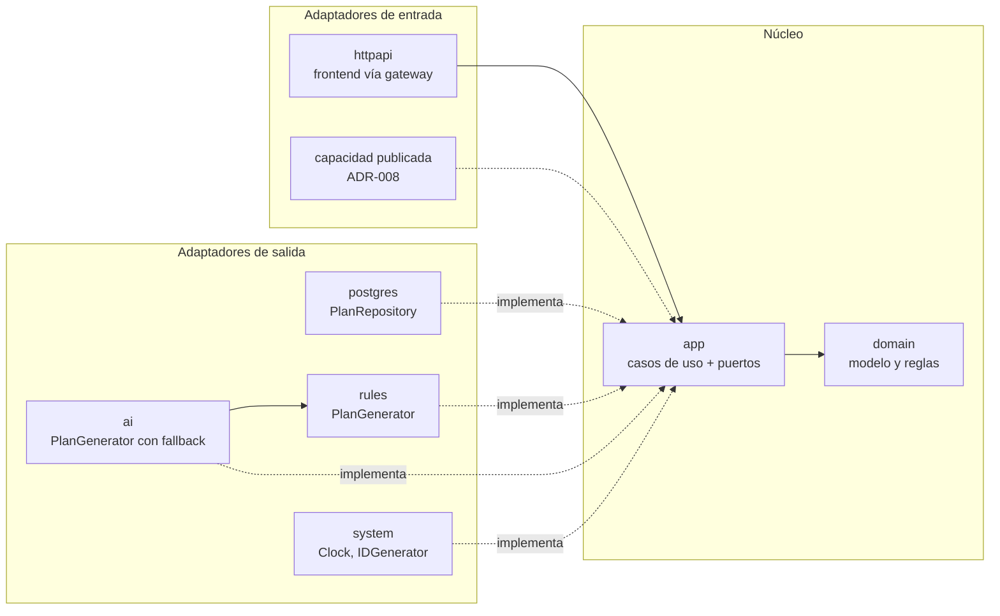
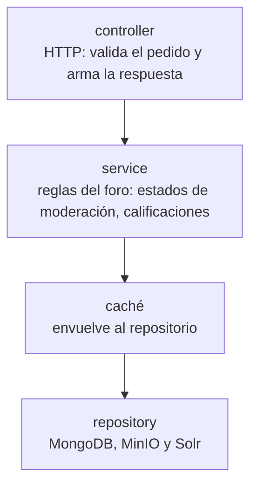

# ADR-002: Arquitectura interna de los servicios

- **Estado:** Propuesta
- **Fecha:** 2026-10-19
- **Decisión del enunciado:** D2
- **Reemplaza a:** —

## Contexto

El enunciado (2.1) pide que al menos dos servicios usen **patrones de arquitectura interna diferentes**, trabajados en la materia, y que se apliquen de manera reconocible. La decisión D2 tiene que justificar los estilos elegidos, las dependencias internas y por qué cada alternativa se adecua al problema de su servicio.

Los servicios tienen problemas muy distintos (ver [ADR-001](ADR-001-limites-de-servicios.md)):

- **planner-service** concentra las reglas de negocio más complejas: la confirmación del plan valida RN-10 a RN-15 en una única transacción (todo o nada, sin superposiciones, sin superar la capacidad diaria y sin duplicarse). Además tiene **varias dependencias intercambiables**: PostgreSQL, el agente de IA, el motor de reglas que lo reemplaza cuando falla (RN-09, [ADR-010](ADR-010-resiliencia.md)) y dos formas de entrada al mismo caso de uso: el frontend a través del gateway y la capacidad publicada para otro grupo ([ADR-008](ADR-008-contrato-propio.md)).
- **forum-service** es mayoritariamente de lectura: publicar, moderar, listar, buscar y calificar resúmenes. Sus reglas son transiciones de estado sobre un único documento (RN-19 a RN-31), y su problema principal es leer rápido: caché del listado y del detalle, e índice de búsqueda.
- **notification-service** no recibe pedidos HTTP de los usuarios: reacciona a eventos de moderación que llegan por RabbitMQ ([ADR-005](ADR-005-comunicacion.md)).

## Opciones consideradas

1. **Arquitectura por capas en todos los servicios.** Es la más simple y la que todo el equipo conoce. En planner-service, en cambio, las reglas de la confirmación quedarían mezcladas con el acceso a la base y con el cliente de la IA, y cambiar el generador del plan (IA o reglas) o sumar la entrada de la capacidad publicada obligaría a tocar el servicio por dentro.
2. **Arquitectura hexagonal en todos los servicios.** Aísla el dominio en todos lados, pero en forum-service agrega puertos y adaptadores para operaciones que son, en su mayoría, leer y escribir documentos, sin dependencias que haya que intercambiar.
3. **Hexagonal en planner-service y por capas en forum-service (elegida).** Cada servicio usa el estilo que mejor responde a su problema, y se cumple el requisito de dos patrones distintos.

## Decisión

### planner-service: arquitectura hexagonal (puertos y adaptadores)

```
services/planner-service/
├── cmd/planner-service/      arranque: arma los adaptadores y los conecta a los puertos
└── internal/
    ├── domain/               modelo y reglas de negocio (RN-10 a RN-15), sin dependencias
    ├── app/                  casos de uso (proponer, confirmar…) y puertos (interfaces)
    └── adapters/
        ├── httpapi/          entrada: API HTTP que usa el frontend a través del gateway
        ├── postgres/         salida: implementa PlanRepository con PostgreSQL
        ├── rules/            salida: implementa PlanGenerator con el motor de reglas
        ├── ai/               salida: implementa PlanGenerator con el agente de IA, con fallback
        └── system/           salida: reloj e identificadores
```



- **Regla de dependencias:** el código depende siempre hacia el centro. `domain` no importa ningún otro paquete del servicio ni librerías externas. `app` depende sólo de `domain`. Los adaptadores dependen de `app` y de `domain`, nunca al revés. Las librerías de infraestructura (pgx, OpenTelemetry, el cliente de la IA, el *circuit breaker*) sólo aparecen en los adaptadores.
- **Puertos** (definidos en `app`): `PlanRepository` (persistencia, incluida la confirmación transaccional), `PlanGenerator` (quién arma la propuesta), `Clock` e `IDGenerator`.
- **Dos generadores detrás del mismo puerto:** el motor de reglas (`adapters/rules`) y el agente de IA (`adapters/ai`). El adaptador de IA envuelve al motor de reglas: si la IA falla, tarda más que su presupuesto o devuelve una propuesta inválida, usa el motor de reglas (RN-09, ADR-010). El caso de uso no sabe cuál de los dos armó el plan; sólo lee `generatedBy`.
- **Las reglas de la confirmación están en el dominio** y se ejecutan dentro de la transacción que abre el adaptador de PostgreSQL, con las sesiones del estudiante bloqueadas (ver [ADR-003](ADR-003-persistencia.md)). Así la regla se escribe una sola vez y la garantía de concurrencia la da la base.
- **El arranque (`cmd/`) es el único lugar que conoce todas las piezas:** crea los adaptadores y se los pasa al caso de uso.

**Por qué se adecua a su problema**

- Las reglas más importantes del sistema (RN-10 a RN-15) se prueban con tests unitarios sobre el dominio y los casos de uso, con implementaciones falsas de los puertos, sin levantar PostgreSQL ni llamar a la IA.
- Cambiar o combinar generadores (IA, reglas, IA con *fallback*) no toca los casos de uso: es armar otro adaptador en el arranque.
- La capacidad publicada para otro grupo es un adaptador de entrada más sobre el mismo caso de uso que usa el frontend (ADR-008), así que las reglas RN-06, RN-07 y RN-09 se implementan una sola vez.

### forum-service: arquitectura por capas

Se organiza en tres capas, como se trabajó en clase. Cada capa sólo llama a la de abajo:



- **controller:** recibe el pedido HTTP, valida el formato y traduce entre JSON y los tipos del servicio. No tiene reglas de negocio.
- **service:** aplica las reglas del foro: transiciones de estado de la moderación (RN-19 a RN-23), calificaciones (RN-28 a RN-31) y qué se publica como evento.
- **repository:** es el único que habla con MongoDB, MinIO y Solr.
- **La caché envuelve al repositorio:** implementa la misma interfaz que el repositorio de lectura y, ante un pedido del listado o del detalle de resúmenes aprobados, primero busca en la caché y, si no está, lo lee del repositorio y lo guarda (*cache-aside*). Se reutiliza la implementación de caché de la clase (interfaz `Cache`, ver ADR-003). El service no sabe si la respuesta vino de la caché, y la caché se puede apagar (versión nula) para medir su impacto. La vigencia y la invalidación se definen en el ADR-007 (D7).

**Por qué se adecua a su problema**

- Las operaciones del foro son, en su mayoría, leer y escribir un documento, con reglas que caben en la capa de service. No hay generadores ni entradas alternativas que justifiquen puertos y adaptadores.
- La caché como envoltorio del repositorio agrega el *cache-aside* sin modificar el service ni el repositorio, y permite medir el antes y el después que pide el enunciado.
- Es el estilo más conocido por el equipo, lo que acelera el servicio con más funcionalidades.

### notification-service: consumidor de eventos

notification-service no expone una API de negocio: su entrada es un **consumidor de RabbitMQ** que recibe los eventos de moderación (ADR-005). Sigue la misma separación en capas que forum-service, con el consumidor en el lugar del controller:

- **consumidor:** lee el mensaje, valida el formato del evento y hace `ack` o lo manda a reintento o a la *dead letter queue*;
- **service:** aplica la idempotencia por `eventId` y arma el mail;
- **repository y envío:** registro de notificaciones en MongoDB y envío por SMTP.

### Resto de los componentes

- **api-gateway:** no tiene lógica de negocio. Se organiza por responsabilidad (proxy hacia los servicios y observabilidad en `internal/`).
- **users-service:** por capas (controller → service → repository), igual que forum-service. Es un servicio simple de registro, inicio de sesión y roles, sin dependencias que haya que intercambiar.

## Consecuencias

**Positivas**

- Se cumple el requisito de dos patrones distintos, y cada uno tiene un motivo propio del servicio.
- En planner-service, la acción principal y sus reglas se prueban sin infraestructura, y la IA, el motor de reglas y la capacidad publicada se conectan sin tocar los casos de uso.
- En forum-service, la caché se agrega y se mide sin cambiar el resto del código.

**Negativas / limitaciones aceptadas**

- planner-service tiene más paquetes e interfaces que un servicio por capas, y hay que respetar la regla de dependencias al agregar código.
- Al convivir dos estilos, quien pasa de un servicio al otro tiene que cambiar de forma de organizar el código.
- En forum-service, si alguna regla llegara a necesitar otra fuente de datos o un servicio externo, la capa de service quedaría acoplada a ese repositorio concreto.

**A validar en la presentación final**

- Que la regla de dependencias de planner-service se siga cumpliendo (`domain` sin dependencias, adaptadores sólo hacia el centro).
- Que forum-service y notification-service, cuando se implementen, sigan esta estructura.
