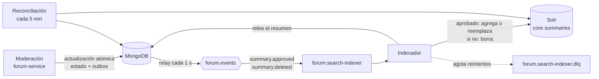

# ADR-006: Búsqueda

- **Estado:** Aceptada (implementada y validada el 2026-10-29, con los cambios de la sección *Actualización*)
- **Fecha:** 2026-10-19
- **Decisión del enunciado:** D6
- **Reemplaza a:** —

## Contexto

El enunciado (2.6) pide que una entidad del dominio tenga **búsqueda implementada con un motor de búsqueda**, con paginación, filtros relevantes y al menos un criterio de orden. El índice tiene que mantenerse **sincronizado** con los cambios del sistema, y el grupo tiene que definir el **retraso máximo tolerable** entre un cambio en los datos y su aparición en los resultados. La decisión D6 tiene que justificar la información indexada, los criterios de consulta, la actualización o reconstrucción del índice y el retraso aceptable.

En Estudiario la entidad buscable es el **resumen** del foro. Lo que pide el [SPEC](../../SPEC.md):

- **RF-19:** buscar resúmenes aprobados por texto (título y descripción), con resultados paginados.
- **RF-20:** filtrar por materia y por calificación mínima, y ordenar por relevancia, calificación promedio o fecha de publicación.
- **RN-24:** sólo los resúmenes *aprobados* aparecen en la búsqueda; uno eliminado deja de aparecer.
- **RN-26:** un resumen aprobado aparece en la búsqueda en, como máximo, **1 minuto**, y uno eliminado deja de aparecer en el mismo plazo.
- **RN-27:** una página tiene como máximo **50** resúmenes.
- **CA-19 a CA-21** verifican el plazo de aparición, el de eliminación y la combinación de filtro por materia con orden por calificación.

Lo que ya está decidido y este ADR toma como base:

- **[ADR-001](ADR-001-limites-de-servicios.md):** la búsqueda vive dentro de forum-service, que es el dueño de los resúmenes. No es un servicio aparte.
- **[ADR-003](ADR-003-persistencia.md):** MongoDB es la fuente de verdad. **Apache Solr** es un almacén **derivado**: si se pierde, se reconstruye desde MongoDB.
- **[ADR-005](ADR-005-comunicacion.md):** el **indexador** es un componente de forum-service que consume `summary.approved` y `summary.deleted` de la cola `forum.search-indexer`. No confía en el contenido del evento: relee el documento en MongoDB. Reintenta con esperas de 1 s, 2 s, 4 s, 8 s y 16 s, y si se agotan, el mensaje va a `forum.search-indexer.dlq`. El *relay* del *outbox* publica los eventos entre 1 y 2 s después de la moderación.
- **[ADR-010](ADR-010-resiliencia.md):** cada búsqueda tiene un timeout de **2 s**; si Solr no responde, la búsqueda devuelve `503 SEARCH_UNAVAILABLE` y el resto del foro sigue funcionando.
- **[ADR-012](ADR-012-balanceo-de-carga.md):** forum-service corre en dos instancias que comparten el mismo Solr.

## Opciones consideradas

**Motor de búsqueda**

1. **Búsqueda de texto de MongoDB (índice `$text`).** No suma componentes, pero el análisis de texto y el cálculo de relevancia son limitados, y combinar texto, filtros y orden por otro campo es poco flexible. Además, el enunciado pide un motor de búsqueda.
2. **Elasticsearch u OpenSearch.** Son equivalentes en funcionalidad, pero más pesados para correr en el entorno local y no se trabajaron en clase.
3. **Apache Solr (elegida).** Es el motor trabajado en clase (CLASE_5), corre en un contenedor, trae análisis de texto en español, relevancia, filtros, orden y paginación, y se usa por HTTP desde Go sin librerías especiales.

**Cómo se mantiene sincronizado el índice**

1. **Escribir en Solr en el mismo pedido que modera.** Es lo más directo, pero acopla la moderación a la disponibilidad de Solr (si está caído, la moderación fallaría o el índice quedaría mal) y no hay forma limpia de reintentar.
2. **Sólo reindexado periódico desde MongoDB.** Es simple y siempre converge, pero para cumplir el minuto de RN-26 habría que recorrer todos los resúmenes cada pocos segundos.
3. **Sólo eventos.** Es rápido, pero si un mensaje termina en la DLQ o el índice se pierde, nada lo corrige solo.
4. **Eventos más reconciliación periódica (elegida).** Los eventos de moderación mantienen el índice al día en segundos, y una reconciliación cada pocos minutos corrige lo que se haya escapado. Para perder el índice entero existe además una reconstrucción completa.

**Cómo se actualiza la calificación en el índice**

1. **Un evento por cada calificación** (por ejemplo, `summary.rated`). Mantiene el promedio al día en segundos, pero suma un evento de mucho volumen y cambia la topología de colas que fijó el ADR-005.
2. **Que forum-service actualice el promedio en Solr dentro del pedido de calificar.** Acopla la calificación a Solr, igual que la opción 1 de la sincronización.
3. **Que la reconciliación periódica actualice el promedio (elegida).** No suma eventos ni acopla la calificación a Solr. El costo es un retraso de algunos minutos en el filtro y el orden por calificación, que se acepta (ver *Retraso aceptable*).

## Decisión

### 1. Información indexada

Se indexan **sólo los resúmenes aprobados** (RN-24), en el core `summaries` de Solr. Cada documento del índice tiene **únicamente los campos que sirven para buscar, filtrar, ordenar o mostrar la tarjeta del resultado**:

| Campo | Tipo en Solr | Para qué se usa |
|---|---|---|
| `id` | `string` (clave) | Identificador del resumen en MongoDB. Con él se arma el enlace al detalle. |
| `title` | `text_es` (texto con análisis en español) | Búsqueda por texto (RF-19). Pesa más que la descripción. |
| `description` | `text_es` | Búsqueda por texto (RF-19). |
| `subject` | `string` | Filtro exacto por materia (RF-20). Es el texto libre que cargó el autor (RN-25). |
| `subject_text` | `text_es` (copia de `subject`) | Que buscar "análisis" también encuentre resúmenes de "Análisis Matemático II". |
| `ratingAvg` | `pfloat` | Filtro por calificación mínima y orden por calificación (RF-20, RN-31). |
| `ratingCount` | `pint` | Desempate del orden por calificación y dato de la tarjeta (RN-31). |
| `publishedAt` | `pdate` | Orden por fecha de publicación (RF-20). Es la fecha de aprobación. |

**Qué no se indexa y por qué:**

- **El PDF.** Extraer y analizar el texto de archivos de hasta 10 MB agranda mucho el índice y el trabajo del indexador, y RF-19 pide buscar por título y descripción. El PDF queda en MinIO.
- **Los datos del autor** (id, nombre y mail). No sirven para buscar y el mail es un dato personal que no tiene por qué salir de MongoDB.
- **Los resúmenes pendientes, rechazados o eliminados.** No deben aparecer nunca (RN-24). Como no están en el índice, no hace falta filtrarlos en cada consulta y no hay riesgo de que un error en el filtro los muestre.

El esquema se define en un archivo versionado en el repositorio (`managed-schema` del core `summaries`) y se aplica al levantar Solr con `docker compose`, sin pasos manuales. Si el esquema cambia, se usa la reconstrucción completa (punto 4).

### 2. Criterios de consulta

forum-service expone la búsqueda como `GET /summaries/search` (detrás del api-gateway). El controller traduce los parámetros a una consulta de Solr; el frontend nunca habla con Solr.

| Parámetro | Qué hace | Valores |
|---|---|---|
| `q` | Texto a buscar en `title` (con más peso), `description` y `subject_text` (consulta *edismax*). | Opcional. Si no viene, devuelve todos los aprobados. |
| `subject` | Filtro exacto por materia (`fq=subject:"..."`). | Opcional. |
| `minRating` | Filtro por calificación mínima (`fq=ratingAvg:[x TO *]`). | Opcional, de 1 a 5. |
| `sort` | Orden de los resultados. | `relevance` (por defecto si hay `q`), `rating` o `date` (por defecto si no hay `q`). |
| `page` y `size` | Paginación. | `page` desde 1; `size` por defecto 20 y **como máximo 50** (RN-27). Un `size` mayor se rechaza con `400`. |

- **Orden por `relevance`:** el puntaje de Solr, con desempate por `publishedAt` descendente.
- **Orden por `rating`:** `ratingAvg` descendente y, a igual promedio, `ratingCount` descendente, para que un 5 con 40 votos quede antes que un 5 con 1 voto. Es lo que verifica CA-21 junto con el filtro por materia.
- **Orden por `date`:** `publishedAt` descendente (los más nuevos primero).
- **Respuesta:** la página de resultados con los campos de la tarjeta (id, título, materia, promedio, cantidad de calificaciones y fecha) y el total de resultados. El **detalle** de un resumen no sale de Solr: se lee de MongoDB a través de la caché ([ADR-007](ADR-007-cache.md)), así siempre muestra el dato de la fuente de verdad.
- **Paginación por número de página** (`start` y `rows` de Solr). Alcanza para el volumen del foro; no se ofrece paginación profunda por cursor.

### 3. Actualización del índice por eventos

El indexador, dentro de forum-service, consume la cola `forum.search-indexer` (ADR-005):

1. Llega `summary.approved` o `summary.deleted`.
2. El indexador **relee el resumen en MongoDB** y no usa los datos del evento. Si el resumen está aprobado, lo agrega o lo reemplaza en Solr con sus datos actuales; si no está aprobado o ya no existe, lo borra del índice.
3. Escribe en Solr con `commitWithin` de **5 s**: Solr hace visible el cambio en, como mucho, 5 s, sin forzar un *commit* por cada documento.
4. Recién después hace `ack` del mensaje.

Este procesamiento es **idempotente** y **no depende del orden** de los eventos: procesar dos veces el mismo evento deja el índice igual, y un `summary.approved` que llega después de un `summary.deleted` no "revive" el resumen, porque el indexador mira el estado actual en MongoDB. Por eso no hace falta registrar los `eventId` procesados, como sí hace notification-service.

Si Solr no responde, el mensaje se reintenta con la política del ADR-005 (1 s, 2 s, 4 s, 8 s y 16 s) y, si se agotan los reintentos, va a `forum.search-indexer.dlq`.

### 4. Reconciliación y reconstrucción

**Reconciliación periódica (cada 5 min).** Un proceso de forum-service compara MongoDB con el índice y corrige las diferencias:

- resúmenes aprobados que faltan en Solr: se agregan (por ejemplo, un evento que terminó en la DLQ);
- documentos de Solr que ya no están aprobados en MongoDB: se borran;
- promedios y cantidades de calificaciones distintos: se actualizan (ver la opción elegida para las calificaciones).

Para no recorrer todo cada vez, compara por la fecha de última modificación del resumen (`updatedAt`, con índice en MongoDB) y, una vez por hora, hace una pasada completa por `id`. Con dos instancias de forum-service ([ADR-012](ADR-012-balanceo-de-carga.md)) la reconciliación puede correr en las dos a la vez: como cada corrección deja el índice igual a MongoDB, correrla dos veces no produce errores, sólo trabajo repetido.

**Reconstrucción completa.** Es un comando de forum-service (`forum-service reindex`) que recorre todos los resúmenes aprobados de MongoDB y los vuelve a escribir en el core. Se usa cuando:

- se pierde el índice (por ejemplo, se borró el volumen de Solr);
- cambia el esquema del índice;
- la reconciliación detecta muchas diferencias y conviene empezar de cero.

Mientras corre, la búsqueda sigue respondiendo con lo que el índice ya tiene. Si el índice se perdió entero, la búsqueda devuelve resultados incompletos hasta que termina; el resto del foro no se ve afectado porque no depende de Solr.

### 5. Retraso aceptable

| Cambio | Retraso máximo aceptado | Cómo se cumple |
|---|---|---|
| Un resumen **aprobado** aparece en la búsqueda | **1 minuto** (RN-26, CA-19) | *Relay* del *outbox* (1 a 2 s) + indexador + `commitWithin` (≤ 5 s). En condiciones normales son menos de **10 s**. |
| Un resumen **eliminado** deja de aparecer | **1 minuto** (RN-26, CA-20) | El mismo camino, con `summary.deleted`. |
| Cambia el **promedio** de calificaciones en el filtro y el orden | **5 minutos** | Reconciliación periódica. |

- **Por qué alcanza el minuto con margen:** aunque Solr falle por un momento, los cinco reintentos del indexador suman 31 s de espera. Sumados al *relay* y al `commitWithin`, el cambio se ve antes del minuto si Solr vuelve dentro de esa ventana.
- **Cuándo se puede pasar del minuto:** si Solr está caído más de unos 30 s o RabbitMQ no entrega los eventos, el mensaje termina en la DLQ o se demora, y el cambio aparece con la siguiente reconciliación (hasta 5 min). Se acepta porque es una falla de infraestructura, queda visible en la métrica de la DLQ y se corrige sola, sin intervención manual.
- **Por qué el promedio puede esperar 5 minutos:** RN-26 habla de que un resumen **aparezca o desaparezca**, que es lo que importa para la moderación (que un resumen eliminado no se siga mostrando). Que un resumen suba o baje unos puestos en el orden por calificación durante unos minutos no afecta ninguna regla de negocio. El detalle del resumen muestra siempre el promedio actual, porque se lee de MongoDB.

### 6. Medición

Para comprobar el retraso y el estado del índice se suman al tablero ([ADR-011](ADR-011-observabilidad.md)):

- **Retraso de indexación:** el indexador registra la diferencia entre `occurredAt` del evento y el momento en que Solr confirma la escritura, como histograma. El p95 tiene que quedar muy por debajo de 60 s.
- **Mensajes en `forum.search-indexer.dlq`:** ya tiene alerta en el ADR-011.
- **Correcciones de la reconciliación:** cantidad de documentos agregados, borrados y actualizados en cada pasada. Si es distinta de cero seguido, algo está fallando en el camino de los eventos.
- **Búsquedas:** latencia y errores de `GET /summaries/search`, incluidos los `503 SEARCH_UNAVAILABLE`.
- **Prueba de CA-19 y CA-20:** un test de integración contra Solr real que aprueba un resumen, espera a que aparezca en la búsqueda y mide cuánto tardó; y lo mismo al eliminarlo.

## Consecuencias

**Positivas**

- La búsqueda cumple RF-19 y RF-20 con un motor real: texto con análisis en español, filtros, tres órdenes y paginación con el tope de RN-27.
- La moderación no depende de Solr: si está caído, se modera igual y el índice se pone al día cuando vuelve.
- El índice siempre converge a MongoDB: los eventos lo mantienen al día en segundos, la reconciliación corrige lo que se escape y la reconstrucción lo rehace desde cero.
- El indexador es idempotente sin guardar nada, porque siempre mira el estado actual del resumen.
- El índice tiene sólo datos públicos: ni el PDF ni los datos del autor salen de su almacenamiento.

**Negativas / limitaciones aceptadas**

- Hay un componente más para operar (Solr) y un esquema que mantener aparte del de MongoDB.
- El filtro y el orden por calificación pueden tener hasta 5 minutos de atraso respecto del promedio real.
- Si Solr o RabbitMQ fallan por más de unos 30 s, un resumen puede tardar más de 1 minuto en aparecer o desaparecer (hasta la siguiente reconciliación).
- No se busca dentro del contenido del PDF: un resumen sólo se encuentra por su título, su descripción o su materia.
- La materia es texto libre (RN-25): "Análisis II" y "Análisis Matemático II" son materias distintas para el filtro exacto. La búsqueda por texto sobre `subject_text` lo mitiga en parte.
- La paginación por número de página se vuelve más lenta en páginas muy profundas. Para el volumen del foro no es un problema.
- La reconciliación agrega una consulta periódica a MongoDB y a Solr, y con dos instancias se hace dos veces.

**A validar al implementar forum-service**

- Medir el retraso real entre una aprobación y su aparición en la búsqueda (CA-19) y entre una eliminación y su desaparición (CA-20), contra el minuto de RN-26.
- Confirmar que 5 s de `commitWithin` y 5 min de reconciliación son buenos valores con datos reales.
- Probar la reconstrucción completa borrando el volumen de Solr y medir cuánto tarda.
- Que la consulta *edismax* con el peso del título dé resultados razonables en español (acentos, plurales).
- Demostrar la caída de Solr: la búsqueda responde `503 SEARCH_UNAVAILABLE`, el resto del foro sigue, y al volver el índice se pone al día ([ADR-010](ADR-010-resiliencia.md)).

## Actualización (2026-10-29): implementación

La búsqueda quedó implementada en forum-service (`internal/search`). Al implementarla cambiaron tres puntos de la decisión original. El resto (Solr, sólo aprobados en el índice, *edismax* con más peso en el título, `commitWithin` de 5 s, reconciliación cada 5 min y reconstrucción completa) se mantiene.

### 1. El indexador lee los cambios de MongoDB en lugar de consumir una cola

**Antes:** el indexador consumía `summary.approved` y `summary.deleted` de la cola `forum.search-indexer` (punto 3).

**Ahora:** cada **5 s** lee de MongoDB los resúmenes con `updatedAt` posterior a la última lectura (con índice sobre `updatedAt`). Si están aprobados, los agrega o reemplaza en Solr; si no, los borra. Vuelve a mirar los últimos 30 s por si otra instancia escribió con el reloj un poco atrasado; repetir no cambia nada, porque siempre indexa el estado actual.

**Por qué:**

- El indexador ya releía el resumen en MongoDB y no usaba el contenido del evento: el evento sólo decía *qué* mirar. `updatedAt` da la misma información sin pasar por el *relay* ni por RabbitMQ.
- La búsqueda deja de depender de dos componentes más. Si RabbitMQ o el *relay* fallan, el índice igual se mantiene al día.
- No hace falta la cola, su DLQ ni la política de reintentos propia: si Solr falla, la marca de la última lectura no avanza y la vuelta siguiente reintenta lo mismo.
- Es la misma idea que la reconciliación incremental por `updatedAt` que ya estaba decidida (punto 4), sólo que más seguido.

**Costo aceptado:** una consulta a MongoDB cada 5 s por instancia, que usa el índice sobre `updatedAt` y casi siempre no devuelve nada. Los eventos `summary.*` se siguen publicando para notification-service y el programa de beneficios. La cola `forum.search-indexer` del [ADR-005](ADR-005-comunicacion.md) ya no se crea.

### 2. Campos del índice y forma de la respuesta

La [capacidad para el Grupo 4](ADR-014-contrato-documentos.md) usa la misma búsqueda, así que el índice sigue al contrato `documents-v1`:

| Campo | Tipo | Cambio |
|---|---|---|
| `title`, `description` | `text_es_estudiario` | Tipo propio (ver abajo). |
| `category_text` | `text_es_estudiario` | Antes `subject_text`. La materia del foro es la `category` del contrato. |
| `categoryKey` | `string` | Antes `subject`. Se guarda normalizada (minúsculas, sin tildes), igual que en MongoDB: "Análisis II" y "analisis ii" son la misma categoría para el filtro. |
| `tagKeys` | `string`, multivaluado | Nuevo: filtro por etiquetas del contrato. |
| `source` | `string` | Nuevo: `estudiario` o `externo`. |
| `ratingAvg`, `ratingCount`, `publishedAt` | `pfloat`, `pint`, `pdate` | Sin cambios. |

- **`text_es_estudiario`:** minúsculas, palabras vacías del español, sin tildes (`ASCIIFoldingFilter`) y raíz en español (`SpanishLightStemFilter`). El `text_es` del configset no saca las tildes, y los estudiantes buscan "analisis" o "cinematica" sin acento.
- **La respuesta se arma desde MongoDB.** Solr devuelve los ids, el total y el orden; forum-service lee esos resúmenes de MongoDB y devuelve el documento completo del contrato (autor, archivo, calificación). Así el índice no guarda datos del autor y la respuesta siempre tiene el dato actual. Si el índice todavía tiene algo que en MongoDB ya no está aprobado, no se muestra (RN-24).
- **El esquema** está en `services/forum-service/internal/search/schema.json`, con el formato de la Schema API que usamos en la CLASE_5. forum-service lo aplica al arrancar (agrega lo que falta y reemplaza lo que existe) y apaga la creación automática de campos del configset `_default`. El core se crea con `solr-precreate summaries`, como en clase.
- La ruta es la que ya tenía el foro, `GET /api/forum/summaries` (no `/summaries/search`), y `GET /v1/documents` para el Grupo 4.

### 3. Calificaciones

Se mantiene que el promedio llega al índice por la reconciliación (hasta 5 min). La reconciliación compara `ratingAvg` y `ratingCount` de cada documento y sólo reescribe los que cambiaron, así que su log (`added`, `updated` y `removed`) muestra cuántas correcciones hizo.

### Validación

Con el sistema completo levantado con `docker compose`:

| Prueba | Resultado |
|---|---|
| Un resumen aprobado aparece en la búsqueda (CA-19) | **4,6 s** (límite: 60 s) |
| Un resumen eliminado deja de aparecer (CA-20) | **6,8 s** (límite: 60 s) |
| Buscar "analisis" e "integral" | Encuentra "Análisis Matemático II" e "Integrales dobles" |
| Materia + orden por calificación (CA-21) | A igual promedio queda primero el de más votos |
| Solr apagado | La búsqueda responde `503 SEARCH_UNAVAILABLE` en 70 ms; el detalle, la publicación y la moderación responden normalmente |
| Solr vuelve | Lo aprobado mientras estaba caído aparece en 9 s, sin reiniciar forum-service |
| Volumen de Solr borrado + `forum-service reindex` | Índice reconstruido, con el esquema aplicado de nuevo |

El test de integración `internal/search/solr_integration_test.go` repite estas pruebas contra un Solr real: análisis en español, filtros, los tres órdenes, paginación, sincronización, reconciliación y reconstrucción. El retraso de cada sincronización queda en el log `índice sincronizado` (`lagMs`), para llevarlo al tablero del [ADR-011](ADR-011-observabilidad.md).
