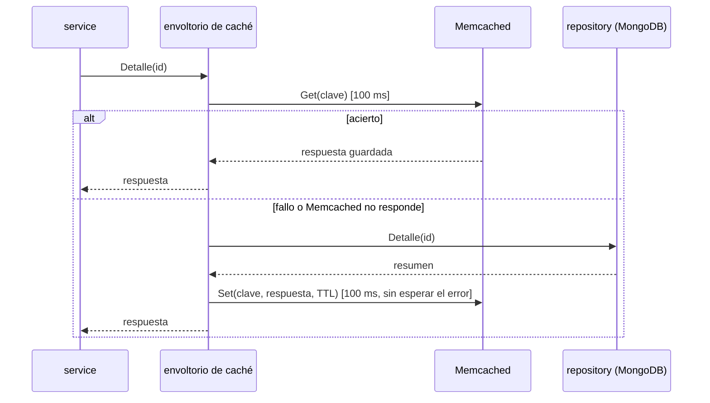

# ADR-007: Caché

- **Estado:** Propuesta (se valida con la medición antes y después al implementar forum-service)
- **Fecha:** 2026-10-19
- **Decisión del enunciado:** D7
- **Reemplaza a:** —

## Contexto

El enunciado (2.7) pide incorporar **caché en al menos un flujo de lectura relevante**, elegido por una **necesidad observable** del sistema y no sólo para cumplir el requisito, con **métricas que muestren su impacto**. Para la presentación final pide además una **medición comparativa antes y después**. La decisión D7 tiene que justificar la información almacenada, la invalidación, la vigencia, el comportamiento ante fallas y los criterios de medición.

**La necesidad.** forum-service es el servicio con más lecturas del sistema ([ADR-002](ADR-002-arquitectura-interna.md), [ADR-012](ADR-012-balanceo-de-carga.md)):

- **El listado de resúmenes aprobados** es la pantalla de entrada del foro: cada estudiante que entra lo pide, y casi siempre las mismas primeras páginas. Cambia sólo cuando el administrador aprueba o elimina un resumen, o cuando alguien califica.
- **El detalle de un resumen** se pide cada vez que alguien abre un resultado de la búsqueda o del listado. Los resúmenes mejor calificados se abren muchas veces, y un resumen aprobado casi no cambia: sólo su promedio de calificaciones.

Las dos lecturas van a MongoDB en cada pedido, y se repiten mucho más de lo que cambian. Es el caso típico en el que una caché ahorra trabajo a la base y baja la latencia. Esa diferencia es la que se tiene que medir (sección 6).

Lo que ya está decidido y este ADR toma como base:

- **[ADR-002](ADR-002-arquitectura-interna.md):** forum-service es por capas, y la caché **envuelve al repositorio** de lectura (*cache-aside*). El service no sabe si la respuesta vino de la caché, y la caché se puede apagar (versión nula) para medir su impacto.
- **[ADR-003](ADR-003-persistencia.md):** la caché es **Memcached**, reutiliza la implementación trabajada en clase (interfaz `Cache` con versión local, Memcached y nula) y **no es fuente de verdad**: si se pierde, todo se vuelve a leer de MongoDB.
- **[ADR-010](ADR-010-resiliencia.md):** cada operación con Memcached tiene un timeout de **100 ms**, y una falla **nunca es un error** para el usuario: se trata como un *cache miss*.
- **[ADR-012](ADR-012-balanceo-de-carga.md):** forum-service corre en **dos instancias**, y lo que tiene que ser igual en las dos no puede vivir en la memoria de una sola. Por eso la caché compartida es Memcached.
- **SPEC:** sólo los resúmenes aprobados aparecen en el foro (RN-24), y un resumen eliminado deja de aparecer en, como máximo, 1 minuto (RN-26).

## Opciones consideradas

**Dónde guardar la caché**

1. **Caché local en la memoria de cada instancia** (la versión local de la clase, o `ccache` de CLASE_3). Es la más rápida, pero con dos instancias cada una tendría su propia copia: al invalidar en una, la otra seguiría mostrando el dato viejo hasta que venza, y un estudiante vería resultados distintos según la instancia que lo atienda.
2. **Dos niveles: local más Memcached.** Suma velocidad, pero tiene el mismo problema de invalidación entre instancias que la opción 1 y complica la medición.
3. **Memcached compartido (elegida).** Las dos instancias ven la misma caché: una invalidación hecha por una vale para las dos. Es el servicio de caché trabajado en clase y corre en un contenedor.
4. **Redis.** Cumpliría la misma función, pero no se trabajó en clase y no necesitamos sus estructuras de datos ni su persistencia.

**Qué implementación usar**

1. **Escribir una caché propia.** No aporta nada sobre lo que ya se hizo en clase.
2. **Reutilizar la caché de clase (`claseCache-2026`) (elegida).** Ya tiene la interfaz `Cache` con tres implementaciones: **Memcached** (la que corre en el sistema), **local** (para desarrollar sin Memcached) y **nula** (no guarda nada, para los tests y para medir "sin caché"). Toma también de CLASE_3 la idea de **degradación elegante**: si Memcached falla, se sigue funcionando sin caché.

**Cómo se invalida**

1. **Sólo por vencimiento (TTL).** Es lo más simple, pero un resumen eliminado seguiría apareciendo hasta que venza su entrada. Para cumplir RN-26 habría que usar vencimientos tan cortos que la caché casi no serviría.
2. **Borrar cada clave afectada.** Funciona para el detalle (hay una clave por resumen), pero un cambio en un resumen afecta a muchas páginas del listado (cada combinación de materia, orden y página), que habría que enumerar una por una.
3. **Vencimiento más invalidación explícita, con una *generación* para el listado (elegida).** El detalle se invalida borrando su clave. El listado se invalida cambiando un número de generación que forma parte de sus claves: todas las páginas viejas quedan sin uso de una sola vez. El vencimiento queda como red de seguridad si una invalidación falla.

## Decisión

### 1. Qué se guarda

| Lectura | Se cachea | Por qué |
|---|---|---|
| **Detalle de un resumen aprobado** (`GET /summaries/{id}`) | Sí | Se pide muchas veces y casi no cambia. |
| **Páginas del listado de aprobados** (`GET /summaries`, por materia, orden y página) | Sí | Es la pantalla de entrada del foro; casi todos piden las mismas primeras páginas. |
| Búsqueda por texto (`GET /summaries/search`) | No | La resuelve Solr ([ADR-006](ADR-006-busqueda.md)), que ya está hecho para eso. Las combinaciones de texto libre casi no se repiten, así que el porcentaje de aciertos sería bajo. |
| Publicaciones pendientes (moderación) y "mis publicaciones" | No | Las usan pocas personas, dependen de quién pregunta y tienen que verse al día para moderar. |
| Calificación propia de un estudiante | No | Es un dato por usuario y cambia con cada calificación. |
| Archivo PDF | No | Lo sirve MinIO. Guardar binarios de hasta 10 MB en Memcached ocuparía casi toda su memoria. |

**Lo que se guarda es la respuesta ya armada** (el JSON del detalle o de la página), no los documentos crudos de MongoDB. Así un acierto evita también el trabajo de armar la respuesta. **Sólo se guardan resúmenes aprobados:** el envoltorio de caché nunca guarda un resumen en otro estado, así un pendiente o rechazado no puede filtrarse por la caché.

### 2. Cómo se usa: *cache-aside*

- El envoltorio de caché implementa la misma interfaz que el repositorio de lectura (ADR-002) y recibe una `Cache` de la clase. En el arranque se elige cuál: Memcached en `docker compose`, nula en los tests unitarios y para medir sin caché, local para desarrollar sin contenedores.
- Si la escritura en la caché falla, se ignora: el usuario ya tiene su respuesta.

### 3. Claves

| Lectura | Clave |
|---|---|
| Detalle | `forum:v1:summary:{id}` |
| Generación del listado | `forum:v1:list:gen` |
| Página del listado | `forum:v1:list:{gen}:{subject}:{sort}:{page}:{size}` |

- **`v1`** es la versión del formato de la respuesta guardada. Si cambia el formato, se pasa a `v2` y las entradas viejas dejan de leerse solas, sin tener que vaciar Memcached.
- **`{gen}`** es la generación actual del listado: para leer una página, primero se lee `forum:v1:list:gen` y con ese valor se arma la clave. Si la generación no está en Memcached (porque venció o porque Memcached se reinició), se crea una nueva.
- La materia se normaliza (minúsculas, sin espacios extra) y se codifica para que la clave no tenga caracteres que Memcached no acepta y no supere los 250 bytes.

### 4. Vigencia e invalidación

**Vigencia (TTL):**

| Entrada | TTL | Por qué |
|---|---|---|
| Detalle | **10 minutos** | Casi no cambia y se invalida explícitamente. El TTL sólo acota el daño si una invalidación falla. |
| Páginas del listado | **60 segundos** | Si una invalidación falla, un resumen eliminado deja de verse en el listado en 1 minuto como máximo, el mismo plazo de RN-26. |
| Generación del listado | **24 horas** | Sólo cambia al invalidar. Si se pierde, se crea una nueva y todas las páginas se vuelven a leer. |

**Invalidación.** Las escrituras del foro pasan por el envoltorio de caché camino al repositorio. **Después** de que MongoDB confirma el cambio, el envoltorio invalida:

| Escritura | Detalle | Listado |
|---|---|---|
| **Aprobar** una publicación | — (un pendiente nunca está en la caché) | Nueva generación: el resumen tiene que aparecer en el listado. |
| **Rechazar** una publicación | — | — (un rechazado nunca estuvo en el listado). |
| **Eliminar** una publicación | Se borra `forum:v1:summary:{id}` | Nueva generación. |
| **Calificar** un resumen | Se borra `forum:v1:summary:{id}` | Nueva generación: cambian el promedio que muestra la tarjeta y el orden por calificación. |

- **Nueva generación** quiere decir guardar en `forum:v1:list:gen` un valor nuevo y único (por ejemplo, la hora en nanosegundos más un número aleatorio). No se usa "leer y sumar uno", porque si dos instancias invalidan a la vez podrían escribir el mismo número; con un valor único, cualquiera de las dos escrituras deja la generación anterior sin uso, que es lo único que importa.
- Las páginas de generaciones viejas no se borran: quedan sin uso y vencen solas a los 60 s, o Memcached las descarta cuando necesita memoria.
- Se invalida **después** de escribir en MongoDB y no antes: si se invalidara antes, un pedido concurrente podría volver a guardar el dato viejo entre la invalidación y la escritura.
- Calificar invalida todo el listado aunque sólo cambie un resumen. Se acepta porque las calificaciones son mucho menos frecuentes que las lecturas; si la medición muestra que el porcentaje de aciertos cae mucho por esto, se puede invalidar sólo el detalle y dejar que el listado venza por TTL.

### 5. Comportamiento ante fallas

| Falla | Qué pasa | Qué ve el usuario |
|---|---|---|
| **Memcached caído o lento** | Cada operación tiene un timeout de **100 ms** (ADR-010). Cualquier error o timeout al leer se trata como un *cache miss* y se lee de MongoDB. Los errores al guardar se ignoran. | El foro funciona igual, sin errores, con la latencia de MongoDB. Es la **degradación elegante** de CLASE_3. |
| **Memcached caído durante un rato largo** | Cada pedido pierde hasta 100 ms esperando a Memcached antes de ir a MongoDB. Se acepta para el volumen del foro. | El foro está más lento. |
| **Falla la invalidación** (Memcached no responde justo después de una escritura) | El cambio ya está en MongoDB. La entrada vieja sigue hasta su TTL. | Hasta 60 s de dato viejo en el listado y hasta 10 min en el detalle. El caso delicado es **eliminar**: para no seguir mostrando el detalle de un resumen eliminado (RN-24), esa invalidación se reintenta en segundo plano hasta 3 veces en los segundos siguientes y, si igual falla, queda un log `ERROR` con el `id`. Aun en ese caso, el PDF no se entrega: la descarga siempre verifica el estado en MongoDB (ADR-003). |
| **Memcached se reinicia** (se pierde todo) | La caché arranca vacía y se llena con los pedidos siguientes. Como no es fuente de verdad, no se pierde nada. | Unos segundos de más latencia. |
| **Carrera entre una lectura y una escritura** | Un pedido lee de MongoDB justo antes de una escritura y guarda la versión vieja justo después de la invalidación. | El dato viejo dura, como mucho, el TTL de la entrada. Se acepta (consistencia eventual, ADR-003). |

En ningún caso una falla de Memcached se convierte en un error `5xx` del foro. Si Memcached está caído, la alerta de errores del [ADR-011](ADR-011-observabilidad.md) no salta; lo que se ve es la caída del porcentaje de aciertos y la suba de la latencia.

### 6. Criterios de medición

**Métricas** (en el tablero del [ADR-011](ADR-011-observabilidad.md), separadas por `instance` según el [ADR-012](ADR-012-balanceo-de-carga.md)):

| Métrica | Para qué |
|---|---|
| Aciertos y fallos por operación (`detalle`, `listado`) | **Porcentaje de aciertos** (*hit ratio*) = aciertos / (aciertos + fallos). Muestra si la caché se está usando de verdad. |
| Errores y timeouts de Memcached | Detectar que Memcached está caído aunque el usuario no vea errores. |
| Invalidaciones por tipo de escritura | Ver cuánto pesan las calificaciones en las invalidaciones del listado. |
| Latencia p50 y p95 de `GET /summaries` y `GET /summaries/{id}` | El impacto que percibe el usuario. |
| Operaciones de lectura sobre MongoDB por segundo | El trabajo que la caché le ahorra a la base. |

**Medición antes y después.** Con la prueba de carga de k6 ([ADR-013](ADR-013-capacidad-y-costos.md)), un escenario de lectura del foro: muchos pedidos al listado (primeras páginas, con y sin filtro por materia) y al detalle de los resúmenes más vistos, con algunas calificaciones y moderaciones intercaladas para que haya invalidaciones. Se corre **dos veces con los mismos datos y la misma carga**:

1. **Sin caché:** forum-service arrancado con la caché nula.
2. **Con caché:** forum-service con Memcached.

Se comparan el throughput, la latencia p50 y p95, los errores y las lecturas sobre MongoDB, y se registra el porcentaje de aciertos de la segunda corrida. Los resultados van a `tests/load/RESULTADOS.md`, junto a los del ADR-013.

**Qué se espera ver:** un porcentaje de aciertos alto en el listado y en el detalle (del orden del 80 % o más en el escenario de prueba), una latencia p95 menor que sin caché y menos lecturas sobre MongoDB. Si la caché no mejora la latencia o el porcentaje de aciertos es bajo, se revisan las claves y los TTL, y se registra en este ADR.

## Consecuencias

**Positivas**

- Las lecturas más frecuentes del foro dejan de ir a MongoDB en cada pedido, y la base queda libre para las escrituras.
- Las dos instancias de forum-service comparten la caché: una invalidación vale para las dos y nadie ve datos distintos según la instancia que lo atienda.
- La invalidación por generación borra todas las páginas del listado de una vez, sin enumerarlas.
- Una caída de Memcached nunca es un error para el usuario, y se puede demostrar con `docker compose stop memcached` ([ADR-010](ADR-010-resiliencia.md)).
- Al reutilizar la caché de clase con su versión nula, se puede medir el antes y el después cambiando sólo la configuración del arranque.

**Negativas / limitaciones aceptadas**

- La caché es eventualmente consistente: por una invalidación fallida o una carrera entre lectura y escritura, el listado puede mostrar datos de hasta 60 s y el detalle de hasta 10 min.
- Calificar invalida todo el listado, aunque sólo haya cambiado un resumen.
- Con Memcached caído, cada pedido del foro pierde hasta 100 ms esperando el timeout.
- Leer una página del listado necesita dos operaciones en Memcached (la generación y la página).
- Hay un componente más para operar y observar.

**A validar al implementar forum-service**

- Hacer la medición antes y después con k6 y registrar los resultados.
- Confirmar con esa medición que 10 min para el detalle y 60 s para el listado son buenos valores, y que invalidar el listado al calificar no baja demasiado el porcentaje de aciertos.
- Demostrar la caída de Memcached: el foro responde sin errores, con más latencia, y el porcentaje de aciertos cae a cero en el tablero.
- Verificar que un resumen eliminado deja de verse en el listado y en el detalle en cuanto se elimina.
