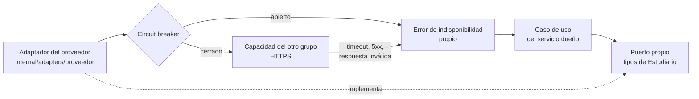

# ADR-009: Consumo del proveedor

- **Estado:** Propuesta (pendiente de asignación del proveedor)
- **Fecha:** 2026-10-19
- **Decisión del enunciado:** D9
- **Reemplaza a:** —

## Contexto

El enunciado (4.1) pide que cada grupo **consuma una capacidad publicada por otro grupo**, asignada por la cátedra. La capacidad tiene que incorporarse en **algún flujo importante** del sistema: una llamada aislada, una pantalla de prueba o una integración sin consecuencias sobre el negocio no se consideran válidas. Además:

- la comunicación tiene que hacerse **desde el microservicio responsable de la funcionalidad** que usa la capacidad, y **no** desde el frontend ni a través del punto de entrada propio (el api-gateway);
- el consumidor trabaja **a partir del contrato y la documentación publicados**, sin explicaciones privadas;
- el grupo consumidor tiene que implementar la integración respetando el contrato, incluir un **test de contrato** que detecte cambios incompatibles, definir **tiempos de espera y tratamiento de errores**, decidir **qué ve el usuario cuando el proveedor falla** y demostrarlo en la jornada de fallas controladas.

La decisión D9 tiene que justificar la incorporación de la capacidad externa, la adaptación al contrato y el comportamiento ante errores, cambios o indisponibilidad.

**Situación actual.** La cátedra **todavía no asignó** qué grupo es nuestro proveedor ni qué capacidad vamos a consumir (ver el README: la capacidad compartida se pospuso para una entrega posterior). Por eso este ADR es una **versión preliminar**: fija el criterio que se va a aplicar con cualquier proveedor, para que la integración se haga rápido y de forma uniforme cuando llegue la asignación, y deja explícito qué falta definir.

Lo que ya está decidido y este ADR toma como base:

- **[ADR-001](ADR-001-limites-de-servicios.md):** la capacidad de otro grupo se consume desde el servicio responsable de la funcionalidad que la usa, nunca desde el frontend ni a través del gateway.
- **[ADR-002](ADR-002-arquitectura-interna.md):** planner-service es hexagonal, con puertos en `internal/app` y adaptadores de salida en `internal/adapters`; forum-service es por capas, y sólo el repositorio habla con sistemas externos.
- **[ADR-005](ADR-005-comunicacion.md):** timeouts escalonados de afuera hacia adentro, a lo sumo un reintento por salto y sólo en operaciones idempotentes, errores en *Problem Details* y `X-Correlation-Id` propagado.
- **[ADR-010](ADR-010-resiliencia.md):** una dependencia externa caída no puede impedir la acción principal. Para la IA ya se usa un *circuit breaker* con [`sony/gobreaker`](https://github.com/sony/gobreaker) y una degradación controlada (motor de reglas y aviso `AI_FALLBACK`).
- **[ADR-008](ADR-008-contrato-propio.md):** como proveedores, publicamos un contrato OpenAPI con mock en Prism y le pedimos al consumidor un lector tolerante. Del lado consumidor aplicamos lo mismo que esperamos de los demás.

## Opciones consideradas

**Desde dónde se llama al proveedor**

1. **Desde el frontend.** Es lo más rápido de conectar, pero el enunciado lo prohíbe, expondría las credenciales del proveedor en el navegador y dejaría la regla de negocio fuera del backend.
2. **A través del api-gateway.** También lo prohíbe el enunciado, y el gateway no tiene lógica de negocio (ADR-001): no sabría qué hacer con la respuesta ni cómo degradar.
3. **Desde el servicio dueño de la funcionalidad (elegida).** Es quien sabe para qué se usa la capacidad, qué hacer si falla y cómo combinar su resultado con los datos propios.

**Cómo se adapta el contrato externo**

1. **Usar los tipos del proveedor en todo el servicio.** Es menos código, pero cada cambio del proveedor (un campo renombrado, un valor nuevo) obliga a tocar casos de uso y reglas de negocio, y sus nombres y formatos se mezclan con los nuestros.
2. **Un adaptador que traduce el contrato externo a tipos propios (elegida).** Es una capa anticorrupción: el resto del servicio sólo conoce un puerto con tipos de Estudiario. Un cambio del proveedor se resuelve dentro del adaptador.

**Cómo se protege la llamada**

1. **Sólo timeout.** Evita esperas infinitas, pero mientras el proveedor está caído cada pedido espera el timeout completo y le sigue mandando tráfico a un sistema que ya está fallando.
2. **Timeout, reintento acotado y *circuit breaker* (elegida).** Es el mismo esquema que ya se usa con la IA (ADR-010), con la misma librería: el equipo ya lo conoce y lo probó.

**Forma de la comunicación** *(se decide con el contrato real)*

1. **Llamada síncrona en el momento en que se necesita el dato.** Es lo más probable, porque la mayoría de las capacidades publicadas son APIs REST.
2. **Copia local alimentada por eventos o por consulta periódica.** Desacopla del proveedor, pero sólo tiene sentido si la capacidad es de lectura de datos que cambian poco y el contrato publica eventos.

## Decisión

Este criterio se aplica a cualquier proveedor que asigne la cátedra.

### 1. Dónde se integra

- La capacidad se consume desde el **servicio dueño del flujo** en el que se usa. Si se usa en el plan de estudio, es planner-service; si se usa en el foro, es forum-service. El frontend y el api-gateway nunca hablan con el proveedor.
- Se incorpora a un **flujo importante** del sistema, no a una pantalla aparte: su resultado tiene que cambiar algo que el usuario ve o decide en ese flujo.

### 2. Adaptador que traduce el contrato

- **Puerto propio.** El servicio define una interfaz con nombres y tipos de Estudiario (en planner-service, junto a los demás puertos en `internal/app/ports.go`; en forum-service, como un repositorio más). Los casos de uso y el dominio sólo conocen ese puerto.
- **Adaptador.** Implementa el puerto con un cliente HTTP del contrato del proveedor. Es el único lugar del código que conoce sus rutas, sus encabezados, sus nombres de campos y sus códigos de error, y los traduce a tipos y errores propios.
- **Lector tolerante.** El adaptador ignora los campos de respuesta que no conoce y acepta valores nuevos en los campos de tipo enumerado cuando el contrato lo permite, como pedimos nosotros en el ADR-008. Valida lo que sí usa: si falta un campo obligatorio o tiene un formato inválido, la respuesta se trata como inválida.
- **Configuración** por variables de entorno: URL base, API key, timeout y versión del contrato. Las credenciales van sólo en el `.env` local y en los secretos de la plataforma de nube, nunca en el repositorio.

### 3. Tiempos de espera y reintentos

| Parámetro | Valor inicial | Criterio |
|---|---|---|
| Timeout por intento | **2 s** | Corto, porque se suma al tiempo del pedido del usuario. Se ajusta con la latencia real del proveedor y con lo que publique en su contrato. |
| Presupuesto total de la llamada | **3 s**, reintento incluido | Tiene que entrar dentro del timeout del api-gateway hacia el servicio (5 s, o 12 s en la propuesta del plan, ADR-005), dejando lugar para el resto del pedido. Si la capacidad se usa en la propuesta del plan junto con la IA, se llama en paralelo con la IA, para no sumar los dos tiempos y seguir respondiendo en menos de 10 s. |
| Reintentos | **A lo sumo 1**, con espera de 200 ms ± 20 %, sólo si queda presupuesto | **Sólo operaciones idempotentes:** lecturas, o escrituras con la clave de idempotencia que el contrato del proveedor ofrezca (por ejemplo, `Idempotency-Key`). Una escritura sin clave nunca se reintenta, porque no se sabe si el proveedor la aplicó. Sólo se reintenta ante error de conexión, timeout, `429` (respetando `Retry-After` si entra en el presupuesto), `502`, `503` o `504`. |
| *Circuit breaker* | Se abre con **3 fallas seguidas**, queda abierto **30 s** y deja pasar **un pedido de prueba** | Mismos valores y misma librería que el de la IA (ADR-010). Con el circuito abierto, la respuesta degradada sale en milisegundos. Un pedido cancelado por el propio usuario no cuenta como falla. |

Toda llamada usa un `context.Context` con *deadline*: cuando vence, se cancela y se descarta cualquier respuesta tardía (ADR-005).

### 4. Tratamiento de errores

| Lo que pasa con el proveedor | Cómo lo trata el adaptador | ¿Cuenta para el *circuit breaker*? |
|---|---|---|
| No responde a tiempo, error de red, `502`, `503`, `504` | Reintento si corresponde; si sigue fallando, error de **indisponibilidad** | Sí |
| `429` (cupo superado) | Reintento sólo si `Retry-After` entra en el presupuesto; si no, error de **indisponibilidad** | Sí |
| `500` | Error de **indisponibilidad**, sin reintento (puede no ser transitorio) | Sí |
| `401` o `403` | Error de **configuración** (API key vencida o mal cargada). Log `ERROR` y alerta: no se arregla reintentando. | Sí |
| `400` o `422` | Error de **integración**: le mandamos algo que su contrato no acepta. Log `ERROR` con el `code` del proveedor. No se reintenta. | No (el proveedor funciona; el error es nuestro) |
| `404` sobre un recurso que tiene que existir | Se traduce al error propio que corresponda (por ejemplo, "no encontrado") | No |
| `200` con una respuesta que no cumple el contrato | Respuesta **inválida**: se descarta y se trata como indisponibilidad | Sí |

Los errores del proveedor **nunca se le muestran tal cual al usuario** ni se devuelven como `5xx` de nuestro servicio por una falla ajena: el adaptador los traduce y el caso de uso decide cómo degradar.

### 5. Qué ve el usuario si el proveedor falla

- **La acción principal nunca se bloquea por el proveedor.** Confirmar el plan y moderar resúmenes no pueden depender de un sistema que no controlamos (ADR-010).
- Si la capacidad **complementa** un flujo (agrega información o una sugerencia), el flujo termina igual sin ese aporte, y la respuesta trae un **aviso** en `warnings`, igual que `AI_FALLBACK` en la propuesta del plan. El frontend muestra un mensaje claro y no técnico (por ejemplo, "Esta información no está disponible en este momento"), y el resto de la pantalla funciona.
- Si la capacidad **es la funcionalidad** (no hay forma de hacerla sin el proveedor), sólo esa función responde con un error controlado y su `code` estable en *Problem Details*, y la interfaz la muestra como temporalmente no disponible, con la opción de reintentar. El resto del sistema sigue funcionando.
- Siempre que se pueda, se ofrece una **alternativa propia** (como el motor de reglas frente a la IA) o el **último resultado válido** guardado, indicando que puede no estar actualizado. Cuál se usa depende de la capacidad asignada.
- El usuario nunca espera más que el presupuesto de la llamada: con el circuito abierto, la respuesta degradada es inmediata.

### 6. Cambios del proveedor y test de contrato

- **Versión fijada.** El adaptador declara qué versión del contrato del proveedor implementa (la versión mayor en la ruta o en el encabezado que el proveedor defina). Se guarda una copia del contrato que se implementó junto al adaptador, en su carpeta `testdata/`.
- **Test de contrato (pedido por el enunciado).** Un test del adaptador que:
  1. valida que **los pedidos** que arma el adaptador cumplen el contrato del proveedor (rutas, encabezados, campos obligatorios y formatos);
  2. valida que el adaptador **entiende las respuestas** del contrato, usando los ejemplos publicados por el proveedor y su mock (por ejemplo, Prism sobre su OpenAPI, como hacemos nosotros en el ADR-008), incluidos los casos de error;
  3. corre contra la **versión publicada** del contrato del proveedor y falla si aparece un cambio incompatible con lo que usamos: un campo que leemos que desaparece o cambia de tipo, un campo obligatorio nuevo en el pedido, una ruta que cambia.
- Además, se compara la copia guardada con la publicada con una herramienta de detección de cambios incompatibles (por ejemplo, `oasdiff breaking`, la misma que proponemos en el ADR-008 para nuestro propio contrato).
- **Tests del adaptador** con un servidor HTTP falso (`httptest`), como los del cliente de la IA: respuesta válida, timeout, `5xx`, `429`, `4xx`, respuesta inválida, reintento y apertura del circuito.
- **Ante un cambio incompatible del proveedor:** se avisa al grupo proveedor, se sigue usando la versión anterior mientras la mantenga, y se actualiza el adaptador. Ni el puerto ni los casos de uso cambian.

### 7. Observabilidad

- Cada llamada propaga el `X-Correlation-Id` y el `traceparent` del pedido, si el proveedor los acepta, y tiene su propio span en la traza ([ADR-011](ADR-011-observabilidad.md)).
- Métricas: duración y resultado de cada llamada (éxito, timeout, error por tipo, respuesta inválida), cantidad de respuestas degradadas y estado del *circuit breaker*.
- Cada degradación deja un log `WARN` con el `correlationId`, el motivo y el tiempo esperado, como el de la IA. Los errores de configuración y de integración son `ERROR`.

### 8. Demostración en la jornada de fallas

Con el sistema levantado, se provoca la falla del proveedor de alguna de estas formas: apuntando la URL base a una dirección que no responde, usando una API key inválida, o usando su mock forzando respuestas de error. Se muestra que el flujo sigue funcionando con la degradación definida, que el aviso llega al usuario, que el *circuit breaker* se abre en el log y en el tablero, y que al restablecer la configuración vuelve a usarse el proveedor. El resultado se registra en `docs/POSTMORTEM.md`.

### Pendiente cuando la cátedra asigne el proveedor

- Qué capacidad se consume, de qué grupo y con qué contrato.
- En qué flujo se incorpora y, por lo tanto, qué servicio la consume.
- Si es una llamada síncrona o una copia local (opciones de forma de la comunicación).
- Qué ve exactamente el usuario cuando falla: aviso, alternativa propia o último resultado válido.
- Los valores concretos de timeout y presupuesto, según la latencia real del proveedor.

Con eso se escribe un nuevo ADR que **reemplaza a este**, indicando qué cambió y por qué, sin borrar esta versión.

## Consecuencias

**Positivas**

- Cuando llegue la asignación, la integración ya tiene definidos el lugar, la forma del adaptador, los tiempos, el tratamiento de errores y el test de contrato: sólo falta aplicarlos a una capacidad concreta.
- La caída o la lentitud del proveedor no se propaga: el timeout acota la espera, el *circuit breaker* deja de insistir y la acción principal sigue funcionando.
- Un cambio del proveedor queda contenido en el adaptador y lo detecta el test de contrato antes de llegar a producción.
- Se reutilizan el esquema y la librería de resiliencia que ya se usan con la IA, así que el equipo ya sabe implementarlos y probarlos.

**Negativas / limitaciones aceptadas**

- Hasta que la cátedra asigne el proveedor, este requisito del enunciado no se puede implementar ni demostrar.
- El adaptador y la copia del contrato son código y documentación extra que hay que mantener al día con el proveedor.
- Mientras el circuito está abierto, el proveedor no se usa durante 30 s aunque ya se haya recuperado.
- Dependemos de que el contrato del otro grupo sea procesable (OpenAPI u otro formato estándar) para el test de contrato. Si no lo es, el test se escribe a mano a partir de sus ejemplos.
- Los valores de este ADR son iniciales y pueden cambiar con la latencia real del proveedor.

**A validar cuando se asigne el proveedor**

- Que la capacidad entre en un flujo importante y no en una pantalla aparte.
- Que el test de contrato detecte un cambio incompatible (por ejemplo, quitando un campo en una copia del contrato).
- Medir la latencia real del proveedor y ajustar el timeout y el presupuesto.
- Demostrar en la jornada de fallas lo que ve el usuario cuando el proveedor falla.
