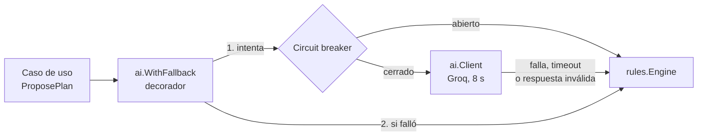

# ADR-010: Resiliencia

- **Estado:** Propuesta (se valida con la caída provocada)
- **Fecha:** 2026-10-19
- **Decisión del enunciado:** D10
- **Reemplaza a:** —

## Contexto

Estudiario depende de piezas que pueden fallar o responder lento: un proveedor externo de IA (Groq), un servidor de mail, dos bases de datos (PostgreSQL y MongoDB), un broker (RabbitMQ), un almacenamiento de objetos (MinIO), un índice de búsqueda (Apache Solr) y una caché (Memcached). El enunciado pide identificar las dependencias de cada servicio, decidir qué pasa cuando cada una falla o se pone lenta, elegir los mecanismos que contienen la falla y demostrarlo con una caída provocada.

Lo que ya está decidido y este ADR toma como base:

- **ADR-001:** no hay llamadas síncronas entre servicios propios, y una dependencia externa caída no debe impedir usar el resto del sistema.
- **ADR-005:** timeouts escalonados de afuera hacia adentro, a lo sumo un reintento por salto y sólo en operaciones idempotentes, *outbox* en forum-service, reintentos con espera y *dead letter queues* en el consumo de eventos.
- **SPEC:** RN-09 (si la IA no está disponible, el plan se arma con reglas fijas), RN-14 (una confirmación no se duplica), RN-26 (plazo de 1 minuto para la búsqueda) y RN-32 a RN-34 (cada moderación genera exactamente un mail, la moderación no depende del mail y los mails que fallan quedan registrados).

El ADR-005 dejó pendiente evaluar un *circuit breaker* para la IA. Este ADR lo resuelve.

## Opciones consideradas

**Ante una IA caída o lenta**

1. **Devolver un error al estudiante.** Es lo más simple, pero contradice RN-09 y deja al estudiante sin poder planificar por una falla ajena.
2. **Sólo timeout y motor de reglas.** Cumple RN-09, pero mientras la IA está caída cada pedido espera hasta 8 s antes de recurrir a las reglas, y cada pedido sigue cargando a un proveedor que ya está fallando.
3. **Timeout, motor de reglas y *circuit breaker* (elegida).** Después de varias fallas seguidas se deja de llamar a la IA por un rato, y la propuesta por reglas sale enseguida.

**Implementación del *circuit breaker***

1. **Hecho a mano.** Son pocas líneas, pero el manejo de estados y la concurrencia (varios pedidos a la vez en estado *half-open*) son fáciles de hacer mal y difíciles de probar.
2. **Librería de resiliencia completa** (por ejemplo, *failsafe-go*). Trae reintentos, *bulkheads* y políticas combinables, pero los timeouts y reintentos ya están resueltos con `context` y no hace falta el resto.
3. **[`sony/gobreaker`](https://github.com/sony/gobreaker) v2 (elegida).** Es la librería de *circuit breaker* más usada en Go, chica, con tipos genéricos y sin dependencias. Hace una sola cosa.

**Dónde poner un *circuit breaker***

Se evaluó ponerlo también delante de PostgreSQL, MongoDB y Solr. No se hace: frente a una base de datos caída no hay alternativa que ofrecer (el pedido falla igual) y los timeouts cortos ya evitan que se acumulen pedidos esperando. El *circuit breaker* sólo tiene sentido donde existe una alternativa más barata, y eso pasa únicamente con la IA.

## Decisión

### 1. Dependencias por servicio y comportamiento ante fallas

Los timeouts entre componentes propios y hacia la IA son los del [ADR-005](ADR-005-comunicacion.md). Los de las dependencias de infraestructura son nuevos: se fijan acá y se ajustan con las mediciones de las pruebas de carga.

#### api-gateway

| Dependencia | Timeout | Si falla | Si responde lento |
|---|---|---|---|
| users-service | 3 s | `503 UPSTREAM_UNAVAILABLE`. Registro e inicio de sesión no funcionan, pero quien ya tiene sesión sigue usando el sistema: el JWT se valida en el gateway sin llamar a users-service. | `504 UPSTREAM_TIMEOUT` |
| planner-service | 5 s (12 s para pedir una propuesta) | `503 UPSTREAM_UNAVAILABLE`. El foro sigue funcionando. | `504 UPSTREAM_TIMEOUT` |
| forum-service (2 instancias) | 5 s (20 s para subir un PDF) | Si cae una instancia, el chequeo de `GET /health` la saca del balanceo y la otra atiende todo. Si caen las dos, `503`. El detalle va en el ADR-012 (D12). | `504 UPSTREAM_TIMEOUT` |

#### users-service

| Dependencia | Timeout | Si falla | Si responde lento |
|---|---|---|---|
| PostgreSQL (`users`) | 3 s por consulta | `503 SERVICE_UNAVAILABLE` en registro e inicio de sesión. No hay alternativa: sin la base no se pueden verificar credenciales. | Se corta la consulta al vencer el timeout y se responde `503`. |

#### planner-service

| Dependencia | Timeout | Si falla | Si responde lento |
|---|---|---|---|
| **Proveedor de IA (Groq)** | **8 s de presupuesto total**: un intento de hasta 6 s y, como mucho, un reintento si falló rápido (ADR-005) | La propuesta se arma con el **motor de reglas** (RN-09). La respuesta es igual de válida, con `generatedBy: reglas` y el aviso `AI_FALLBACK`. Si falla 3 veces seguidas, se abre el *circuit breaker*. | Al vencer el presupuesto se cancela la llamada, se descarta cualquier respuesta tardía y se usa el motor de reglas. |
| **Respuesta inválida de la IA** | — | Si el JSON no tiene la forma pedida o el plan no cumple las reglas RN-06 y RN-10 a RN-13, se descarta y se usa el motor de reglas. Cuenta como falla para el *circuit breaker*. | — |
| PostgreSQL (`planner`) | 3 s por consulta; la confirmación, en una única transacción | `503 SERVICE_UNAVAILABLE`. La confirmación es todo o nada: si la base se cae en el medio, la transacción se revierte y no queda ninguna sesión reservada. El cliente reintenta con la misma `Idempotency-Key` sin riesgo de duplicar (RN-14). | La consulta se cancela con el contexto y se responde `503`. |
| Capacidad de otro grupo | A definir | Se define en el ADR-009 (D9) cuando la cátedra asigne el proveedor. La regla es la misma: su caída no puede impedir la acción principal. | — |

#### forum-service

| Dependencia | Timeout | Si falla | Si responde lento |
|---|---|---|---|
| MongoDB (`forum`) | 3 s por operación | Publicar, moderar y calificar responden `503`. El listado y el detalle que estén en Memcached se siguen sirviendo hasta que vence su entrada. | Se corta la operación y se responde `503`. |
| MinIO | 10 s para subir, 5 s para descargar | Subir un resumen o descargar un PDF responde `503`. El resto del foro (búsqueda, moderación, calificaciones) funciona. | Igual que una falla. |
| Apache Solr | 2 s por búsqueda | La búsqueda responde `503 SEARCH_UNAVAILABLE`; el resto del foro sigue. Como el índice es derivado, cuando Solr vuelve el indexador procesa los eventos pendientes y la reconciliación periódica corrige lo que falte (ADR-006, D6). | Igual que una falla: la búsqueda no espera más de 2 s. |
| Memcached | 100 ms | **Nunca es un error.** Se trata como un *cache miss* y se lee de MongoDB. El foro se vuelve más lento, pero sigue funcionando. | Igual que una falla. |
| RabbitMQ | 5 s por publicación (*publisher confirm*) | La moderación termina igual: el evento queda en el *outbox* del documento y el *relay* reintenta con espera exponencial (1 s, 2 s, 4 s… hasta 30 s). Cuando el broker vuelve, se publica (RN-33). | El *relay* trata la confirmación vencida como falla y reintenta. Puede publicar dos veces, y los consumidores descartan duplicados por `eventId`. |

#### notification-service

| Dependencia | Timeout | Si falla | Si responde lento |
|---|---|---|---|
| RabbitMQ | — | El consumidor se reconecta con espera exponencial. Los mensajes son persistentes y quedan en la cola hasta que vuelve. | — |
| MongoDB (`notifications`) | 3 s | No se puede registrar el `eventId`, así que el mail **no se envía** (si no, se perdería la idempotencia). El mensaje pasa a `notifications.retry` y se reintenta. | Igual que una falla. |
| Servidor de mail (SMTP) | 10 s | Reintentos con espera de 5 s, 15 s, 45 s, 2 min 15 s y 6 min 45 s. Si se agotan, el mensaje va a `notifications.dlq` y el registro queda `fallido` (RN-34). Las demás notificaciones siguen saliendo. | Igual que una falla. |

### 2. Mecanismos elegidos

| Mecanismo | Dónde | Para qué |
|---|---|---|
| **Timeouts con `context.Context`** | Toda llamada saliente y toda consulta a una base, en todos los servicios | Que una dependencia lenta no retenga pedidos ni conexiones. Al vencer el *deadline* se cancela el trabajo pendiente y se descarta la respuesta tardía. |
| **Reintentos acotados** | Gateway (sólo `GET`/`HEAD`, 1 vez), planner-service → IA (1 vez, dentro de los 8 s) y consumidores de eventos (con espera exponencial) | Superar fallas transitorias sin amplificar una caída. Nunca se reintenta una escritura sin clave de idempotencia (ADR-005). |
| **Degradación al motor de reglas** | planner-service | Que el estudiante y el grupo consumidor siempre reciban un plan válido aunque la IA no esté (RN-09). |
| ***Circuit breaker*** | planner-service, delante de la IA | Dejar de esperar a una IA que está fallando. |
| ***Outbox*** | forum-service | Que ningún evento de moderación se pierda si RabbitMQ está caído (RN-32, RN-33). |
| **Consumo idempotente** | notification-service y el indexador | Tolerar la entrega "al menos una vez" sin mandar mails duplicados. |
| **Cola de reintento y DLQ** | `notifications.retry`, `notifications.dlq` y `forum.search-indexer.dlq` | Que un mensaje que falla no frene a los demás y quede guardado para revisarlo y reinyectarlo (RN-34). |
| **Chequeo de salud y balanceo** | api-gateway → instancias de forum-service | Sacar del balanceo una instancia caída (ADR-012). |

#### Implementación en planner-service

El puerto `PlanGenerator` (ver `internal/app/ports.go`) tiene dos implementaciones, el agente de IA (`internal/adapters/ai`) y el motor de reglas (`internal/adapters/rules`), y un **decorador** que las combina:

- El caso de uso no sabe que existen dos generadores: recibe siempre un `app.Proposal`, que indica quién lo armó (`GeneratedBy`) y los avisos (`Warnings`).
- El cliente de la IA valida la respuesta con `domain.ValidatePlan`, la misma función que usa la confirmación. Así una propuesta de la IA nunca puede ser peor que una por reglas: si no se podría confirmar, se descarta.
- Cuando se usa el motor de reglas, el decorador escribe un log en JSON (`log/slog`) de nivel `WARN` con el `correlationId`, el motivo (`timeout`, `invalid_response`, `http_status`, `unavailable` o `circuit_open`), el error y el tiempo que se esperó. Los cambios de estado del *circuit breaker* también quedan en el log.
- **Valores del *circuit breaker*:** se abre con **3 fallas seguidas**, queda abierto **30 s** y después deja pasar **un pedido de prueba**. Si ese pedido funciona, se cierra; si falla, vuelve a abrirse otros 30 s. Un pedido cancelado por quien lo hizo no cuenta como falla de la IA.
- Con el circuito abierto, una propuesta por reglas tarda milisegundos en lugar de los 6 a 8 s del timeout.
- La configuración va por variables de entorno (`AI_API_KEY`, `AI_MODEL`, `AI_BASE_URL`, `AI_TIMEOUT`). La clave vive sólo en el `.env` local, que no se versiona. Sin clave, el servicio funciona sólo con el motor de reglas.

Los tests unitarios del adaptador (`client_test.go`) levantan un servidor HTTP falso con `httptest` y verifican la respuesta válida, el timeout, el JSON inválido, el error `5xx`, la propuesta que no cumple las reglas, el reintento y la apertura del circuito. En los casos de timeout, JSON inválido y error `5xx` se comprueba, a través del decorador, que la propuesta la arma el motor de reglas, que trae `AI_FALLBACK` y que el log tiene el `correlationId`.

### 3. Cómo se demuestra la caída provocada

La demostración se hace con el sistema levantado con `docker compose`, y cada escenario se puede repetir con los mismos pasos. Durante cada escenario se muestran la respuesta que recibe el usuario, los logs filtrados por `correlationId` y las métricas del tablero de observabilidad (ADR-011, D11). El informe queda en [`docs/POSTMORTEM.md`](../POSTMORTEM.md).

**Escenario principal: la IA no responde (CA-05)**

1. Con el sistema funcionando, se pide un plan y se muestra que llega con `generatedBy: ia`.
2. Se provoca la falla de una de estas dos formas:
   - **IA que no responde:** se reinicia planner-service con `AI_BASE_URL` apuntando a una dirección que no contesta (por ejemplo `http://10.255.255.1`). Cada llamada agota el timeout.
   - **IA que rechaza los pedidos:** se reinicia planner-service con una `AI_API_KEY` inválida, y el proveedor responde `401`.
3. Se pide un plan: llega igual, con `generatedBy: reglas` y el aviso `AI_FALLBACK`, en menos de los 10 s comprometidos en el contrato. En el log aparece el `WARN` con el `correlationId` del pedido y el motivo.
4. Después del tercer pedido fallido, el log muestra que el *circuit breaker* pasó a `open`, y los pedidos siguientes se responden por reglas en milisegundos.
5. Se restablece la configuración. Pasados 30 s, el siguiente pedido prueba la IA, el circuito se cierra y los planes vuelven a llegar con `generatedBy: ia`.
6. Se confirma uno de los planes armados por reglas, para mostrar que la acción principal no se vio afectada.

**Escenarios complementarios**

| Escenario | Cómo se provoca | Qué se tiene que ver |
|---|---|---|
| Servidor de mail caído (CA-26) | `docker compose stop` del servidor SMTP local | La moderación se registra igual. Al levantarlo de nuevo, el autor recibe un único mail. |
| RabbitMQ caído | `docker compose stop rabbitmq` | La moderación responde normalmente y el evento queda pendiente en el *outbox*. Al volver el broker, se publica y llega el mail una sola vez. |
| Mail que falla siempre (CA-27) | SMTP configurado para rechazar los envíos | Después de los reintentos, el mensaje está en `notifications.dlq` y el registro queda `fallido`. Las demás notificaciones siguen saliendo. |
| Instancia del foro caída | `docker compose stop forum-service-1` | El gateway saca la instancia del balanceo y el foro sigue respondiendo desde `forum-service-2` (ADR-012). |
| Memcached caído | `docker compose stop memcached` | El foro responde sin errores, con más latencia. |
| Solr caído | `docker compose stop solr` | La búsqueda responde `503 SEARCH_UNAVAILABLE` y el resto del foro sigue. Al volver, el índice se pone al día. |

## Consecuencias

**Positivas**

- Una IA caída o lenta no se nota como error: el estudiante y el grupo consumidor siempre reciben un plan válido, y con el circuito abierto, sin esperar.
- La propuesta de la IA pasa por las mismas reglas que la confirmación, así que una respuesta mal armada del modelo nunca llega al estudiante.
- Ningún evento de moderación ni ningún mail se pierde por una caída de RabbitMQ, del servidor de mail o de la base de notificaciones.
- Las dependencias derivadas (Memcached y Solr) pueden caerse sin afectar los datos ni las operaciones que no las usan.
- Cada degradación deja un log con el `correlationId`, así la caída provocada se puede seguir pedido por pedido.

**Negativas / limitaciones aceptadas**

- Con el circuito abierto, durante 30 s todos los planes salen por reglas aunque la IA ya se haya recuperado.
- El estado del *circuit breaker* vive en memoria de cada instancia de planner-service. Con varias instancias, cada una abre su propio circuito. Se acepta para el volumen esperado.
- PostgreSQL y MongoDB son puntos únicos de falla en el entorno local: si se caen, las operaciones que dependen de ellos fallan con `503`. No se replican en este hito.
- Los timeouts de las dependencias de infraestructura son estimados y pueden cambiar con las mediciones.

**A validar con la caída provocada y las pruebas de carga**

- Medir la latencia real de Groq y confirmar que 6 s por intento y 8 s en total alcanzan en condiciones normales.
- Confirmar que 3 fallas seguidas y 30 s de circuito abierto son buenos valores: que el circuito no se abra por fallas aisladas ni tarde demasiado en volver a probar la IA.
- Medir cuánto tarda un mail en llegar después de que vuelven RabbitMQ o el servidor de mail.
