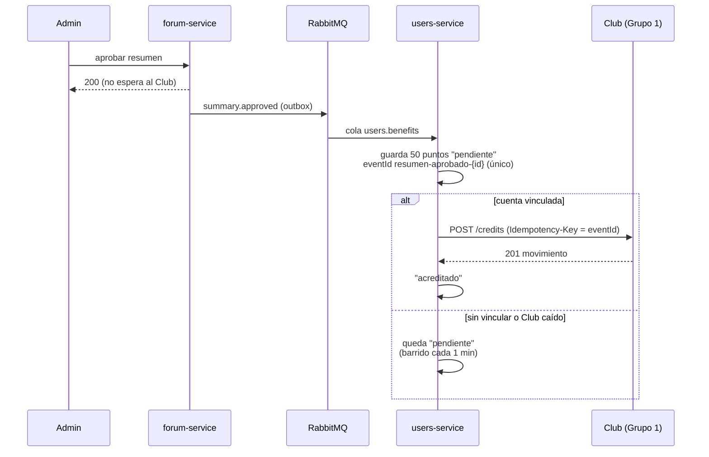

# ADR-015: Consumo del Club de Beneficios del Grupo 1

- **Estado:** Aceptada (implementada y probada contra el Club real el 2026-11-09)
- **Fecha:** 2026-11-09
- **Decisión del enunciado:** D9
- **Reemplaza a:** [ADR-009](ADR-009-consumo-del-proveedor.md) (criterio general de consumo, escrito antes de que la cátedra asignara el proveedor)

## Contexto

El [ADR-009](ADR-009-consumo-del-proveedor.md) fijó cómo consumir la capacidad de otro grupo cuando todavía no sabíamos cuál iba a ser: adaptador propio, timeouts, reintentos, *circuit breaker*, qué ve el usuario y test de contrato. Dejó pendiente qué capacidad, en qué flujo, desde qué servicio y con qué valores, y pidió escribir un ADR nuevo cuando llegara la asignación.

La cátedra asignó el **Club de Beneficios de Metalfitness (Grupo 1)**:

- URL: `https://metalfitness-club.vercel.app/partner-api/v2`. Contrato OpenAPI 3.1 **v2.0.0** (2026-11-08), copiado en [`docs/contracts/consumidos/club-beneficios-v2.yaml`](../contracts/consumidos/club-beneficios-v2.yaml).
- Operaciones: registrar o vincular una persona (`POST /v2/external-register`, asíncrona: responde `202` y termina cuando la persona confirma por mail), consultar ese registro, acreditar puntos, consultar el saldo y listar los movimientos hechos por Estudiario. No hay débitos ni canjes.
- API key de Estudiario en `X-API-Key`. Las escrituras exigen `Idempotency-Key` y un `eventId` propio, que el Club deduplica aunque cambie la clave.
- Su gateway corta a los **5 s**. Medimos ~1,9 s en una lectura con el despliegue frío.

El SPEC ya tenía la regla de negocio (RF-28, RN-42 a RN-44): cuando un administrador aprueba un resumen de un estudiante, esa participación se registra en el programa de beneficios, una sola vez, y la moderación no puede depender del Grupo 1.

## Opciones consideradas

**Qué servicio llama al Club**

1. **forum-service, dentro de la aprobación.** Es el dueño de la moderación, que es lo que dispara los puntos. Pero la aprobación pasaría a esperar a un sistema que no controlamos (hasta 5 s), y si el Club está caído habría que elegir entre bloquear la aprobación (contradice RN-43) o perder los puntos.
2. **notification-service, que ya consume `summary.approved`.** Ya tiene la cola, pero su responsabilidad es mandar mails, no administrar cuentas ni datos del usuario.
3. **users-service, consumiendo `summary.approved` (elegida).** Los puntos son del **usuario**, no del resumen: la vinculación con el Club (qué cuenta del Club es de qué estudiante) es un dato de la cuenta, y su dueño es users-service ([ADR-001](ADR-001-limites-de-servicios.md)). Además el perfil, que es donde se ve el saldo, ya es de users-service. El evento llega por RabbitMQ con reintentos y DLQ, así que la aprobación no espera al Club.

**Cómo se vincula la cuenta**

1. **Vincular automáticamente a todos los usuarios al registrarse.** Mandaría al Club los datos de personas que no lo pidieron, y el Club les mandaría un mail que no esperan.
2. **Vincular a pedido desde el perfil (elegida).** El estudiante decide. Los puntos que gana antes de vincular no se pierden: quedan pendientes y se acreditan al completar la vinculación.

**Qué pasa con los puntos si el Club no responde**

1. **Sólo reintentos de la cola.** Agotados (unos 10 minutos), el mensaje va a la DLQ y los puntos quedarían sin acreditar hasta que alguien reprocese la DLQ a mano.
2. **Guardar los puntos antes de llamar y barrer los pendientes (elegida).** Los puntos se guardan en la base de users-service con su `eventId` antes de llamar al Club. La cola reintenta, y además un barrido cada minuto acredita lo pendiente. Aunque el mensaje termine en la DLQ, los puntos se acreditan solos cuando el Club vuelve (RN-43).

## Decisión

### Flujo

| Paso | Qué hace users-service |
|---|---|
| **Vincular** (`POST /api/users/me/club`) | Manda `external-register` con nombre, mail, `externalUserId = estudiario-{id}` y `eventId = vinculo-{id}`, fijos por usuario: repetirlo no crea otra cuenta. Guarda la vinculación como `pendiente` y responde `202`. Si el Club no responde, queda igual `pendiente` con el aviso `CLUB_UNAVAILABLE` y el barrido la vuelve a mandar. |
| **Completar la vinculación** | Al consultar el perfil y en cada barrido, pregunta `external-registrations/{eventId}`. Con `completed`, la marca `vinculada` y acredita los puntos que el estudiante ganó antes. Si el Club responde `404` (nunca recibió el pedido), lo vuelve a mandar con el mismo `eventId`. |
| **Ganar puntos** (RF-28) | Consume `summary.approved` de su cola `users.benefits`. Si `awardBenefits` es `false` (documentos de sistemas externos, RN-41) no hace nada. Si no, guarda **50 puntos** con `eventId = resumen-aprobado-{summaryId}`; la clave primaria impide guardarlos dos veces (RN-42). Si el autor está vinculado, los acredita con `Idempotency-Key = eventId`. |
| **Ver puntos** (`GET /api/users/me/club`) | Estado de la vinculación, saldo, últimos 10 movimientos y puntos pendientes. |

### Valores (ajustados con la latencia real)

| Parámetro | ADR-009 | Ahora | Por qué |
|---|---|---|---|
| Timeout por intento | 2 s | **4 s** | El Club tarda ~2 s con el despliegue frío; 2 s cortaría pedidos sanos. Queda por debajo de los 5 s de su gateway. |
| Presupuesto de la llamada | 3 s | **6 s**, reintento incluido | Entra en el timeout del api-gateway hacia users-service. Las acreditaciones no lo usan desde un pedido del usuario: van por la cola. |
| Reintentos | 1 | **1**, a los 200 ms ± 20 % (o `Retry-After`) | Sólo ante error de red, timeout, `429`, `502`, `503`, `504` o `409 IDEMPOTENCY_IN_PROGRESS`, siempre con la misma `Idempotency-Key`. Nunca ante `500` ni `4xx`. |
| *Circuit breaker* | 3 fallas, 30 s, 1 de prueba | **igual** | Misma librería que la IA (`sony/gobreaker`). Cuentan como falla la indisponibilidad y la API key rechazada; un `404` o un `400` no, porque son problemas del pedido. |
| Reintentos de la cola | — | 5 s, 15 s, 45 s, 2 min 15 s, 6 min 45 s, después DLQ | Los mismos que notification-service ([ADR-005](ADR-005-comunicacion.md)). |
| Barrido | — | **cada 1 min**, hasta 50 vinculaciones y 50 acreditaciones | Corta en cuanto el Club vuelve a fallar. |

### Errores del Club

| Respuesta | Qué hace |
|---|---|
| Timeout, red, `429`, `5xx`, respuesta que no cumple el contrato, circuito abierto | **Indisponible.** En la cola: reintento y después DLQ (los puntos siguen pendientes). En el perfil: `200` con `warning: CLUB_UNAVAILABLE`. |
| `404 ACCOUNT_NOT_FOUND` | La cuenta no está vinculada: los puntos quedan pendientes. |
| `401` / `403` | Mal configurado (API key). Log `ERROR`; los puntos quedan pendientes hasta que se corrija. No se reintenta desde la cola. |
| `400` / `409 IDEMPOTENCY_CONFLICT` | Rechazado: no se arregla reintentando. La acreditación queda `rechazado` con el motivo, y en el perfil al vincular se responde `422 CLUB_REJECTED`. |

### Qué ve el usuario

- **La aprobación nunca espera al Club** ni falla por él: responde en milisegundos aunque el Club esté caído.
- En el **perfil**, si el Club no responde: el estado de la vinculación y los puntos pendientes se ven igual, sin el saldo, con el aviso *"No pudimos consultar tus puntos ahora. Tus puntos no se pierden."* (`warning: CLUB_UNAVAILABLE`).
- Con el circuito abierto, la respuesta degradada es inmediata.

### Test de contrato

[`internal/club/contract_test.go`](../../services/users-service/internal/club/contract_test.go) lee el OpenAPI del Club y comprueba:

1. que existen las 5 operaciones que usamos y que los pedidos que arma el adaptador cumplen el contrato: campos obligatorios, ningún campo desconocido (`additionalProperties: false`), patrones y encabezados obligatorios;
2. que los campos de las respuestas que leemos siguen siendo obligatorios, y que el adaptador entiende todos los ejemplos del contrato;
3. que los códigos de error que traducimos siguen documentados.

Corre contra la copia guardada y, con `CLUB_CONTRACT_LIVE=1`, también contra el contrato publicado en GitHub. Se comprobó que falla si se quita `balance` de los obligatorios del saldo o si la acreditación exige un campo nuevo. Además, [`club_test.go`](../../services/users-service/internal/club/club_test.go) prueba el adaptador con un Club falso: éxito, cada error, timeout, reintento, respuesta inválida y apertura del circuito.

Para desarrollar sin internet y para la jornada de fallas hay un mock con Prism sobre la copia del contrato (`club-mock`, puerto 4011; `CLUB_BASE_URL=http://club-mock:4010`).

### Seguridad

- La API key va sólo en el `.env` (y en el de la nube). La usa únicamente users-service: nunca el frontend ni el api-gateway.
- Los logs no tienen la API key ni el `externalUserId` (la ruta se loguea como `/v2/accounts/{externalUserId}/...`). Sí guardan el `correlationId` que devuelve el Club, para reportarle un problema.

## Consecuencias

**Positivas**

- La capacidad del Grupo 1 entra en un flujo importante (la moderación del foro) y cambia algo que el estudiante ve: sus puntos.
- La moderación no depende del Club: los puntos se guardan primero y se acreditan cuando se puede, sin intervención manual.
- Nunca se acredita dos veces: la clave primaria en nuestra base, la `Idempotency-Key` y el `eventId` del Club protegen lo mismo en las dos puntas. En la prueba, `summary.approved` llegó dos veces (lo publicaron las dos instancias del foro) y se acreditó una sola.
- Todo lo que sabe del Club está en `internal/club`: un cambio del proveedor no toca los casos de uso.

**Negativas / limitaciones aceptadas**

- Los puntos no son instantáneos: con el Club caído pueden tardar hasta 1 minuto después de que vuelva.
- Si llegan a la vez dos copias del mismo evento, las dos pueden llamar al Club. No se duplica porque el Club deduplica por `eventId`. Dependemos de esa garantía de su contrato, que verifica el test de contrato.
- La vinculación depende de que la persona confirme el mail del Club, y eso no lo controlamos. Mientras tanto, los puntos quedan pendientes.
- Eliminar un resumen aprobado no descuenta puntos (RN-44). Además, el contrato no ofrece débitos.
- El barrido corre en cada instancia de users-service. Hoy hay una; con más, se repetirían llamadas, que el Club deduplica.

## Validación (2026-11-09, contra el Club real)

| Prueba | Resultado |
|---|---|
| Vincular un usuario nuevo | `202 pendiente` en 2,9 s; el Club la completó y el perfil pasó a `vinculada` |
| Aprobar un resumen del usuario | Aprobación `200`; **+50 puntos** en el Club; el perfil muestra saldo 50 y el movimiento |
| El mismo `summary.approved` llegó dos veces | Un solo movimiento en el Club |
| Club caído (`CLUB_BASE_URL` a un host inexistente) y aprobar otro resumen | Aprobación `200` en 3 ms; perfil `200` con `CLUB_UNAVAILABLE` y 50 puntos pendientes; reintento en la cola y el *circuit breaker* se abrió |
| Restablecer el Club | En el siguiente barrido se acreditaron los 50 puntos: saldo 100, dos movimientos, ninguno duplicado |
| Tests | Unitarios del adaptador, del servicio y del consumidor; de integración contra PostgreSQL (5 inserciones simultáneas del mismo `eventId` guardan una); test de contrato contra la copia y contra el publicado |
