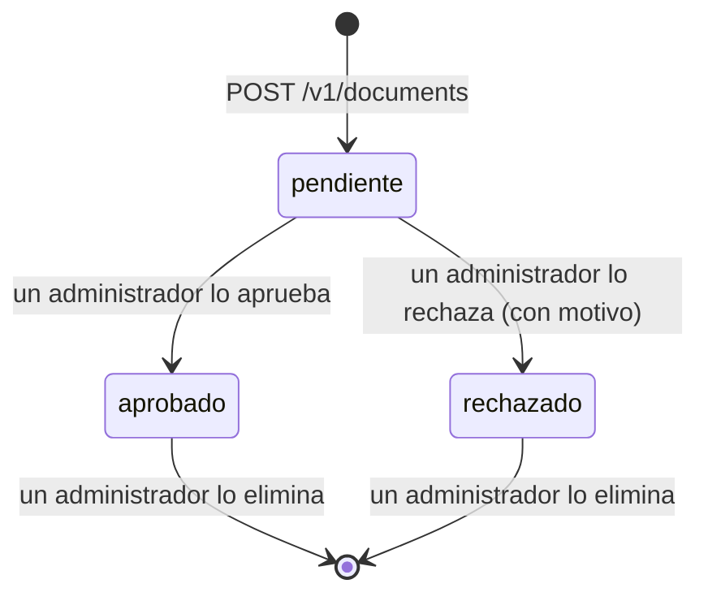

# Capacidad publicada: registro y consulta de documentos

Estudiario publica para otros grupos la capacidad de **registrar documentos en su foro y consultar los documentos publicados**: el consumidor sube un PDF con sus datos, un administrador de Estudiario lo modera y, una vez aprobado, cualquier consumidor lo puede buscar y descargar (RF-13 del [SPEC](../../SPEC.md)).

La cátedra asignó esta capacidad al **Grupo 4 (Agencia de viajes)**, que la usa para **guías de viaje compartidas**. El contrato no tiene nada propio del dominio de viajes: sirve para cualquier documento en PDF.

Este documento alcanza para integrarse sin hablar con nosotros. El contrato formal es [`documents-v1.yaml`](documents-v1.yaml) (OpenAPI 3.0.3). Si este README y el contrato no coinciden, vale el contrato. Las decisiones de diseño están en el [ADR-014](../adr/ADR-014-contrato-documentos.md).

> La capacidad que publicábamos antes, **generar un plan de estudio**, quedó retirada sin llegar a implementarse cuando la cátedra asignó la integración. Su contrato se conserva como historial en [`retirados/`](retirados/).

## Índice

1. [Versión vigente](#1-versión-vigente)
2. [Dónde está disponible](#2-dónde-está-disponible)
3. [Autenticación](#3-autenticación)
4. [Operaciones](#4-operaciones)
5. [Ciclo de vida de un documento](#5-ciclo-de-vida-de-un-documento)
6. [Qué se envía y qué se recibe](#6-qué-se-envía-y-qué-se-recibe)
7. [Idempotencia](#7-idempotencia)
8. [Tiempos de espera, reintentos y cupo de uso](#8-tiempos-de-espera-reintentos-y-cupo-de-uso)
9. [Errores](#9-errores)
10. [Ejemplos con curl](#10-ejemplos-con-curl)
11. [Mock para desarrollar y probar](#11-mock-para-desarrollar-y-probar)
12. [Versionado y compatibilidad](#12-versionado-y-compatibilidad)
13. [Cómo verificar la integración contra el contrato](#13-cómo-verificar-la-integración-contra-el-contrato)
14. [Historial de cambios](#14-historial-de-cambios)

## 1. Versión vigente

| Versión mayor | Versión del contrato | Archivo | Ruta base | Estado |
|---|---|---|---|---|
| v1 | **1.0.0** | [`documents-v1.yaml`](documents-v1.yaml) | `/v1` | **Vigente** |

## 2. Dónde está disponible

| Entorno | URL base | Para qué |
|---|---|---|
| Mock | `http://localhost:4010` | Desarrollar y probar la integración desde hoy, sin depender de nuestra implementación (ver [sección 11](#11-mock-para-desarrollar-y-probar)) |
| Local | `http://localhost:8083` | forum-service levantado con `docker compose` desde este repositorio |
| Nube | *Se publica acá antes de la presentación final* | Implementación real, accesible desde internet y operativa hasta el fin de la evaluación |

La capacidad la expone **forum-service directamente**. No pasa por el api-gateway de Estudiario, que es sólo para nuestro frontend.

## 3. Autenticación

Cada pedido lleva una **API key** en el encabezado `X-API-Key`:

```http
X-API-Key: <clave entregada al grupo>
```

- Le damos una clave a cada grupo consumidor **por un canal privado** (mensaje directo al referente del grupo). Nunca está en este repositorio, y les pedimos que tampoco la suban al suyo: guárdenla como variable de entorno o secreto.
- La clave identifica al grupo consumidor. Sobre ella se cuentan el cupo de uso, el alcance de las claves de idempotencia y **qué documentos son suyos** (los que registró con esa clave).
- Si la clave falta o no es válida, la respuesta es `401 UNAUTHENTICATED`. Si creen que se filtró, avísennos y la rotamos.
- El mock acepta **cualquier** valor de `X-API-Key`. Sólo exige que el encabezado esté.
- `GET /health` no requiere clave.

Los usuarios del sistema consumidor no necesitan cuenta en Estudiario. Para relacionar un documento con uno de sus usuarios, manden su id en `authorExternalId`.

## 4. Operaciones

| Método y ruta | Operación | Encabezados obligatorios |
|---|---|---|
| `POST /v1/documents` | Registrar un documento (queda pendiente de moderación) | `X-API-Key` + `Idempotency-Key` |
| `GET /v1/documents` | Buscar entre los documentos **aprobados**, con filtros, orden y paginación | `X-API-Key` |
| `GET /v1/documents/{id}` | Ver el detalle de un documento | `X-API-Key` |
| `GET /v1/documents/{id}/file` | Descargar el PDF | `X-API-Key` |
| `GET /v1/submissions` | Listar los documentos que registré, en cualquier estado | `X-API-Key` |
| `GET /health` | Saber si el servicio puede atender pedidos | — |

## 5. Ciclo de vida de un documento



| Estado | Quién lo ve | Aparece en la búsqueda |
|---|---|---|
| `pendiente` | Sólo la API key que lo registró (en el detalle y en `/v1/submissions`) | No |
| `aprobado` | Cualquier consumidor | **Sí**, en como máximo **1 minuto** desde la aprobación (RN-26) |
| `rechazado` | Sólo la API key que lo registró, con `rejectionReason` | No |
| eliminado | Nadie: el detalle y la descarga devuelven `404` | No, desaparece en como máximo 1 minuto |

**Cómo enterarse de que un documento se moderó.** En v1 no hay notificaciones al consumidor: consulten `GET /v1/submissions?status=pendiente` o el detalle de cada documento. Sugerimos hacerlo cada pocos minutos, nunca más de una vez por minuto por documento. Un aviso automático (por ejemplo, un *webhook*) se puede agregar en una versión menor sin romper v1.

**La calificación (`rating`)** la ponen los estudiantes de Estudiario desde el foro (de 1 a 5, RN-31). Es de sólo lectura para el consumidor.

## 6. Qué se envía y qué se recibe

### Registrar: `POST /v1/documents`

El cuerpo es `multipart/form-data`, un campo por dato:

| Campo | Obligatorio | Formato | Para guías de viaje |
|---|---|---|---|
| `title` | Sí | 3 a 150 caracteres | Título de la guía |
| `category` | Sí | 2 a 120 caracteres, texto libre (RN-25) | Destino o tema, por ejemplo `Patagonia` |
| `authorName` | Sí | 2 a 100 caracteres | Nombre visible de quien comparte la guía |
| `file` | Sí | PDF de hasta **10 MB** (RN-20), con `Content-Type: application/pdf` | La guía |
| `description` | No | Hasta 2000 caracteres | Resumen de la guía |
| `tags` | No | Hasta 10 etiquetas separadas por comas, de 2 a 40 caracteres cada una | Tipo de viaje, temporada, idioma: `trekking,invierno` |
| `authorExternalId` | No | Hasta 100 caracteres | Id del usuario en su sistema. No lo interpretamos y sólo se lo devolvemos a ustedes |

La respuesta es **`202 Accepted`** con el documento en estado `pendiente` y el encabezado `Location` con la ruta de su detalle.

### Buscar: `GET /v1/documents`

| Parámetro | Qué hace |
|---|---|
| `q` | Texto a buscar en el título, la descripción y la categoría |
| `category` | Filtro exacto por categoría, sin distinguir mayúsculas |
| `tag` | Filtro por etiqueta. Se puede repetir (`tag=trekking&tag=invierno`) y devuelve los que tienen **todas** |
| `minRating` | Calificación promedio mínima, de 1 a 5 |
| `sort` | `relevance` (por defecto si hay `q`), `date` (por defecto si no hay `q`, más nuevos primero) o `rating` (promedio y, a igual promedio, cantidad de calificaciones) |
| `page` y `size` | Paginación: `page` desde 1, `size` de 1 a **50** (RN-27), por defecto 20 |

La respuesta es una página: `{ "items": [...], "page": 1, "size": 20, "total": 37 }`.

Sólo se buscan documentos **aprobados**, tanto los que suben los estudiantes en el foro (`source: estudiario`) como los registrados por sistemas consumidores (`source: externo`). No se busca dentro del contenido del PDF ([ADR-006](../adr/ADR-006-busqueda.md)).

### El documento

Lo devuelven el registro, el detalle, la búsqueda y `/v1/submissions`. Ejemplo de un documento aprobado:

```json
{
  "id": "d7f3k2m9qx4p8r1s",
  "title": "Guía de trekking en los glaciares",
  "description": "Recorridos de uno a tres días, refugios y qué llevar en cada temporada.",
  "category": "Patagonia",
  "tags": ["trekking", "invierno"],
  "status": "aprobado",
  "rejectionReason": null,
  "source": "externo",
  "author": { "name": "Lucía Fernández", "externalId": "viajero-1842" },
  "rating": { "average": 4.6, "count": 12 },
  "file": {
    "contentType": "application/pdf",
    "sizeBytes": 2481152,
    "downloadPath": "/v1/documents/d7f3k2m9qx4p8r1s/file"
  },
  "createdAt": "2026-11-02T18:30:00-03:00",
  "publishedAt": "2026-11-02T19:05:00-03:00"
}
```

- `author.externalId` sólo se devuelve a la API key que registró el documento.
- `rating.average` es `null` mientras el documento no tenga calificaciones.
- `publishedAt` es el momento de la aprobación, y `null` si no está aprobado.

## 7. Idempotencia

`POST /v1/documents` exige el encabezado **`Idempotency-Key`**: un identificador único por documento, generado por el consumidor (recomendamos un UUID v4). Así, si se corta la conexión y reintentan, el documento no se registra dos veces.

| Caso | Respuesta |
|---|---|
| Misma clave y mismo cuerpo dentro de las **24 h** | El mismo documento, con `Idempotent-Replayed: true` |
| Misma clave y **otro** cuerpo | `422 IDEMPOTENCY_KEY_REUSED` |
| Misma clave mientras el primer pedido todavía se procesa | `409 REQUEST_IN_PROGRESS`, con `Retry-After` |
| Clave nueva para el mismo archivo | Se registra **otro** documento: la clave es la que decide |

Las claves son por API key: dos grupos pueden usar la misma clave sin interferir. Las lecturas (`GET`) no necesitan clave.

## 8. Tiempos de espera, reintentos y cupo de uso

| Tema | Valor |
|---|---|
| Tiempo de respuesta de forum-service | Menos de 2 s para buscar y ver el detalle; menos de 10 s para registrar un PDF de 10 MB |
| Timeout recomendado del lado del consumidor | 5 s para las lecturas y 20 s para registrar |
| Reintentos recomendados | Hasta 3, con espera exponencial (1 s, 2 s, 4 s), **sólo** ante error de red, timeout, `409`, `429` o `503`. Al registrar, siempre con la **misma** `Idempotency-Key` |
| Cupo | **60 pedidos por minuto** por API key, de los cuales hasta **10 registros** |

Si superan el cupo, la respuesta es `429 RATE_LIMITED` con `Retry-After`. Las respuestas informan el cupo en `RateLimit-Limit` y `RateLimit-Remaining`.

**Si la búsqueda no está disponible** (`503 SEARCH_UNAVAILABLE`), el detalle y la descarga de un documento siguen funcionando, porque no dependen del motor de búsqueda.

## 9. Errores

Todos los errores tienen el formato *Problem Details* (RFC 9457), con `Content-Type: application/problem+json`:

```json
{
  "type": "about:blank",
  "title": "Unprocessable Entity",
  "status": 422,
  "code": "VALIDATION_ERROR",
  "detail": "hay campos inválidos",
  "correlationId": "viajes-7f3a2c",
  "errors": [{ "field": "title", "message": "tiene que tener entre 3 y 150 caracteres" }]
}
```

Decidan siempre según `status` y `code`, nunca según `title` o `detail`, que pueden cambiar de redacción.

| Estado | `code` | Qué pasó | ¿Reintentar? |
|---|---|---|---|
| 400 | `MALFORMED_REQUEST` | No se pudo leer el pedido: falta una parte del formulario o un encabezado | No: corregir el pedido |
| 401 | `UNAUTHENTICATED` | Falta la API key o no es válida | No: revisar la clave |
| 404 | `NOT_FOUND` | El documento no existe, fue eliminado, o es de otro consumidor y no está aprobado | No |
| 409 | `REQUEST_IN_PROGRESS` | Hay un registro en curso con la misma `Idempotency-Key` | Sí, con la misma clave, después de `Retry-After` |
| 413 | `FILE_TOO_LARGE` | El PDF pesa más de 10 MB | No |
| 415 | `UNSUPPORTED_FILE_TYPE` | El archivo no es un PDF | No |
| 422 | `VALIDATION_ERROR` | Algún campo no cumple el formato; `errors` dice cuál | No: corregir los datos |
| 422 | `IDEMPOTENCY_KEY_REUSED` | La clave ya se usó con otro documento | No: usar una clave nueva |
| 429 | `RATE_LIMITED` | Se superó el cupo de la API key | Sí, después de `Retry-After` |
| 503 | `SERVICE_UNAVAILABLE` | forum-service no puede atender el pedido (por ejemplo, la base no responde) | Sí, con espera exponencial |
| 503 | `SEARCH_UNAVAILABLE` | El motor de búsqueda no responde. El detalle y la descarga siguen funcionando | Sí, con espera exponencial |

Manden un `X-Correlation-Id` propio en cada pedido (o usen el que devolvemos): con ese valor encontramos el pedido en nuestros logs si nos avisan de un problema.

## 10. Ejemplos con curl

Los ejemplos usan el mock (`http://localhost:4010`) y el PDF de prueba [`examples/guia-ejemplo.pdf`](examples/guia-ejemplo.pdf). Para el entorno real, cambien la URL base y usen su API key.

**Registrar una guía:**

```bash
curl -i -X POST http://localhost:4010/v1/documents \
  -H "X-API-Key: clave-de-prueba" \
  -H "Idempotency-Key: $(uuidgen)" \
  -F "title=Guía de trekking en los glaciares" \
  -F "category=Patagonia" \
  -F "tags=trekking,invierno" \
  -F "authorName=Lucía Fernández" \
  -F "authorExternalId=viajero-1842" \
  -F "file=@docs/contracts/examples/guia-ejemplo.pdf;type=application/pdf"
```

**Buscar guías aprobadas de un destino, las mejor calificadas primero:**

```bash
curl -s "http://localhost:4010/v1/documents?category=Patagonia&tag=trekking&sort=rating&page=1&size=20" \
  -H "X-API-Key: clave-de-prueba"
```

**Ver el estado de las guías que registré y todavía no se moderaron:**

```bash
curl -s "http://localhost:4010/v1/submissions?status=pendiente" -H "X-API-Key: clave-de-prueba"
```

**Ver el detalle y descargar el PDF:**

```bash
curl -s http://localhost:4010/v1/documents/d7f3k2m9qx4p8r1s -H "X-API-Key: clave-de-prueba"
curl -s -o guia.pdf http://localhost:4010/v1/documents/d7f3k2m9qx4p8r1s/file -H "X-API-Key: clave-de-prueba"
```

**Estado del servicio:**

```bash
curl -i http://localhost:4010/health
```

## 11. Mock para desarrollar y probar

El mock es [Prism](https://docs.stoplight.io/docs/prism), que levanta un servidor a partir de `documents-v1.yaml`: valida cada pedido contra el contrato y responde con los ejemplos.

### Cómo levantarlo

Cualquiera de estas opciones lo deja escuchando en `http://localhost:4010`.

Con el `docker compose` de este repositorio:

```bash
docker compose up contract-mock
```

Con Docker, sin clonar nada más que la carpeta `docs/contracts`:

```bash
docker run --rm -p 4010:4010 -v "$(pwd)/docs/contracts:/contracts" stoplight/prism:5 mock -h 0.0.0.0 --multiprocess=false /contracts/documents-v1.yaml
```

Con Node.js:

```bash
npx @stoplight/prism-cli@5 mock -p 4010 docs/contracts/documents-v1.yaml
```

### Cómo elegir la respuesta

Por defecto el mock devuelve el primer ejemplo de la respuesta exitosa. Con el encabezado `Prefer` se fuerza otra, para probar cómo maneja cada caso su sistema:

| Para probar | Encabezado |
|---|---|
| Un documento rechazado, en el detalle | `Prefer: example=rechazado` |
| Archivo demasiado grande | `Prefer: code=413` |
| Archivo que no es PDF | `Prefer: code=415` |
| Clave de idempotencia reutilizada | `Prefer: code=422, example=claveReusada` |
| Cupo superado | `Prefer: code=429` |
| Búsqueda no disponible | `Prefer: code=503` en `GET /v1/documents` |
| Documento inexistente | `Prefer: code=404` |

```bash
curl -i "http://localhost:4010/v1/documents/d7f3k2m9qx4p8r1s" -H "X-API-Key: x" -H "Prefer: example=rechazado"
```

### Limitaciones del mock

- **No guarda nada.** Devuelve siempre los ejemplos del contrato, sin importar lo que se registre o se busque.
- **No modera ni aplica reglas de negocio** (idempotencia, cupo, visibilidad por API key). Esos casos se prueban forzándolos con `Prefer`.
- **Valida el esquema, pero con sus propios códigos.** Si el pedido no cumple el contrato, responde `422` con el cuerpo del ejemplo `validacion`, y el detalle de qué falló viene en el encabezado `sl-violations`. Si falta la `Idempotency-Key` o el `file`, el mock devuelve `422`, mientras que el servicio real devuelve `400 MALFORMED_REQUEST`.
- **No controla el tamaño ni el tipo del archivo.** Usen `Prefer: code=413` y `Prefer: code=415`.
- **Acepta cualquier API key.** Sólo controla que el encabezado `X-API-Key` esté presente. Si falta, responde `401`.
- No agrega los encabezados `RateLimit-*`, `Idempotent-Replayed` ni `X-Correlation-Id`.

## 12. Versionado y compatibilidad

**Esquema de versiones.** El contrato usa versionado semántico (`info.version` en el YAML). La **versión mayor** va en la ruta (`/v1`) y en el nombre del archivo (`documents-v1.yaml`).

| Tipo de cambio | Ejemplos | Versión | ¿Afecta al consumidor? |
|---|---|---|---|
| **Compatible** | Agregar un campo **opcional** al registro; agregar campos a la respuesta; agregar códigos de error nuevos; agregar valores a `status` o `source`; agregar operaciones nuevas (por ejemplo, un *webhook*) | Menor (`1.0.0` → `1.1.0`), misma ruta `/v1` | No, si el consumidor es un **lector tolerante** |
| **Corrección** | Aclarar descripciones o ejemplos sin cambiar el comportamiento | Parche (`1.0.0` → `1.0.1`) | No |
| **Incompatible** | Quitar o renombrar un campo; volver obligatorio un campo opcional; cambiar un tipo o un formato; cambiar el significado de un código; endurecer una validación | Mayor: nueva ruta `/v2` y archivo `documents-v2.yaml` | Sí |

**Lector tolerante.** Para que los cambios compatibles no rompan su integración:

- Ignoren los campos de la respuesta que no conozcan.
- Acepten valores desconocidos en `status` y `source`.
- Decidan según `status` y `code`, nunca según `title`, `detail` o `message`.

**Cómo se publica una versión nueva.**

1. El cambio se hace en una rama propia con *pull request* revisado, igual que el resto del código. Un cambio incompatible requiere además un ADR que reemplace al [ADR-014](../adr/ADR-014-contrato-documentos.md).
2. Se actualizan el YAML, este README y el [historial de cambios](#14-historial-de-cambios).
3. Se avisa al grupo consumidor **antes** de desplegar el cambio.

**Ciclo de vida de una versión mayor.**

- Cuando sale `/v2`, `/v1` sigue funcionando **al menos 4 semanas** y, en cualquier caso, **hasta el final de la evaluación**.
- Mientras tanto, las respuestas de `/v1` incluyen los encabezados `Deprecation: true` y `Sunset: <fecha de baja>` (RFC 8594), además del aviso directo al grupo.
- Nunca se hace un cambio incompatible dentro de `/v1`.

## 13. Cómo verificar la integración contra el contrato

El enunciado pide que el grupo consumidor tenga un **test de contrato** que detecte cambios incompatibles. Sugerimos:

- **Validar las respuestas contra el esquema.** Cargar `documents-v1.yaml` en el test y validar cada respuesta (éxitos y errores) contra el esquema correspondiente, con el validador de OpenAPI de su lenguaje.
- **Fijar la versión del contrato.** Copiar el YAML a su repositorio con la versión explícita y, en el test, compararlo con el publicado acá. Si cambia la versión mayor, el test falla.
- **Probar contra el servicio real a través de Prism en modo proxy**, que valida cada respuesta real contra el contrato y reporta las diferencias:

  ```bash
  npx @stoplight/prism-cli@5 proxy docs/contracts/documents-v1.yaml <URL base real> --errors
  ```

Nosotros validamos nuestra implementación contra este mismo YAML en los tests de forum-service, así que cualquier diferencia entre el contrato y el servicio la detectamos de nuestro lado antes de desplegar.

## 14. Historial de cambios

| Versión | Fecha | Cambios |
|---|---|---|
| 1.0.0 | 2026-10-29 | Primera versión: registro con moderación, búsqueda, detalle, descarga, listado de los documentos registrados y `GET /health`. Autenticación por API key, `Idempotency-Key` obligatoria al registrar, errores en formato Problem Details y cupo de 60 pedidos por minuto. Reemplaza a la capacidad de generar un plan de estudio, retirada sin llegar a implementarse. |
